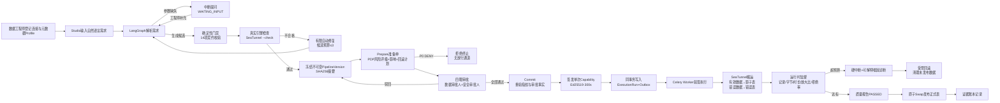
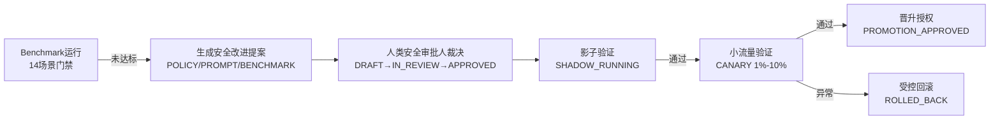
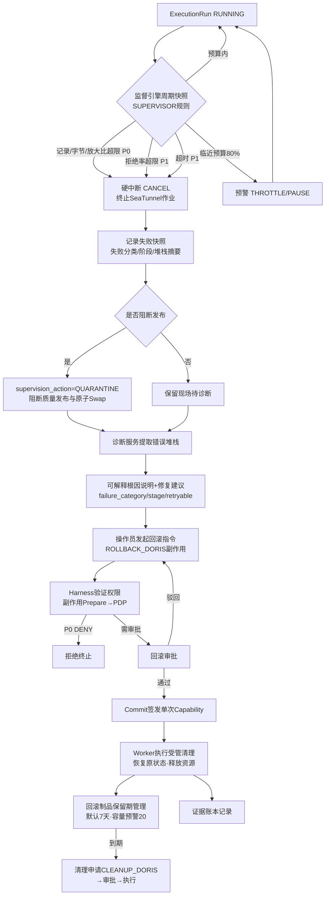
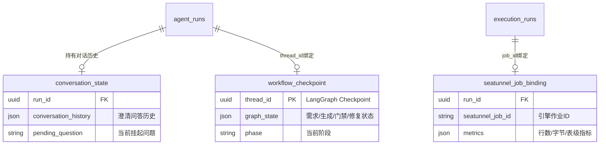
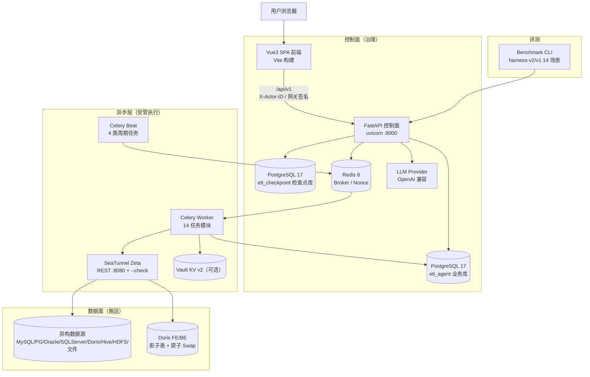

# etl_agent 产品需求文档（PRD）

> | 文档名称 | etl_agent 产品需求文档（PRD / 需求规格说明书） |
> |----------|------------------------------------------|
> | 版本 | v1.1 |
> | 作者角色 | 产品经理 |
> | 日期 | 2026-10-13 |
> | 状态 | 评审稿 |

## 修订记录

| 版本 | 日期 | 修订摘要 |
|------|------|---------|
| v1.0 | 2026-10-13 | 初稿：以《需求文档.md》2.8 节为基线，结合 `etl_agent` 代码库实现梳理 11 章结构 PRD |
| v1.1 | 2026-10-13 | 基线对齐修订（13 项）：① M2/M3 补充 ClickHouse、S3/MinIO、REST API 接入与文件格式核对（ORC/XML/Markdown/PDF 标扩展）；② FR-50 明确 L0/L1/L2 分层仿真评测的场景、指标与验收；③ 新增「交付形式与部署拓扑」章节；④ 新增三层状态隔离 FR（Conversation / Workflow / Execution State）并同步更新 ER；⑤ 新增「运行报告与审计输出格式」独立章节；⑥ 新增 6.3「任务中断诊断与受管回滚流程」图；⑦ 新增「示例业务场景」章节；⑧ 补充认证鉴权与多租户 FR/NFR；⑨ 新增「原始角色 ↔ PRD 角色」映射表；⑩ 将「代码已实现全部 P0/P1/P2」表述修正为「已实现范围 + 待确认范围」；⑪ 验收标准与 2.8.10 九条原始验收逐条映射并补齐；⑫ FR-55 补「不可变版本与 Diff」视图；⑬ 待确认问题扩充至 Q11。改动处均以【修订】标注，未删除任何 v1.0 既有 FR。 |

> **编制说明**【修订】：本文档以《需求文档.md》2.8 节为唯一基线，与 v1.0 逐条比对后修订而成。范围表述采用**双清单**：**已实现范围**——代码已实现的条目标注实现依据（模块/文件）；**待确认范围**——需求文档提出但代码尚未覆盖的条目（ClickHouse、S3/MinIO、REST API 等）一律标注【待实现/待确认】并拆分 P1/P2，与第 14 章 Q2/Q8 保持一致，不得静默丢弃。文中阈值、状态机、角色与门禁指标均可在代码中找到对应事实；示例 JSON 为格式定义示例，非业务数据。

---

## 1. 产品目标与价值

- **背景与要解决的问题**：企业在异构数据源（MySQL / PostgreSQL / Oracle / SQL Server / Doris / Hive / HDFS / 文件）之间做数据搬运时，自然语言驱动的 ETL 生成缺乏安全治理——Agent 生成的配置可能夹带明文凭据、越权访问、破坏性变更，且生成—审批—执行链路缺少不可篡改证据，无法满足生产审计与四眼管控要求。
- **建设目标**：建设生产级 ETL-Agent 控制面平台 `etl_agent`，以 LangGraph 状态机完成「自然语言需求 → 受管元数据探查 → 结构化 EtlPlan 与 SeaTunnel HOCON 生成 → 确定性门禁 → 不可变制品 → 四眼审批 → 单次能力授权 → 受管执行 → 质量契约发布」的全闭环，控制面治理与数据面搬运（Apache SeaTunnel）严格分离。
- **成功标准（可量化）**：
  - P0/P1 风险操作拦截率 = **100%**（Benchmark 门禁 `p0_p1_block_rate = 1.0`，漏拦即发布失败）；
  - 合法需求端到端生成成功率 ≥ **95%**（`legitimate_success_rate ≥ 0.95`）；
  - 安全策略误报率 ≤ **5%**（`false_positive_rate ≤ 0.05`）；
  - 证据覆盖率 = **100%**、评测可复现率 = **100%**（哈希链 + 冻结制品保证）；
  - 非 LLM 决策路径 P95 ≤ **20 ms**（相对基线回归 ≤ 20%）；
  - 全链路敏感明文泄露 = **0 起**（模型不接触凭据、脱敏样本、Secret 引用制）；
  - 单次生成的自动修复候选 ≤ **3 份**（禁止无限自修复）；
  - Capability 令牌有效期 ≤ **300 s** 且全局仅可消费 **1 次**。

## 2. 用户角色与权限矩阵

系统采用**两层角色体系**：项目成员角色（资源可见性与项目级操作）+ Harness 职责角色（安全执行内核的职责分离槽位）。Harness 角色通过 `ProjectRoleGrant` 显式授予，**ADMIN 不隐式升级为安全审批人**。

### 2.1 角色职责与权限

| 角色 | 层级 | 职责描述 | 核心权限 |
|------|------|---------|---------|
| 项目管理员（ADMIN） | 项目成员【扩展】 | 项目与成员治理 | 创建/管理项目成员、授予 Harness 职责、查看项目全部资源；不因此获得审批特权 |
| 数据工程师（DATA_ENGINEER） | 项目成员 / Harness（Maker） | 连接登记、探查、生成、提交 | 创建/编辑数据连接、发起元数据探查、输入自然语言需求、调试生成 Pipeline 候选、冻结不可变版本并提交审批申请；**禁止审批本人申请** |
| 项目审批人（APPROVER） | 项目成员【扩展】 | 设计维度审批 | 审查需求描述、Schema 映射、质量规则与 DAG 结构并决策 |
| 审计只读员（VIEWER） | 项目成员【扩展】 | 只读查阅 | 查看 Pipeline、执行记录与报告，无写操作 |
| 数据审批人（DATA_APPROVER） | Harness（Checker 1） | 数据维度审批 | 审查字段映射、脱敏前后结构对比、质量规则、DAG 拓扑，对准备单执行数据维度审批 |
| 安全审批人（SECURITY_APPROVER） | Harness（Checker 2） | 安全维度审批 | 审查资源范围、数据敏感分级、执行预算、Secret 引用与回滚方案；管理 Benchmark 与安全策略进化 |
| 系统操作员（OPERATOR） | Harness | 受管执行与运维 | 审批全通过后执行 Commit、触发执行、暂停/取消/回滚、凭据轮转 |
| 审计人员（AUDITOR） | Harness | 审计查阅 | 查看执行历史、审计事件、签名证据账本、质量报告与 Benchmark 大盘 |

### 2.2 原始角色 ↔ PRD 角色映射表【修订新增】

基线《需求文档.md》2.8.2 定义的五类原始角色与 PRD 两层角色体系一一对应；ADMIN / APPROVER / VIEWER 为 PRD 在代码实现基础上扩展的项目成员角色（需求文档未定义）。

| 原始角色（需求文档 2.8.2） | 对应 PRD Harness 职责 | 对应 PRD 项目成员角色 | 映射说明 |
|----------------------------|----------------------|----------------------|---------|
| 数据工程师（Maker） | `DATA_ENGINEER` | `DATA_ENGINEER` | 一一对应：登记连接、探查、生成、提交审批 |
| 数据审批人（Checker 1） | `DATA_APPROVER` | `APPROVER`【扩展】 | 一一对应：数据维度独立审批 |
| 安全审批人（Checker 2） | `SECURITY_APPROVER` | （无预设项目成员角色，经 `ProjectRoleGrant` 显式授予） | 一一对应：安全维度独立审批；另承担 Benchmark 与安全策略管理（FR-50/51/52） |
| 系统操作员 | `OPERATOR` | （经 `ProjectRoleGrant` 显式授予） | 一一对应：Commit、执行触发、暂停/取消/回滚、凭据轮转 |
| 审计人员 | `AUDITOR` | `VIEWER`【扩展】 | 一一对应：AUDITOR 提供审计查阅；VIEWER 提供项目级只读视图 |
| —（需求文档未定义） | — | `ADMIN`【扩展】 | 项目与成员治理；不隐式获得任何审批职责 |

### 2.3 强制职责分离规则（红线）

1. 申请人禁止自批：同一准备单上 `(preparation_id, decided_by)` 唯一，一人只能占一个审批槽；
2. 同一准备单的每个职责槽位唯一：`(preparation_id, role)` 唯一，高风险操作禁止同一自然人兼任多个审批槽；
3. P0 级操作（破坏性、敏感外发）必须同时获得数据审批人 + 安全审批人双人批准（`required_approvals = 2`）；
4. P0-DENY 类意图（跨项目、Secret 外发）不存在人工放行通道，审批无法覆盖。

## 3. 用户故事

- US-01：作为数据工程师，我希望登记异构数据源连接并做安全连通性测试，以便在不暴露凭据的前提下管理数据资产。（→ FR-04、FR-05、FR-06）
- US-02：作为数据工程师，我希望对源表/目标表/文件执行只读元数据探查并查看脱敏样本，以便在生成方案前掌握 Schema、主键与近似统计。（→ FR-12、FR-13、FR-14）
- US-03：作为数据工程师，我希望用自然语言描述 ETL 需求，系统在参数缺失时中断提问、我补充后从检查点恢复，以便低门槛完成需求表达。（→ FR-16、FR-17）
- US-04：作为数据工程师，我希望系统生成结构化 EtlPlan 与 SeaTunnel HOCON 候选并通过确定性门禁与真实引擎检查，以便在人工审批前拦截错误配置。（→ FR-18、FR-19、FR-20）
- US-05：作为数据工程师，我希望候选不合格时系统做有限自动修复（预算内重生成），以便提高一次通过率且不被无限重试拖垮。（→ FR-21）
- US-06：作为数据工程师，我希望通过校验的方案冻结为带 SHA256 摘要的不可变版本，以便审批与执行始终绑定同一份事实。（→ FR-26）
- US-07：作为数据工程师，我希望配置质量契约、增量水印与调度策略后提交审批，以便把数据质量要求前置声明。（→ FR-22、FR-23、FR-40、FR-28）
- US-08：作为数据审批人，我希望在审批面板审查字段映射 Diff、脱敏前后结构对比、质量规则与 DAG 拓扑后独立决策，以便把住数据维度质量关。（→ FR-25、FR-32）
- US-09：作为安全审批人，我希望审查资源范围、数据敏感分级、执行预算、Secret 引用与回滚方案后独立决策，以便把住安全维度风险关。（→ FR-15、FR-31、FR-32）
- US-10：作为系统操作员，我希望在审批全部通过后执行 Commit 并触发受管执行，以便由系统签发单次能力令牌完成授权闭环。（→ FR-33、FR-38）
- US-11：作为系统操作员，我希望实时看到吞吐、行数字节、监督快照与质量分流明细，以便掌握执行健康度。（→ FR-39、FR-44、FR-45）
- US-12：作为系统操作员，我希望在超预算/异常时系统硬中断并给出可解释根因，我能一键发起受管回滚，以便快速恢复原状态。（→ FR-46、FR-47、FR-48）
- US-13：作为审计人员，我希望查看执行历史、审计事件与签名证据账本，以便证明关键操作不可篡改。（→ FR-36）
- US-14：作为安全审批人，我希望运行版本化 Benchmark 评测集并管理安全改进提案的影子/小流量/晋升发布，以便受控地进化安全策略。（→ FR-50、FR-51、FR-52）
- US-15：作为系统操作员，我希望对连接凭据执行轮换、迁移与销毁治理，并在凭据临期时收到预警，以便降低凭据泄露与过期风险。（→ FR-07、FR-08、FR-09、FR-10）
- US-16【修订新增】：作为数据工程师，我希望在需求文档点名的数据源（含 ClickHouse、S3/MinIO、REST API）就绪后同样走「接入→探查→生成→门禁→执行」闭环，以便不因数据源类型被排除在生产链路之外。（→ FR-61、FR-62、FR-63；范围待 Q2/Q8 确认）
- US-17【修订新增】：作为审计人员，我希望区分对话、工作流、执行三层状态并分别追溯，以便定位「谁在什么上下文说了什么、生成了什么、执行了什么」。（→ FR-67、FR-68、FR-69）

## 4. 功能需求清单（需求池）

优先级定义：**P0 必须**（主流程缺一不可，本期 100% 交付）；**P1 重要**（生产治理必备，随主流程交付）；**P2 可选**（增强能力，可排期）。

**范围声明**【修订】：本清单区分**已实现范围**与**待确认范围**——标注【已实现】的条目有代码依据；标注【待实现/待确认】的条目来自需求文档基线但代码尚未覆盖（ClickHouse、S3/MinIO、REST API），已拆分 P1/P2 并写入验收（AC-18/19/20）与待确认问题（Q2/Q8），**不删除、不静默降级**；标注【扩展】的条目为代码已实现且超出需求文档点名范围的能力。

### M1 项目与工作区治理

| 编号 | 模块 | 功能 | 优先级 | 说明 |
|------|------|------|--------|------|
| FR-01 | 项目治理 | 工作区初始化与管理员创建 | P0 | 【已实现】受 `bootstrap_enabled` + Bootstrap Token（≥32 字节）保护的首次初始化；创建首个项目与管理员身份 |
| FR-02 | 项目治理 | 项目成员管理 | P0 | 【已实现】成员增删、项目角色（ADMIN/DATA_ENGINEER/APPROVER/VIEWER）分配，`(project_id, user_id)` 唯一 |
| FR-03 | 项目治理 | Harness 职责授予 | P0 | 【已实现】`ProjectRoleGrant` 显式授予 DATA_ENGINEER/DATA_APPROVER/SECURITY_APPROVER/OPERATOR/AUDITOR；不把管理员隐式升级为安全审批人；记录授予人 |

### M2 数据连接与凭据治理

| 编号 | 模块 | 功能 | 优先级 | 说明 |
|------|------|------|--------|------|
| FR-04 | 连接管理 | 异构连接登记 | P0 | 【已实现】MySQL、PostgreSQL、Oracle、SQL Server、Doris、Hive、HDFS、本地文件；项目内连接名唯一；Secret 引用制，不存明文 |
| FR-05 | 连接管理 | 安全连通性测试 | P0 | 【已实现】后台测试并回写状态（UNTESTED/TESTING/READY/FAILED）与错误摘要 |
| FR-06 | 连接管理 | 凭据受管加密存储 | P0 | 【已实现】SecretProvider 双模式：`fernet-db`（本地密文，key_version 管理）与 `vault-kv-v2`（外部仅存不可认证的定位引用）；销毁后保留不含秘密的墓碑 |
| FR-07 | 凭据治理 | 凭据轮换 | P1 | 【已实现】状态机 VALIDATING→WAITING_APPROVAL→APPROVED→ACTIVATING→SUCCEEDED/FAILED；新凭据先暂存并真实连通性验证，激活前继续用旧凭据；回滚恢复旧凭据原始年龄 |
| FR-08 | 凭据治理 | 凭据 Provider 迁移 | P1 | 【已实现】源/目标 Provider 间迁移；目标 UUID 申请时冻结，Worker 重试写同一路径，避免孤立秘密 |
| FR-09 | 凭据治理 | 凭据销毁 | P1 | 【已实现】轮换源/回滚暂存两类目标的资格判定与销毁申请，留墓碑记录 |
| FR-10 | 凭据治理 | 到期预警与告警投递 | P1 | 【已实现】默认最大账龄 90 天、预警 14 天；WARNING/OVERDUE 两级告警、去重键、确认/静默/解决；Webhook 外置投递（退避冷却：预警 24h / 逾期 6h） |
| FR-11 | 凭据治理 | 连接轮换策略配置 | P1 | 【已实现】按连接配置 `credential_max_age_days`（1–3650）与 `credential_warning_days`（0 < warning < max_age） |
| FR-61 | 连接管理 | ClickHouse 数据源接入 | P1 | 【修订新增】【待实现/待确认】需求文档 2.8.1 点名 ClickHouse；代码 `ConnectorType` 枚举暂无 `CLICKHOUSE`；需新增 probe 适配器、门禁契约与类型映射；是否本期见 Q2/Q8；验收见 AC-18 |
| FR-62 | 连接管理 | S3/MinIO 对象存储接入 | P1 | 【修订新增】【待实现/待确认】需求文档 2.8.1 点名文件数据源 S3/MinIO；当前文件资产仅支持本地上传（`file_asset_store`）；需对象存储适配器（前缀列举、只读凭据、引擎路径映射）；是否本期见 Q2/Q8；验收见 AC-19 |
| FR-63 | 连接管理 | REST API 数据源接入 | P2 | 【修订新增】【待实现/待确认】需求文档 2.8.1 点名 API 数据源；需定义拉取契约（分页/游标、认证头受管化、响应 Schema 冻结为 Profile）；是否本期见 Q2/Q8；验收见 AC-20 |

### M3 元数据探查与文件资产

| 编号 | 模块 | 功能 | 优先级 | 说明 |
|------|------|------|--------|------|
| FR-12 | 元数据探查 | 表级只读 Profile 探查 | P0 | 【已实现】Schema、字段类型、主键、近似统计、脱敏样本采样；SOURCE/SINK 端点角色；不执行全表 COUNT；带过期时间 |
| FR-13 | 文件资产 | 文件上传与探查 | P0 | 【已实现】需求文档点名格式 **CSV、Excel（XLSX）、JSON、Parquet 全部覆盖**（`FileAssetFormat`：CSV/JSON/JSONL/XLSX/PARQUET）；上限 25 MiB / 100,000 行；上传路径不暴露给 API，引擎只读受挂载路径。**ORC/XML/Markdown/PDF 为【扩展】**：代码已实现但超出需求文档点名范围 |
| FR-14 | 元数据探查 | 脱敏样本渲染 | P0 | 【已实现】按列名启发式脱敏（`mask_sample`/`mask_value`），样本值不回明文 |
| FR-15 | 数据分级 | 敏感数据分级 | P1 | 【已实现】字段级 PUBLIC/INTERNAL/CONFIDENTIAL/RESTRICTED/SECRET/UNKNOWN 推断（显式声明优先、同名传播、显式映射传播），产出带 SHA256 的分级报告，UNKNOWN 按保守等级参与策略 |
| FR-64 | 文件资产 | 需求文档点名格式覆盖核对 | P0 | 【修订新增】【已实现】CSV/Excel/JSON/Parquet 随 FR-13 交付；S3/MinIO 与 REST API 分别见 FR-62/FR-63【待实现/待确认】；本 FR 作为基线覆盖核对项，防止点名格式在演进中丢失 |

### M4 Pipeline Studio 智能生成

| 编号 | 模块 | 功能 | 优先级 | 说明 |
|------|------|------|--------|------|
| FR-16 | 智能生成 | 自然语言需求输入与运行管理 | P0 | 【已实现】创建 AgentRun（QUEUED/RUNNING/WAITING_INPUT/WAITING_APPROVAL/FAILED），绑定 PipelineVersion 与 Profile 集合 |
| FR-17 | 智能生成 | LangGraph 澄清中断与 Checkpoint 恢复 | P0 | 【已实现】必要参数缺失时 `interrupt` 提问并持久化，用户回答后从同一 thread 恢复；生成遥测只记次数/耗时/非敏感诊断，不存 Prompt 与候选正文 |
| FR-18 | 智能生成 | EtlPlan / SeaTunnel HOCON 候选生成 | P0 | 【已实现】多后端（direct / seatunnel-cli）与 OpenAI 兼容多模型 Provider；产出结构化 plan + HOCON |
| FR-19 | 确定性门禁 | 静态契约校验 | P0 | 【已实现】14 项确定性检查：禁明文凭据、受支持连接器/转换契约、质量契约 sink/routing/traceability/predicates、Profile 拓扑、受管文件源、HDFS 文件契约、数据库端点、目标 Schema、增量契约、逐行 LLM 契约 |
| FR-20 | 确定性门禁 | 真实引擎检查 | P0 | 【已实现】Worker 侧物化运行期变量后执行 SeaTunnel `--check`，只回传脱敏摘要；发生在人工审批中断之前 |
| FR-21 | 有限修复 | 自动修复预算 | P0 | 【已实现】格式错误、门禁错误、引擎检查共享预算：最多 3 份候选（初始 + 2 次修复），耗尽即确定性失败 |
| FR-22 | 质量契约 | QualityContract 配置 | P1 | 【已实现】字段级清洗过滤规则与错误码标签；有效 sink / 错误 sink 路由匹配；最大拒绝行数/拒绝率阈值 |
| FR-23 | 增量同步 | 水印增量契约 | P1 | 【已实现】TIMESTAMP 水印列、初始值、滞后秒数；驱动 WATERMARK_INCREMENTAL 调度 |
| FR-24 | 行级 AI | 逐行 LLM Transform 契约 | P2 | 【已实现】OPENAI/DOUBAO/DEEPSEEK/KIMIAI/MICROSOFT/ZHIPU/CUSTOM；限速（默认 10 行/s）、允许 API 主机清单 |
| FR-25 | 设计审查 | 方案审查视图 | P1 | 【已实现】DAG 拓扑（SOURCE/TRANSFORM/SINK 节点与边）、字段映射 Diff（新增/删除/类型变更/显式投影）、脱敏前后样本对比、风险分级提示（HIGH/MEDIUM/LOW/INFO） |

### M5 不可变版本与设计审批

| 编号 | 模块 | 功能 | 优先级 | 说明 |
|------|------|------|--------|------|
| FR-26 | 版本管理 | Pipeline 与不可变版本 | P0 | 【已实现】版本链 DRAFT→PROFILING→GENERATED→VALIDATED→WAITING_APPROVAL→APPROVED/REJECTED；修改必须派生新版本（`parent_version_id`），制品 SHA256 冻结，乐观锁 `lock_version` |
| FR-27 | 版本管理 | 版本 Diff 对比 | P1 | 【已实现】不同版本的 Schema、HOCON 配置与质量规则差异对比（后端能力；前端入口见 FR-55） |
| FR-28 | 设计审批 | 审批申请与决策 | P0 | 【已实现】ApprovalRequest 绑定 `artifact_sha256`；APPROVE/REJECT 决策与理由留痕 |

### M6 Harness 安全执行内核

| 编号 | 模块 | 功能 | 优先级 | 说明 |
|------|------|------|--------|------|
| FR-29 | 策略内核 | 策略决策点（PDP） | P0 | 【已实现】9 条确定性规则，输出 P0–P3 风险与 ALLOW/DENY/REQUIRE_APPROVAL/DEFER；按 DENY>DEFER>REQUIRE_APPROVAL>ALLOW、P0>P1>P2>P3 取最严聚合；DENY 清空审批要求（无放行通道）；决策持久化且只存规则证据，不存原始数据与 Prompt |
| FR-30 | 策略内核 | 签名策略包 | P1 | 【已实现】策略清单（rule_id/version 唯一、排序稳定）+ SHA256 + Ed25519 分离签名；PDP 启动与热切换前强制验签；请求不得临时切换策略版本 |
| FR-31 | 执行协议 | Prepare 准备单 | P0 | 【已实现】冻结输入指纹/资源指纹/影响报告/数据分级/监督契约/回滚计划；TTL 默认 24h（300s–7d）；状态机 DENIED/WAITING_APPROVAL/READY/REJECTED/EXPIRED/COMMITTED；幂等键去重；无外部副作用 |
| FR-32 | 执行协议 | 四眼审批与职责分离 | P0 | 【已实现】具名审批人对职责槽位决策，强制 `(preparation_id, role)` 与 `(preparation_id, decided_by)` 双唯一；决策带 `evidence_sha256` |
| FR-33 | 执行协议 | Commit 与单次 Capability | P0 | 【已实现】服务端重验指纹与审批事实后签发 Ed25519 签名令牌；TTL 默认 300s（30–900s）；绑定工具/版本/主体/环境/制品指纹/监督契约哈希/分级报告哈希/允许的减损动作；同一事务原子创建 ExecutionRun 与 Outbox 命令 |
| FR-34 | 执行协议 | Tool Broker 与防重放 Guard | P0 | 【已实现】所有副作用的唯一出口；以注册清单（非 Agent 自报）判定副作用；Replay Guard 保证令牌仅消费一次 |
| FR-35 | 执行协议 | 事务 Outbox 可靠投递 | P0 | 【已实现】业务事实与 Worker 命令同事务落库；PENDING/SENDING/SENT/FAILED 状态机、重试与锁定；进程崩溃不丢已授权执行 |
| FR-36 | 审计证据 | 不可篡改证据账本 | P0 | 【已实现】只追加事件流：sequence、payload_sha256、前序哈希、事件哈希、可选 Ed25519 检查点签名；支持整流验证报告（valid/event_count/head_hash/errors） |
| FR-37 | 执行协议 | 通用副作用受管执行 | P0 | 【已实现】9 类副作用（CANCEL_EXECUTION、ROLLBACK_DORIS、CLEANUP_DORIS、MIGRATE_SECRET、STAGE/VALIDATE/ACTIVATE/ROLLBACK/DESTROY_SECRET）与 Pipeline 执行同协议：prepare→approve→commit→outbox→worker；执行租约防并发重入 |

### M7 执行调度与数据面

| 编号 | 模块 | 功能 | 优先级 | 说明 |
|------|------|------|--------|------|
| FR-38 | 执行引擎 | Celery Worker 受管执行 | P0 | 【已实现】消费验签后命令、物化 Secret、调用 SeaTunnel 作业并回传状态与指标；心跳上报（默认 10s，35s 判失活）与能力声明；`task_acks_late` + `prefetch_multiplier=1` + `reject_on_worker_lost` 保证至少一次投递 |
| FR-39 | 执行引擎 | 运行管理与监控 | P0 | 【已实现】ExecutionRun 状态机 QUEUED/SUBMITTED/RUNNING/SUCCEEDED/FAILED/CANCELLING/CANCELLED；执行事件流（level/stage/event_type）；源/目标行数、字节、表级指标 |
| FR-40 | 调度 | 定时调度 | P1 | 【已实现】cron + 时区；BATCH / WATERMARK_INCREMENTAL；misfire 策略 SKIP/FIRE_ONCE，宽限默认 120s；扫描间隔默认 30s（Celery Beat） |
| FR-41 | 调度 | 水印增量同步 | P1 | 【已实现】调度推进水印值并记录 `watermark_window` |
| FR-42 | 执行引擎 | 执行重试 | P1 | 【已实现】稳定 SeaTunnel JobId；`retry_of_run_id`/`attempt_number` 追溯 |
| FR-43 | 数据面发布 | 影子表与原子 Swap | P0 | 【已实现】Doris `CREATE LIKE` 预复制 + `REPLACE TABLE ... PROPERTIES('swap'='true')` 原子发布；同 Schema 强校验 |
| FR-44 | 质量治理 | 错误分流与质量报告 | P0 | 【已实现】未命中规则数据写入错误表并记录原始值与违规原因；QualityReport（PASSED/WARNING/FAILED/INCOMPLETE、总/通过/拒绝行数、拒绝率、错误码统计、诊断） |

### M8 运行时监督与受管回滚

| 编号 | 模块 | 功能 | 优先级 | 说明 |
|------|------|------|--------|------|
| FR-45 | 运行时监督 | 监督契约与预算执行 | P0 | 【已实现】冻结预算：最大记录数（默认 10M）、最大字节（默认 10 GiB）、最长时长（默认 3600s）、输出放大比（≤2.0）、拒绝率（≤0.5）、最低质量行数（100）、预警比例（0.8）；6 条确定性规则：P0 记录预算 / P0 字节预算 / P1 超时 / P0 输出放大 / P1 拒绝率 / P3 预算预警；快照带 `snapshot_sha256` |
| FR-46 | 运行时监督 | 硬中断与隔离 | P0 | 【已实现】减损动作 CONTINUE/THROTTLE/PAUSE/CANCEL/QUARANTINE；QUARANTINE 阻断后续质量发布与原子交换；外部减损动作独立可重试（NOT_REQUIRED/PENDING/APPLYING/APPLIED/FAILED） |
| FR-47 | 诊断 | 可解释根因诊断 | P0 | 【已实现】失败分类（CONFIGURATION/CREDENTIALS/CONNECTIVITY/SOURCE_SCHEMA/SINK_WRITE/ENGINE/OBSERVABILITY/CANCELLATION/UNKNOWN）与失败阶段、可重试性判定、修复建议 |
| FR-48 | 回滚 | 受管回滚与制品清理 | P0 | 【已实现】回滚申请/审批/执行状态机；回滚表保留期默认 7 天、容量预警阈值 20；到期清理申请；回滚制品清单（AVAILABLE/ROLLED_BACK/ROLLBACK_PENDING/CLEANUP_PENDING/INVALID_METADATA） |
| FR-49 | 执行引擎 | 执行取消 | P1 | 【已实现】CANCELLING→CANCELLED，记录取消原因 |

### M9 评测与安全进化

| 编号 | 模块 | 功能 | 优先级 | 说明 |
|------|------|------|--------|------|
| FR-50 | 评测 | 分层仿真评测与版本化 Benchmark | P0 | 【已实现】【修订】按需求文档 2.8.1「分层仿真评测」要求明确三层结构，场景数、指标与验收条件见下表 |

**FR-50 分层评测定义**【修订】：

| 层级 | 定义（基线 2.8.1） | 场景构成（代码事实） | 指标 | 验收条件 |
|------|--------------------|--------------------|------|---------|
| **L0 静态注入** | 无外部副作用的静态策略、权限与制品攻击仿真 | `tests/simulation/test_l0_static_simulation.py`（marker `simulation_l0`）：参数化策略攻击矩阵 + 未选中连接器注入拒绝 + 明文 Secret 制品拒绝；对应 Benchmark 套件 `harness-v2/v1` 的静态可判定场景 | P0/P1 拦截率 = 1.0；误报率 ≤ 0.05；证据覆盖率 = 1.0；非 LLM P95 ≤ 20 ms 且回归 ≤ 20% | 任一攻击用例未被拦截、被误拦为 FAIL、或产生任何外部副作用，即评测 FAIL（AC-14） |
| **L1 模拟故障** | 仅在模拟器内注入故障、重放、超时和部分成功 | `tests/simulation/test_l1_deterministic_simulation.py`（marker `simulation_l1`）：参数化运行时故障矩阵 + 能力令牌重复消费幂等拒绝 + 网络部分成功与未知状态分类 | 最强减损动作选择正确率 = 100%；重复令牌消费拒绝率 = 100%；未知状态零误判为成功 | 故障矩阵全部选中最强减损动作；重复消费被幂等拒绝；部分成功/未知状态被正确分类且不产生重复副作用（AC-15） |
| **L2 真实链路** | 需要开发 Compose 的真实 MySQL/文件、SeaTunnel 与 Doris 链路 | `tests/simulation/test_l2_compose_e2e.py`（marker `simulation_l2`）：1 个端到端垂直切片用例（真实连接 → Harness 协议 → SeaTunnel → Doris 写入）；配套 `infra/e2e` fixtures（mysql-to-doris.conf、harness-mysql-to-doris.conf、harness-file-to-doris.conf、file-orders.jsonl） | 端到端成功率 = 100%；质量报告生成率 = 100%；原子 Swap 正确率 = 100% | 完整走通「连接→探查→生成→门禁→审批→执行→影子表→分流→Swap」全流程（AC-16） |
| **Benchmark 套件** | 版本化自动化测试集（冻结 manifest + baseline） | `benchmarks/harness-v2/v1`：14 场景（P0×6 / P1×4 / P3×4；对抗×6 / 合法×3 / 变异×3 / 回归×2） | p0_p1_block_rate = 1.0；legitimate_success_rate ≥ 0.95；false_positive_rate ≤ 0.05；evidence_coverage_rate = 1.0；reproducibility_rate = 1.0；non_llm_p95 回归 ≤ 20% | 六项门禁全部满足才判 PASS；任一 P0/P1 漏拦或证据未覆盖即 FAIL（AC-09） |

| 编号 | 模块 | 功能 | 优先级 | 说明 |
|------|------|------|--------|------|
| FR-51 | 安全进化 | 安全改进提案 | P1 | 【已实现】类型限定 POLICY/PROMPT/BENCHMARK；候选可离线审查、非可执行代码；状态机 DRAFT→IN_REVIEW→APPROVED/REJECTED→RELEASED，不可跳跃；仅人类安全审批人可裁决 |
| FR-52 | 安全进化 | 受控发布 | P1 | 【已实现】影子验证→小流量（1%–10%）→晋升授权/回滚；发布清单 Ed25519 签名；观察样本为脱敏聚合事实（异常计数 ≤ 样本量自校验） |

### M10 前端控制台（Vue 3 SPA）

| 编号 | 模块 | 功能 | 优先级 | 说明 |
|------|------|------|--------|------|
| FR-53 | 前端 | 总览工作台 | P0 | 【已实现】项目连接数、Pipeline 数量、待审批概况、运行成功率、目标切片预览与生产边界提示、快捷导航 |
| FR-54 | 前端 | 数据源与资产管理页 | P0 | 【已实现】连接表单、连通性测试、端点角色选择、表级/文件探查与脱敏样本、文件导入（25 MiB / 10 万行）、凭据轮换表单 |
| FR-55 | 前端 | Pipeline Studio | P0 | 【已实现】【修订】自然语言输入、LangGraph 澄清对话、HOCON 语法高亮、DAG 渲染、字段映射 Diff、脱敏前后对比、门禁结果与审批提交；**新增「不可变版本与 Diff」视图**（对应需求文档 2.8.5「不可变版本与 Diff 模块」）：对比不同 Pipeline 版本的 Schema、HOCON 配置与质量规则差异，版本只能派生、不可原地覆盖 |
| FR-56 | 前端 | 运行中心与审批控制台 | P0 | 【已实现】准备单与审批面板（影响范围/回滚方案/审批槽位/四眼决策）、执行监控（吞吐曲线/日志/监督快照/质量分流/诊断）、中断与受管回滚、Worker 健康、凭据治理清单 |
| FR-57 | 前端 | 安全治理与 Benchmark 页 | P0 | 【已实现】Benchmark 用例集与触发、准确率与 P0/P1 拦截率大盘、安全提案与发布状态管理 |
| FR-58 | 前端 | 工作区初始化与身份注入 | P0 | 【已实现】首次初始化引导；统一经 `X-Actor-ID` 头注入操作者身份（生产由可信网关签名，见 FR-65） |

### M11 平台与可观测性

| 编号 | 模块 | 功能 | 优先级 | 说明 |
|------|------|------|--------|------|
| FR-59 | 平台 | 健康检查 | P0 | 【已实现】`/health` 返回存活状态与脱敏的 SecretProvider 配置状态，不主动读取凭据 |
| FR-60 | 可观测性 | 链路可观测 | P1 | 【已实现】OpenTelemetry 埋点（FastAPI / HTTPX / SQLAlchemy / Celery）、OTLP 导出、结构化日志、错误响应附带 trace_id |

### M12 认证鉴权与多租户【修订新增模块】

| 编号 | 模块 | 功能 | 优先级 | 说明 |
|------|------|------|--------|------|
| FR-65 | 认证鉴权 | 用户认证与身份鉴权 | P0 | 【已实现】双模式：开发 `dev-header`（`X-Actor-ID` 头声明身份，仅限非生产）；生产 `trusted-gateway`（HMAC-SHA256 签名：actor/timestamp/nonce/METHOD/path+query 规范载荷；时钟偏移 ≤ 60s；Nonce 16–128 位安全字符、Redis `SET NX` 跨实例一次性消费、存储不可用失败关闭返回 503）。Actor 身份经项目成员关系与 `ProjectRoleGrant` 映射为 Harness 职责。**外部 IAM 边界**：若由外部 IAM/网关承接，IAM 负责身份鉴别与签名头注入，`etl_agent` 负责授权、职责分离与审计，不自行管理密码/会话（边界划分见 Q9） |
| FR-66 | 认证鉴权 | 多租户项目隔离 | P0 | 【已实现】全部资源（连接/Profile/文件/Pipeline/执行/准备单/证据流/评测）以 `project_id` 为隔离边界；访问控制基于项目成员关系；跨项目工具意图由 PDP `HARNESS-P0-CROSS-PROJECT` 规则直接 DENY（无审批通道）。当前隔离级别为**项目级**；是否需要库级/行级隔离见 Q10 |

### M13 三层状态隔离【修订新增模块】

基线 2.8.4「三层状态隔离机制」的功能化定义。三层载体、生命周期与隔离边界如下，ER 同步更新（见第 8 章）。

| 编号 | 模块 | 功能 | 优先级 | 说明 |
|------|------|------|--------|------|
| FR-67 | 状态隔离 | Conversation State（对话状态） | P0 | 【已实现】记录自然语言交互历史（澄清问题与用户补充）。载体：LangGraph Checkpoint（`etl_checkpoint` 库）+ `AgentRun.pending_question`（业务库仅存当前挂起问题）。生命周期：随 AgentRun 创建 → `WAITING_INPUT` 挂起 → 用户回答后恢复 → 运行终态归档。隔离边界：对话内容不含凭据；Prompt 与候选 HOCON 正文不持久化到业务库，仅保留计数/耗时/非敏感诊断（`generation_*` 遥测字段） |
| FR-68 | 状态隔离 | Workflow State（Agent 状态机） | P0 | 【已实现】LangGraph 管理「需求澄清 → 生成 → 确定性门禁 → 有限修复 → 等待审批」状态机。载体：`AgentRun.thread_id`（唯一）+ Postgres Checkpointer，跨请求持久化与恢复。隔离边界：图状态不含凭据；运行期变量物化在 Worker 侧完成（`credential_materialization`），图内只传占位符；机器门禁未通过前不进入人工审批中断 |
| FR-69 | 状态隔离 | Execution State（底层执行状态） | P0 | 【已实现】记录实际任务运行实例。载体：`ExecutionRun`（状态机 + `seatunnel_job_id` + metrics/table_metrics）+ `ExecutionEvent` + `RuntimeSupervisionSnapshot`。生命周期：QUEUED→SUBMITTED→RUNNING→终态，与 SeaTunnel 作业一一对应、可追溯。隔离边界：控制面只存治理事实与聚合指标，不直连搬运海量业务数据；与 Workflow State 通过 `pipeline_version_id` 关联而非共享存储 |

## 5. 非功能需求（量化）

| 类别 | 要求 | 指标 |
|------|------|------|
| 性能 | 非 LLM 决策路径（PDP/门禁/监督/证据） | P95 ≤ 20 ms；相对基线回归 ≤ 20% |
| 性能 | LLM 生成调用 | 单次请求超时 ≤ 180 s（默认值，可配置） |
| 性能 | 运行时预算硬上限（平台级，可按环境下探） | 最大读取记录 10,000,000；最大写入字节 10 GiB；最长执行 3600 s；输出放大比 ≤ 2.0；错误拒绝率 ≤ 0.5；最低质量行数 100；预警比例 0.8（达到预算 80% 即预警） |
| 安全 / 合规 | 认证边界【修订】 | 生产环境必须 `trusted-gateway`（HMAC-SHA256，密钥 ≥ 32 字节，时钟偏移 ≤ 60 s，Nonce 一次性）；开发 `dev-header` 仅限非生产；Bootstrap Token ≥ 32 字节 |
| 安全 / 合规 | 授权与防重放 | Ed25519 签名 Capability；TTL ≤ 300 s；单次消费；Replay Guard；P0-DENY 无人工放行通道 |
| 安全 / 合规 | 多租户隔离【修订】 | 项目级隔离；跨项目意图 DENY；生产环境必须配置 `harness_public_keys` 方可启动 |
| 安全 / 合规 | 凭据保护 | Secret 不明文落地（fernet-db 密文 / Vault KV v2 外部引用）；模型永不可见连接密码；Profile 脱敏样本；销毁留墓碑不含秘密 |
| 安全 / 合规 | 审计 | 全量审计事件（actor/project/action/resource/before/after/reason/trace_id）；证据账本哈希链 + 签名检查点，可整流验证 |
| 可用性 | Worker 可靠性 | 心跳间隔 10 s、35 s 判失活；Outbox 扫描 2 s、投递重试与锁；副作用执行租约防并发重入；`acks_late` + `reject_on_worker_lost` |
| 可用性 | 服务 SLA | 控制面无单点依赖数据面；准备单 TTL 24 h、幂等键防重复提交；令牌 TTL 300 s |
| 可用性 | 评测分层【修订】 | L0/L1 为无外部副作用确定性仿真（CI 可重复跑）；L2 依赖开发 Compose；Benchmark 六项门禁全部满足才允许安全策略发布 |
| 兼容性 | 运行环境 | Python 3.12（>=3.12,<3.13）；PostgreSQL 17；Redis 8；现代浏览器（Vue 3 + Vite SPA） |
| 兼容性 | 数据源 | 已实现：MySQL / PostgreSQL / Oracle / SQL Server / Doris / Hive / HDFS / 本地文件；文件 CSV/JSON/JSONL/XLSX/Parquet（+扩展 ORC/XML/Markdown/PDF）。待确认：ClickHouse、S3/MinIO、REST API（FR-61/62/63） |
| 并发 | 资源边界 | 文件资产 25 MiB / 100,000 行；单准备单资源 Scope ≤ 100；副作用意图资源 Scope ≤ 100 |
| 可观测性 | 遥测 | OTel 四组件埋点 + OTLP 导出（超时 10 s）；trace_id 贯通 API 错误响应；结构化日志 |
| 数据保留 | 回滚制品 | Doris 回滚表保留 7 天；容量预警阈值 20 件 |

## 6. 核心业务流程图

### 6.1 需求生成与受管发布主流程



### 6.2 安全策略受控进化流程



### 6.3 任务中断诊断与受管回滚流程【修订新增】

对应基线 2.8.7「任务中断诊断与受管回滚流程」。



## 7. 关键页面原型说明

- **页面 1：总览工作台**（FR-53）
  - 顶部：工作区标识（项目名 + 当前操作者）。
  - 统计卡：连接数 / Pipeline 数 / 待审批门禁数 / 运行成功率。
  - 目标切片预览卡：`MySQL orders → Doris fact_orders` 迷你流程图（Source → Agent(map·mask·quality) → Sink）。
  - 生产边界提示卡：① 模型永远看不到连接密码；② 审批绑定不可变 Artifact 哈希；③ 重试使用稳定 SeaTunnel JobId。
  - 导航：总览 / 数据连接 / 运行中心 / 安全治理 / Pipeline Studio。

- **页面 2：数据源与资产管理页**（FR-54）
  - 左：连接列表（名称、连接器类型、状态徽标：UNTESTED/TESTING/READY/FAILED）。
  - 右上：登记连接表单（类型、主机、端口、库名、凭据；标记「加密」）。
  - 右中：端点角色选择（SOURCE/SINK）→ 表级探查表单（Schema/Table/采样上限 1–100）→ Profile 列表（主键、脱敏样本条数、状态）。
  - 右下：受管文件源导入（CSV/JSON/JSONL/XLSX/Parquet 及扩展格式 ORC/XML/Markdown/PDF；25 MiB / 100,000 行上限）。
  - 浮层：凭据轮换表单（新用户名/新密码/轮换原因 → 安全暂存并验证）。

- **页面 3：Pipeline Studio**（FR-55）
  - 需求输入区：自然语言多行输入 + 源端/目标端 Profile 选择 + 澄清对话历史（问题/回答）。
  - 生成过程区：阶段状态（生成 → 门禁 → 引擎检查 → 修复计数 n/2）、生成遥测（后端/模型/候选数/修复数/耗时）。
  - 方案配置区：HOCON 代码高亮 + DAG 拓扑图 + 字段映射 Diff（新增/删除/类型变更列）+ 脱敏前后样本对比表 + 风险分级提示列表。
  - **不可变版本与 Diff 视图**【修订新增】：版本列表（版本号/状态/SHA256 摘要/父版本）→ 选择两个版本对比 Schema 差异（新增/删除/类型变更列）、HOCON 配置差异、质量规则差异；不可变版本不可原地编辑，只能派生新版本。
  - 门禁与提交区：门禁结果清单（逐项 PASS/FAIL）、调度策略（cron/模式/misfire）、质量契约配置、「冻结并提交审批」按钮。

- **页面 4：运行中心与审批控制台**（FR-56）
  - 审批面板：准备单列表 → 详情（风险等级 P0–P3、影响范围、数据分级、监督契约、回滚方案、required_roles/required_approvals）→ 审批槽位卡片（数据审批人 / 安全审批人，显示「不可自批」约束）→ APPROVE/REJECT + 理由。
  - 执行监控区：运行列表（状态、触发方式 MANUAL/SCHEDULED、重试次数）→ 实时事件日志 → 监督快照时间线（action/risk/命中规则/预算水位）→ 吞吐与行数字节指标 → 质量报告卡（总/通过/拒绝行数、拒绝率、错误码分布、诊断建议）。
  - 运维操作区：取消 / 重试 / 受管回滚 / 清理；Worker 健康列表；凭据治理清单（轮换状态、回滚窗口、销毁资格）。

- **页面 5：安全治理与 Benchmark 页**（FR-57）
  - 评测大盘：门禁指标卡（P0/P1 拦截率、合法成功率、误报率、证据覆盖率、可复现率、非 LLM P95 及回归）+ 用例结果表（case_id/类别/风险/是否拦截/误报/证据覆盖/复现/耗时）。
  - 触发区：选择 suite 版本 → 「运行 Benchmark」。
  - 进化管理区：提案列表（类型/状态/来源评测）→ 发布状态（影子/小流量百分比/晋升/回滚）→ 人工裁决操作。

## 8. 数据实体初稿（ER）

```mermaid
erDiagram
    projects ||--o{ project_memberships : "成员关系"
    users ||--o{ project_memberships : "属于"
    projects ||--o{ project_role_grants : "Harness职责授予"
    users ||--o{ project_role_grants : "承担职责"
    projects ||--o{ pipelines : "包含"
    pipelines ||--o{ pipeline_versions : "版本链"
    pipeline_versions ||--o| pipeline_versions : "parent_version_id派生"
    pipeline_versions ||--o{ agent_runs : "生成运行thread_id"
    pipeline_versions ||--o{ pipeline_artifacts : "不可变制品sha256"
    pipeline_versions ||--o{ approval_requests : "设计审批"
    projects ||--o{ data_connections : "连接"
    data_connections ||--o| encrypted_secrets : "secret_ref凭据"
    data_connections ||--o{ data_profiles : "元数据Profile"
    data_connections ||--o{ secret_rotation_requests : "轮换"
    projects ||--o{ file_assets : "文件资产"
    pipelines ||--o| pipeline_schedules : "调度策略"
    pipeline_versions ||--o{ execution_runs : "执行"
    execution_runs ||--o{ execution_events : "事件流"
    execution_runs ||--o| runtime_supervision_snapshots : "监督快照"
    execution_runs ||--o| quality_reports : "质量报告"
    execution_runs ||--o{ rollback_requests : "回滚"
    execution_runs ||--o{ rollback_cleanup_requests : "回滚制品清理"
    projects ||--o{ harness_policy_decisions : "PDP决策"
    harness_policy_decisions ||--o| execution_preparations : "授权依据"
    execution_preparations ||--o{ harness_approval_decisions : "四眼审批槽位"
    execution_preparations ||--o| harness_capability_grants : "单次令牌"
    execution_runs ||--o| harness_capability_grants : "授权执行"
    projects ||--o{ harness_side_effect_preparations : "副作用准备单"
    harness_side_effect_preparations ||--o{ harness_side_effect_approvals : "审批"
    harness_side_effect_preparations ||--o| harness_side_effect_capability_grants : "令牌"
    projects ||--o{ harness_command_outbox : "可靠投递"
    projects ||--o{ harness_evidence_streams : "证据流head_hash"
    harness_evidence_streams ||--o{ harness_evidence_events : "哈希链事件"
    projects ||--o{ benchmark_runs : "评测运行"
    benchmark_runs ||--o{ safety_improvement_proposals : "改进提案"
    safety_improvement_proposals ||--o| safety_releases : "受控发布"
    projects ||--o{ audit_events : "审计事件"

    users {
        uuid id PK
        string subject UK "登录主体"
        string display_name
    }
    project_role_grants {
        uuid id PK
        uuid project_id FK
        uuid user_id FK
        enum role "DATA_ENGINEER/DATA_APPROVER/SECURITY_APPROVER/OPERATOR/AUDITOR"
        uuid granted_by "授予人"
    }
    data_connections {
        uuid id PK
        uuid project_id FK
        enum connector_type "MYSQL/DORIS/POSTGRESQL/ORACLE/SQL_SERVER/HIVE/HDFS/LOCAL_FILE"
        enum status "UNTESTED/TESTING/READY/FAILED"
        uuid secret_ref FK
        int credential_max_age_days "默认90"
        int credential_warning_days "默认14"
    }
    pipeline_versions {
        uuid id PK
        uuid pipeline_id FK
        int version_number UK
        enum status "DRAFT→…→APPROVED/REJECTED"
        string artifact_sha256 "冻结摘要"
        uuid parent_version_id FK "派生来源"
        int lock_version "乐观锁"
    }
    execution_runs {
        uuid id PK
        uuid pipeline_version_id FK
        uuid harness_preparation_id FK UK "V2唯一绑定"
        enum status "QUEUED/SUBMITTED/RUNNING/SUCCEEDED/FAILED/CANCELLING/CANCELLED"
        string seatunnel_job_id "引擎作业ID"
        string supervision_action "默认CONTINUE"
        enum trigger "MANUAL/SCHEDULED"
        int attempt_number
    }
    execution_preparations {
        uuid id PK
        uuid policy_decision_id FK UK
        enum status "DENIED/WAITING_APPROVAL/READY/REJECTED/EXPIRED/COMMITTED"
        string risk_level "P0-P3"
        string input_fingerprint
        string resource_fingerprint
        json impact_report
        json rollback_plan
        int required_approvals
        datetime expires_at "默认24h"
    }
    harness_capability_grants {
        uuid token_id PK
        uuid preparation_id FK UK
        string token_sha256 UK
        json claims "签名声明"
        datetime expires_at "默认300s"
        datetime consumed_at "单次消费事实"
    }
    harness_evidence_events {
        uuid id PK
        uuid stream_id FK
        bigint sequence
        string previous_hash
        string event_hash UK
        string signature_value "Ed25519检查点"
    }
    quality_reports {
        uuid id PK
        uuid run_id FK UK
        enum status "PASSED/WARNING/FAILED/INCOMPLETE"
        bigint total_rows
        bigint rejected_rows
        float reject_rate
        string valid_sink
        string error_sink
    }
    benchmark_runs {
        uuid id PK
        string suite_id
        string manifest_version
        string manifest_sha256
        enum status "PASS/FAIL"
        json metrics "六项门禁指标"
        string report_sha256
    }
```

### 8.1 三层状态隔离 ER 补充【修订新增】

对应 FR-67/68/69。注意物理分布：`conversation_state` 与 `workflow_checkpoint` 由 LangGraph Postgres Checkpointer 管理，物理位于独立的 `etl_checkpoint` 库（与业务库 `etl_agent` 分离）；业务库仅保留 `AgentRun` 的挂起问题与非敏感遥测。



> 其余实体（`approval_requests`、`pipeline_schedules`、`secret_migration_requests`、`secret_rotation_rollback_requests`、`secret_destruction_requests`、`credential_expiry_alerts`、`credential_alert_deliveries`、`worker_heartbeats`、`runtime_supervision_snapshots`、`rollback_cleanup_requests`、`harness_side_effect_preparations/approvals/capability_grants`、`harness_command_outbox`、`audit_events`、`safety_improvement_proposals`、`safety_releases`）字段以 `infrastructure/models.py`（Alembic 版本化迁移）为准，此处不再展开。

## 9. 交付形式与部署拓扑【修订新增章节】

对应基线「交付形式」：可运行 Vue 前端控制台、FastAPI 控制面服务、Celery 异步 Worker/Beat 服务、PostgreSQL/Redis 初始化环境、SeaTunnel Zeta 集成配置、仿真评测 Benchmark 数据集与端到端业务演示链路。

### 9.1 交付物清单

| 交付物 | 形态 | 关键事实（代码依据） |
|--------|------|--------------------|
| Vue 前端控制台 | 静态 SPA（Vite 构建，`frontend/`） | 5 大视图（FR-53~57）；统一 `/api/v1` + `X-Actor-ID` 头 |
| FastAPI 控制面服务 | `etl-agent-api` 入口（uvicorn，:8000） | 97 个端点，前缀 `/api/v1`；OpenAPI 自动文档 |
| Celery Worker | `celery -A etl_agent.worker worker` | 注册 14 个任务模块；`acks_late`/`prefetch=1`/`reject_on_worker_lost` |
| Celery Beat | `celery -A etl_agent.worker beat` | 4 类周期任务：Worker 心跳 10s、凭据告警扫描 3600s、调度扫描 30s、Outbox 扫描 2s |
| PostgreSQL/Redis 初始化环境 | `infra/compose.yaml` + `infra/postgres-init.sql` | PostgreSQL 17（业务库 `etl_agent` + 检查点库 `etl_checkpoint`）；Redis 8（Broker/结果后端/网关 Nonce） |
| SeaTunnel Zeta 集成配置 | `infra/seatunnel/`（Dockerfile、plugin_config） | 引擎 REST API :8080；只读引擎路径 `/data/file-assets`；CLI `--check` |
| 仿真评测 Benchmark 数据集 | `benchmarks/harness-v2/v1/`（scenarios.json + baseline.json） | 14 场景 + 六项门禁阈值；`etl-agent-benchmark` 入口 |
| 端到端业务演示链路 | `infra/e2e/`（compose `e2e` profile） | MySQL 8.4 → SeaTunnel → Doris FE/BE 3.0.8；fixtures：mysql-to-doris.conf、harness-mysql-to-doris.conf、harness-file-to-doris.conf、file-orders.jsonl |
| （可选）Vault KV v2 | `infra/vault/etl-agent-policy.hcl` | 外部 SecretProvider，策略最小权限 |
| （可选）OTel Collector | OTLP 端点配置 | 四组件埋点导出 |

### 9.2 部署拓扑图



### 9.3 进程与入口

| 进程 | 启动方式（pyproject scripts / 命令） | 说明 |
|------|-----------------------------------|------|
| API | `etl-agent-api`（`uvicorn etl_agent.main:app`） | 控制面 HTTP 服务 |
| Worker | `celery -A etl_agent.worker worker` | 受管任务执行（需与 API 同版本部署） |
| Beat | `celery -A etl_agent.worker beat` | 周期任务调度（部署形态待确认，见 Q11） |
| Checkpoint 初始化 | `etl-agent-checkpoint-setup` | LangGraph Postgres Checkpointer 建表 |
| Benchmark | `etl-agent-benchmark` | 运行版本化评测套件 |
| 数据库迁移 | `alembic upgrade head` | 业务库 Schema 版本化 |

### 9.4 初始化与配置要点

1. 双库分离：业务库 `etl_agent` 与检查点库 `etl_checkpoint` 分别初始化（`infra/postgres-init.sql` 挂载 checkpoint 初始化脚本）；
2. 迁移顺序：先 `alembic upgrade head`，再 `etl-agent-checkpoint-setup`；
3. 环境变量统一 `ETL_AGENT_` 前缀（`.env`）；生产必须项：`AUTH_MODE=trusted-gateway`、`GATEWAY_HMAC_SECRET`（≥32 字节）、`HARNESS_PUBLIC_KEYS`；
4. SeaTunnel 引擎挂载：文件资产只读路径 `/data/file-assets` 由部署方挂载，引擎不接触上传原始文件名；
5. 开发 Compose：`docker compose --profile e2e up` 拉起 MySQL/Doris 端到端链路（L2 评测与演示）。

## 10. 运行报告与审计输出格式【修订新增章节】

对应基线 2.8.8「运行报告与审计输出格式」。以下四类输出为平台标准产物；示例为**格式定义示例**（字段取自 ORM/契约），非业务数据。

### 10.1 Preparation 准备单（`ExecutionPreparation`）

| 字段 | 说明 |
|------|------|
| `id` / `idempotency_key` | 准备单 ID / 幂等键（项目内唯一） |
| `pipeline_version_id` | 关联不可变 Pipeline 版本 |
| `policy_decision_id` | PDP 决策记录（唯一绑定） |
| `status` | DENIED / WAITING_APPROVAL / READY / REJECTED / EXPIRED / COMMITTED |
| `risk_level` | P0–P3 |
| `environment` / `tool_name` / `tool_version` | 执行环境与目标工具 |
| `artifact_sha256` | 关联制品摘要 |
| `input_fingerprint` / `resource_fingerprint` | 输入与资源范围指纹（SHA256） |
| `impact_report` | 影响范围：effects、bounded、resource_count、source/sink Profile、数据分级报告摘要、监督契约摘要 |
| `rollback_plan` | 回滚方案：mode / available / requires_new_preparation |
| `required_roles` / `required_approvals` | 必需审批职责槽与票数 |
| `requested_by` / `expires_at` / `committed_by` / `committed_at` | 申请人、过期时间（默认 24h）、提交人与时间 |

```json
{
  "id": "…", "status": "WAITING_APPROVAL", "risk_level": "P1",
  "artifact_sha256": "<64-hex>", "input_fingerprint": "<64-hex>",
  "required_roles": ["DATA_APPROVER"], "required_approvals": 1,
  "impact_report": {
    "effects": ["WRITE"], "bounded": true, "resource_count": 2,
    "data_classification": { "highest_classification": "CONFIDENTIAL" },
    "runtime_supervision_contract": { "budget": { "max_records": 1000000 } }
  },
  "rollback_plan": { "mode": "doris-shadow-swap", "available": true }
}
```

### 10.2 ExecutionRun 执行记录（`ExecutionRun`）

| 字段 | 说明 |
|------|------|
| `id` / `idempotency_key` | 运行 ID / 幂等键 |
| `pipeline_version_id` / `harness_preparation_id` | 版本与准备单绑定（V2 唯一） |
| `status` | QUEUED / SUBMITTED / RUNNING / SUCCEEDED / FAILED / CANCELLING / CANCELLED |
| `seatunnel_job_id` / `engine_status` | SeaTunnel 作业 ID 与引擎状态 |
| `trigger` / `schedule_id` / `scheduled_for` | MANUAL / SCHEDULED 及调度事实 |
| `submitted_at` / `started_at` / `finished_at` / `last_observed_at` | 起止与观测时间 |
| `source_rows` / `sink_rows` / `source_bytes` / `sink_bytes` | 读取行数、写入字节数 |
| `table_metrics` | 表级指标（含平均吞吐速率推导依据） |
| `retry_of_run_id` / `attempt_number` | 重试追溯 |
| `failure_category` / `failure_stage` / `retryable` / `diagnosis` | 失败分类、阶段、可重试性与诊断 |
| `supervision_action` / `supervision_contract_sha256` / `quarantined_at` | 监督动作与契约哈希 |

```json
{
  "id": "…", "status": "SUCCEEDED", "trigger": "MANUAL",
  "seatunnel_job_id": "…", "source_rows": 120000, "sink_rows": 119760,
  "source_bytes": 24000000, "sink_bytes": 23500000,
  "table_metrics": { "doris.fact_orders": { "rows": 119760 } },
  "supervision_action": "CONTINUE"
}
```

### 10.3 质量契约与分流报告（`QualityReport`）

| 字段 | 说明 |
|------|------|
| `run_id` | 关联执行（唯一） |
| `status` | PASSED / WARNING / FAILED / INCOMPLETE |
| `total_rows` / `passed_rows` / `rejected_rows` / `reject_rate` | 总量与分流统计 |
| `valid_sink` / `error_sink` | 有效数据与错误数据落地目标 |
| `rules` | 质量契约规则（code / description / invalid_when） |
| `diagnostics` | 诊断说明（含规则未命中样本摘要） |
| `generated_at` | 生成时间 |

错误码分布（ErrorCode）按 `rules[].code` 聚合；规则未命中样本摘要仅保留条数与字段级归因，样本正文的保留策略见 10.5。

```json
{
  "run_id": "…", "status": "PASSED",
  "total_rows": 120000, "passed_rows": 119760, "rejected_rows": 240,
  "reject_rate": 0.002,
  "valid_sink": "doris.fact_orders_shadow", "error_sink": "doris.fact_orders_error",
  "rules": [{ "code": "R001", "description": "order_id 非空", "invalid_when": "order_id IS NULL" }],
  "diagnostics": ["R001 未命中 240 行，集中于 created_at 解析失败批次"]
}
```

### 10.4 证据账本记录（`HarnessEvidenceEvent`）

| 字段 | 说明 |
|------|------|
| `stream_id` / `sequence` | 证据流与序号（流内唯一、递增） |
| `occurred_at` / `actor_id` / `event_type` / `risk_level` | 时间戳、操作主体、事件类型、风险等级 |
| `payload_sha256` | 事件载荷摘要 |
| `previous_hash` / `event_hash` | 链式前序区块哈希与本事件哈希 |
| `signature_algorithm` / `signature_key_id` / `signature_value` | 可选 Ed25519 检查点签名 |
| `policy_decision_id` / `trace_id` | 关联 PDP 决策与链路追踪 |

```json
{
  "stream_id": "…", "sequence": 42, "event_type": "harness.commit",
  "risk_level": "P1", "payload_sha256": "<64-hex>",
  "previous_hash": "<64-hex>", "event_hash": "<64-hex>",
  "signature_algorithm": "Ed25519", "signature_key_id": "local-harness-v1"
}
```

整流验证输出（`EvidenceVerificationReport`）：`{ valid, event_count, head_hash, errors[] }`。

### 10.5 脱敏与数据回传要求

1. **凭据零回传**：API 响应、证据账本、监督快照、诊断报告中任何字段不得包含凭证明文；模型侧永不可见连接密码（FR-06/FR-65）；
2. **Prompt 与候选正文不落业务库**：AgentRun 仅持久化计数/耗时/阶段/非敏感诊断（FR-67）；
3. **样本脱敏**：Profile 与文件资产样本经列名启发式脱敏后展示（FR-14）；
4. **错误表例外条款**：按基线 2.8.4，数据面执行时未命中质量规则的数据分流写入错误表并**记录原始值与违规原因**（供修复）；但运行报告、证据账本与监督快照只保存聚合指标与摘要，不回传错误表明文；
5. **监督快照脱敏**：`observed` 仅含聚合指标（行数/字节/比率），`rule_matches` 仅含规则证据，不保存日志正文；
6. **评测观测脱敏**：Benchmark 与安全发布的观察样本为脱敏聚合事实（FR-52）。

## 11. 示例业务场景【修订新增章节】

对应基线 2.8.9。两个场景均为端到端全流程演示候选（至少任选一个完成演示，见 AC-10）。

### 11.1 场景 A：MySQL 至 Doris 业务宽表增量同步与投产

**参与角色**：数据工程师（Maker / `DATA_ENGINEER`）、数据审批人（Checker 1 / `DATA_APPROVER`）、安全审批人（Checker 2 / `SECURITY_APPROVER`）、系统操作员（`OPERATOR`）、审计人员（`AUDITOR`）。

**业务描述**：数据工程师通过自然语言描述将业务库订单表与用户表在 Doris 汇总为宽表；系统生成 SeaTunnel 配置并提示缺失主键去重逻辑，工程师确认后自动修复；门禁通过后冻结版本，数据审批人核对字段映射无误，安全审批人确认无敏感明文暴露；操作员触发 Commit，SeaTunnel 将有效数据写入影子表，格式异常数据分流写入错误表，校验通过后原子 Swap 上线。

| 步骤 | 动作 | 参与角色 | FR 映射 |
|------|------|---------|---------|
| 1 | 配置源库（MySQL）与目标库（Doris）连接，安全连通性测试通过 | 数据工程师 | FR-04/05/06 |
| 2 | 对订单表、用户表分别执行受管元数据探查，生成 Profile（Schema/主键/脱敏样本） | 数据工程师 | FR-12/14/15 |
| 3 | 在 Studio 输入自然语言 ETL 需求（宽表汇总） | 数据工程师 | FR-16 |
| 4 | LangGraph 解析需求，**提示缺失主键去重逻辑**→ 中断提问 → 工程师确认后从 Checkpoint 恢复 | 数据工程师 | FR-17/68 |
| 5 | 模型生成结构化 EtlPlan 与 SeaTunnel HOCON；按澄清反馈自动修复 | 数据工程师 | FR-18/21 |
| 6 | 确定性门禁（语法与 Schema 对齐校验）+ 真实引擎 `--check` 通过 | 系统 | FR-19/20 |
| 7 | 冻结不可变 PipelineVersion，计算 SHA256 摘要 | 数据工程师 | FR-26 |
| 8 | 调用 Prepare 生成准备单；PDP 计算风险等级并分配数据审批人与安全审批人职责槽 | 系统 | FR-29/31 |
| 9 | 数据审批人核对字段映射 Diff 无误；安全审批人确认无敏感明文暴露；双人独立审批（四眼原则） | Checker 1 / Checker 2 | FR-32/25 |
| 10 | 操作员调用 Commit；服务端重验审批与指纹，签发单次 Capability，同事务写 Outbox | 系统操作员 | FR-33/35 |
| 11 | Celery Worker 验签后调用 SeaTunnel 执行数据搬运 | 系统 | FR-38 |
| 12 | 有效数据写入影子表；格式异常数据分流写入错误表；监督引擎持续监控预算 | 系统 | FR-43/44/45 |
| 13 | 质量报告通过后，目标端执行原子 Swap 发布正式表 | 系统 | FR-43/44 |
| 14 | 关键链路生成防篡改证据账本；审计人员可整流验证 | 审计人员 | FR-36/69 |

**场景验收**：AC-03/04/05/06/07/10。

### 11.2 场景 B：海量日志同步脏数据超限硬中断与受管回滚

**参与角色**：系统操作员（`OPERATOR`）、数据审批人（`DATA_APPROVER`，回滚审批）、审计人员（`AUDITOR`）。

**业务描述**：执行日志清洗入库任务过程中，因源端日志格式突发变更导致错误分流率超过该任务冻结的 **20% 拒绝率预算阈值**（平台默认上限 50%，本任务冻结更严阈值）；运行时监督引擎触发硬中断并终止 SeaTunnel 作业，生成根因诊断提示字段类型解析异常；操作员一键触发受管回滚，Harness 验证权限后调用受管清理逻辑恢复原状态。

| 步骤 | 动作 | 参与角色 | FR 映射 |
|------|------|---------|---------|
| 1 | 日志清洗入库任务受管执行中（ExecutionRun RUNNING） | 系统 | FR-38/39 |
| 2 | 源端日志格式突发变更，错误数据上升 | （外部事件） | — |
| 3 | 监督引擎周期快照发现拒绝率超过冻结预算 20%（P1 规则命中） | 系统 | FR-45 |
| 4 | 触发**硬中断**，终止 SeaTunnel 作业，记录失败快照（失败分类/阶段/堆栈摘要） | 系统 | FR-46/69 |
| 5 | 诊断服务提取错误堆栈，生成可解释根因说明与修复建议（字段类型解析异常） | 系统 | FR-47 |
| 6 | 操作员一键发起回滚指令（`ROLLBACK_DORIS` 副作用） | 系统操作员 | FR-48/37 |
| 7 | Harness 验证权限：副作用 Prepare → PDP 裁决 → 回滚审批 → Commit 签发单次 Capability | 数据审批人 / 系统 | FR-29/32/33 |
| 8 | Worker 执行受管清理逻辑：清理影子表未发布脏数据、释放资源，恢复原状态 | 系统 | FR-48 |
| 9 | 回滚制品进入保留期管理（默认 7 天，容量预警阈值 20），到期可申请清理 | 系统操作员 | FR-48 |
| 10 | 全过程写入证据账本，审计人员可查 | 审计人员 | FR-36 |

**场景验收**：AC-08/10。

## 12. 验收标准（AC）

对应基线 2.8.10 九条原始验收逐条映射（AC-01~09），并补齐全链路无敏感明文泄露、运行中心实时指标与质量报告、端到端演示链路、分层评测、认证与多租户、三层状态隔离、版本 Diff 及条件范围验收（AC-10~20）。

| AC 编号 | 对应 FR | 原始验收（2.8.10） | 验收条件（前置—操作—预期） |
|---------|---------|-------------------|--------------------------|
| AC-01 | FR-02/03/32 | 条目 1 | 给定项目管理员已登录，当为三名独立成员分别配置 DATA_ENGINEER / DATA_APPROVER / SECURITY_APPROVER 职责时，则系统强制拦截申请人自批与职责混用（`(preparation_id, decided_by)` 与 `(preparation_id, role)` 双唯一约束 + API 双重校验） |
| AC-02 | FR-04/06/12/14 | 条目 2 | 给定异构数据库与文件数据源已接入，当完成安全元数据探查并查看样本时，则展示 Schema/主键/近似统计/脱敏样本；且**全链路无敏感明文泄露**（API 响应、证据账本、监督快照、诊断报告、前端均无凭证明文，错误表按 10.5 例外条款保留原始值） |
| AC-03 | FR-16/17/18 | 条目 3 | 给定自然语言需求缺少必要参数，当运行 Agent 时，则状态进入 WAITING_INPUT 并挂起澄清问题；工程师补充回答后从同一 thread_id 的 Checkpoint 恢复并继续生成 EtlPlan 与 SeaTunnel HOCON |
| AC-04 | FR-19/20/26 | 条目 4 | 给定生成候选进入门禁，当执行语法与 Schema 对齐校验及引擎检查后，则不合规候选被拦截并进入有限修复（≤3 份）；通过后生成不可变版本摘要（SHA256）且拒绝原地覆盖 |
| AC-05 | FR-31/32/33/34 | 条目 5 | 给定已冻结版本，当完整执行 prepare→approve→commit 时，则生成含影响报告与回滚计划的准备单、完成四眼审批（`required_approvals=2` 场景双人均批）、签发 Ed25519 单次 Capability（TTL ≤ 300s），且第二次使用同一令牌被 Replay Guard 拒绝 |
| AC-06 | FR-38/43/44 | 条目 6 | 给定已授权执行，当 Celery Worker 调度 SeaTunnel 完成搬运时，则有效数据落入影子表、错误数据按质量契约分流写入错误表并生成 QualityReport |
| AC-07 | FR-39/43/56 | 条目 7 | 给定质量报告 PASSED，当执行原子 Swap 后，则正式表发布成功；且**运行中心可查看实时指标与质量报告**（吞吐、行数/字节、监督快照、分流统计、拒绝率与错误码分布） |
| AC-08 | FR-45/46/47/48 | 条目 8 | 给定执行超预算或异常，当监督引擎触发硬中断时，则产生失败快照与可解释根因诊断（分类/阶段/可重试性/修复建议）；操作员发起受管回滚经审批后恢复原状态并记录回滚制品 |
| AC-09 | FR-50 | 条目 9 | 给定 v1 Benchmark 套件（14 场景），当运行评测时，则输出准确率与 P0/P1 安全拦截率报告；六项门禁（拦截率 1.0 / 合法 ≥0.95 / 误报 ≤0.05 / 证据覆盖 1.0 / 可复现 1.0 / P95 回归 ≤20%）全部满足才判 PASS |
| AC-10 | FR-31~48/36 | 补齐：端到端演示链路 | 给定第 11 章示例业务场景，当完整走通场景 A 或场景 B 全流程时，则从连接配置到发布/回滚的每一步均有对应运行记录与证据账本条目，可在控制台复盘 |
| AC-11 | FR-65 | 补齐：认证边界 | 给定生产环境配置缺失（`auth_mode≠trusted-gateway` 或公钥未配置），当启动服务时，则启动被拒绝；给定伪造签名/过期时间戳/已消费 Nonce 的请求，当调用 API 时，则返回 401/503 且不降级放行 |
| AC-12 | FR-66 | 补齐：多租户隔离 | 给定成员不属于目标项目，当访问该项目资源或发起跨项目工具意图时，则访问被拒绝且 PDP 以 `HARNESS-P0-CROSS-PROJECT` 直接 DENY |
| AC-13 | FR-67/68/69 | 补齐：三层状态隔离 | 给定一次含澄清与中断后恢复的生成运行，当检查三层状态时，则对话历史仅存于 Checkpoint 层、工作流状态可跨请求恢复且不含凭据、ExecutionRun 与 SeaTunnel JobId 绑定可追溯，业务库无 Prompt/候选正文 |
| AC-14 | FR-50（L0） | 补齐：L0 静态注入 | 给定 L0 攻击矩阵用例集，当运行静态仿真时，则全部攻击用例被拦截、零误拦合法用例、零外部副作用；任一用例失败即评测 FAIL |
| AC-15 | FR-50（L1） | 补齐：L1 模拟故障 | 给定故障矩阵（故障/重放/超时/部分成功），当运行模拟仿真时，则全部故障选中最强减损动作、重复令牌消费被幂等拒绝、部分成功与未知状态被正确分类 |
| AC-16 | FR-50（L2） | 补齐：L2 真实链路 | 给定开发 Compose（MySQL→SeaTunnel→Doris），当运行端到端垂直切片时，则完整走通「连接→探查→生成→门禁→审批→执行→影子表→分流→Swap」并成功写入 Doris |
| AC-17 | FR-55/27 | 补齐：版本 Diff 视图 | 给定同一 Pipeline 的两个不可变版本，当在前端版本 Diff 视图选择对比时，则展示 Schema 差异（新增/删除/类型变更列）、HOCON 配置差异与质量规则差异，且不可对已冻结版本原地编辑 |
| AC-18 | FR-61 | 补齐：ClickHouse（条件） | **条件验收**：若 ClickHouse 纳入本期范围（Q2/Q8 确认），则完成连接登记、连通性测试、元数据探查、生成、门禁与执行闭环；若未纳入，本条与 FR-61 整体标注「不在本期范围」 |
| AC-19 | FR-62 | 补齐：S3/MinIO（条件） | **条件验收**：若 S3/MinIO 纳入本期范围，则完成对象存储接入、只读凭据托管、文件资产探查与生成/执行闭环；若未纳入，本条与 FR-62 整体标注「不在本期范围」 |
| AC-20 | FR-63 | 补齐：REST API（条件） | **条件验收**：若 REST API 纳入本期范围，则完成拉取契约（分页/游标、认证头受管化）、响应 Schema 冻结为 Profile 与生成/执行闭环；若未纳入，本条与 FR-63 整体标注「不在本期范围」 |

## 13. 依赖与约束

**外部依赖**（标注可控性）：

| 依赖 | 用途 | 可控性 |
|------|------|--------|
| Apache SeaTunnel（Zeta + REST API + CLI `--check`） | 数据面搬运与配置校验 | 外部开源组件，团队可控部署 |
| PostgreSQL 17 | 控制面业务库 + LangGraph Checkpoint 库（两库分离） | 团队可控 |
| Redis 8 | Celery Broker / 结果后端 / 网关 Nonce | 团队可控 |
| HashiCorp Vault（KV v2，可选） | 外部 SecretProvider | 团队可控，可选 |
| LLM Provider（OpenAI 兼容 / 多供应商） | 候选生成、逐行 LLM Transform | 外部服务，需采购/配额 |
| MySQL 8.4 / Doris FE+BE 3.0.8（e2e profile） | 端到端演示与 L2 评测链路 | 团队可控 |
| OTel Collector（可选） | 遥测出口 | 团队可控 |

**约束**：

1. **架构约束**：控制面（FastAPI + LangGraph + Celery + PostgreSQL）与数据面（SeaTunnel）分离，控制面不直连搬运海量业务数据；引擎只读取部署时挂载的只读文件路径，不接触上传原始文件名；
2. **技术栈约束**：Python 3.12；FastAPI + SQLAlchemy 异步 + Alembic；Vue 3 + Vite + TypeScript 前端；Celery[redis]；
3. **安全约束**：生产环境必须 `trusted-gateway` 认证与 `harness_public_keys` 配置；策略包必须签名且规则清单与内嵌 PDP 实现严格一致；能力令牌短时单次；P0-DENY 无放行通道；
4. **预算约束**：生成候选总预算 ≤ 3 份/次运行；运行时预算为不可扩权硬上限（监督动作只能收窄权限，不能修改作业语义）；
5. **兼容性约束**：领域枚举以字符串持久化（禁 PostgreSQL 原生枚举），保证迁移可回滚；
6. **演示约束**：至少完成一个端到端场景全流程演示（第 11 章场景 A 或场景 B）。

## 14. 待确认问题（Open Questions）

| 编号 | 问题 | 建议确认方 |
|------|------|-----------|
| Q1 | 生产可信网关（`trusted-gateway` HMAC）由哪套既有 IAM/网关承接？Actor 身份到 Harness 职责的映射规则需与安全团队对齐 | 安全架构 / 平台团队 |
| Q2 | 需求文档 2.8.1 提出的 ClickHouse 数据库接入与 S3/MinIO、REST API 数据源在当前代码中未覆盖（现有连接器为 MySQL/PostgreSQL/Oracle/SQL Server/Doris/Hive/HDFS/本地文件），是否列入后续版本范围 | 业务负责人 / 产品 |
| Q3 | LLM Provider 选型（OpenAI 兼容 / 豆包 / DeepSeek / Kimi / 智谱 等）、配额与成本预算，以及生成质量基线如何标定 | 业务负责人 / 财务 |
| Q4 | SeaTunnel Zeta 生产部署形态（单机 / 集群）与版本升级策略，`--check` 与作业提交的 API 契约版本锁定 | 数据平台团队 |
| Q5 | Vault KV v2 生产部署、密钥轮换与灾难恢复策略；`fernet-db` 主密钥的 KMS 托管方式 | 安全架构 |
| Q6 | Benchmark 基线（`baseline.json`）与策略包版本（当前 `harness-v2-20260808`）的发布节奏与变更管理流程；影子/小流量阶段的通过准则量化值 | 安全审批人 / 质量团队 |
| Q7 | 多环境（local/staging/prod）配置分离与密钥分发方式（`.env` vs 配置中心） | 平台团队 |
| Q8【修订新增】 | ClickHouse / S3/MinIO / REST API 是否列入**本期**范围？v1.1 暂列 P1/P1/P2【待实现/待确认】（与 Q2 关联）；若纳入，需同步确定适配器排期与验收激活时点（AC-18/19/20） | 业务负责人 / 产品 |
| Q9【修订新增】 | 认证网关归属与 Actor→Harness 角色映射规则（关联 Q1）：外部 IAM 负责身份鉴别与签名头注入、`etl_agent` 负责授权与职责分离的边界如何划分；`dev-header` 模式的禁用时点 | 安全架构 / 平台团队 |
| Q10【修订新增】 | 多租户隔离级别：当前为项目级隔离（`project_id` 边界 + 跨项目 DENY），是否满足合规要求；是否需要库级/Schema 级或行级隔离，以及跨项目只读审计视图是否允许 | 安全架构 / 合规 |
| Q11【修订新增】 | Celery Beat 部署形态：单实例 Beat 是否满足生产（调度扫描 30s、misfire 宽限 120s 语义下的单点风险），或多实例调度（如 redbeat）与时钟源方案 | 平台团队 |

---

## 附录 A：差异清单-修订映射表【修订新增】

本表记录 v1.0 → v1.1 的全部修订项、PRD 落点、基线来源、修订类型与代码实现状态，供评审逐项核对。

| # | 修订项 | PRD 落点（v1.1） | 基线来源（需求文档） | 修订类型 | 代码实现状态 |
|---|--------|------------------|---------------------|---------|-------------|
| 1 | M2/M3 补充 ClickHouse、S3/MinIO、REST API；文件格式补齐 CSV/Excel/JSON/Parquet；ORC/XML/Markdown/PDF 标扩展 | FR-61/62/63/64、FR-13 说明、FR-54 页面 2、US-16 | 2.8.1 数据源与元数据探查 | 补充 + 标注 | CSV/Excel/JSON/Parquet 已实现；ClickHouse/S3/REST【待实现/待确认】；ORC/XML/MD/PDF 已实现【扩展】 |
| 2 | 分层仿真评测 L0/L1/L2 的场景数、指标与验收 | FR-50（含分层子表）、NFR「评测分层」、AC-14/15/16 | 2.8.1 评测与安全进化 | 调整 | L0（3 用例集）/ L1（3 用例集）/ L2（1 垂直切片）测试已实现；Benchmark 14 场景已实现 |
| 3 | 交付形式与部署拓扑新章节 | 第 9 章（9.1 清单 / 9.2 拓扑图 / 9.3 进程入口 / 9.4 初始化要点） | 交付形式 | 新增章节 | 已实现（compose/scripts/e2e fixtures） |
| 4 | 三层状态隔离 FR 与 ER 更新 | FR-67/68/69、US-17、第 8.1 节 ER 补充块、AC-13 | 2.8.4 三层状态隔离机制 | 新增 FR + ER 补充 | 已实现（Checkpoint 双库 + AgentRun + ExecutionRun） |
| 5 | 运行报告与审计输出格式独立章节 | 第 10 章（10.1~10.5） | 2.8.8 | 新增章节 | 已实现（字段取自 ORM/契约） |
| 6 | 6.3 任务中断诊断与受管回滚流程图 | 6.3 节 | 2.8.7 任务中断诊断与受管回滚流程 | 新增 | 已实现（FR-45~48/37） |
| 7 | 示例业务场景完整展开 | 第 11 章（场景 A/B，含角色/步骤/FR 映射）、AC-10 | 2.8.9 | 新增章节 | 场景 A 有 e2e fixtures + L2 用例支撑；场景 B 依赖 L2 或现场演示 |
| 8 | 认证鉴权与多租户 FR/NFR | FR-65/66、NFR「认证边界」「多租户隔离」、AC-11/12 | 2.8.1 基础能力 | 补充 | dev-header / trusted-gateway（HMAC + Redis Nonce）已实现 |
| 9 | 原始角色 ↔ PRD 角色映射表 | 2.2 节 | 2.8.2 | 新增表格 | 已实现（ProjectRole + ProjectRoleGrant） |
| 10 | 修正「代码已实现全部 P0/P1/P2」表述 | 编制说明、第 4 章范围声明 | —（准确性修订） | 调整 | — |
| 11 | 验收标准与 2.8.10 九条逐条映射并补齐 | 第 12 章 AC-01~20 | 2.8.10 | 调整 + 补充 | — |
| 12 | FR-55 补不可变版本与 Diff 视图 | FR-55、第 7 章页面 3、AC-17 | 2.8.5 不可变版本与 Diff 模块 | 补充 | 后端 FR-27 已实现；前端视图随 FR-55 交付 |
| 13 | 待确认问题扩充 | Q8~Q11 | — | 补充 | — |

## 附录 B：质量自检（Quality Gate）核对记录

| 检查项 | 结果 |
|--------|------|
| 目标可量化 | ✅ 8 条成功标准全部数值化 |
| 角色无遗漏 | ✅ 8 类角色 + 原始角色一一对应映射（2.2），职责分离 4 条红线 |
| 用户故事可映射 | ✅ 17 条 US 均标注对应 FR 编号 |
| 需求池有优先级 | ✅ 69 条 FR（v1.0 的 60 条全部保留 + 新增 9 条），P0 覆盖主流程全链路；已实现/待确认/扩展三态标注 |
| 非功能已量化 | ✅ 性能/安全/可用性/兼容性/并发/可观测性/数据保留均给数值 |
| 流程图自洽 | ✅ 6.1 主流程、6.2 进化流程、6.3 中断回滚流程节点均可映射到 FR |
| 验收可测 | ✅ 20 条 AC：原始 9 条逐条映射 + 11 条补齐（含条件验收） |
| 无臆造事实 | ✅ 阈值/状态机来自代码与基线；示例 JSON 为格式示例并显式声明；文档与代码差异记入 Q2/Q8 |
