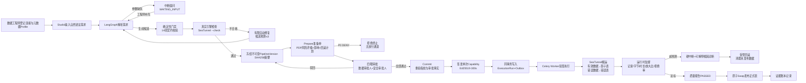
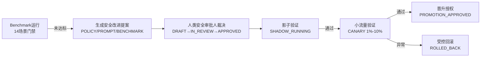

# etl_agent 产品需求文档（PRD）

> | 文档名称 | etl_agent 产品需求文档（PRD / 需求规格说明书） |
> |----------|------------------------------------------|
> | 版本 | v1.0 |
> | | 作者角色 | 产品经理 |
> | 日期 | 2026-10-13 |
> | 状态 | 评审稿 |
>
> **编制说明**：本文档依据《需求文档.md》（2.8 节）与 `etl_agent` 代码库实际实现（FastAPI 控制面 + LangGraph + Celery Worker + Vue 前端 + Harness 安全内核）反向梳理而成，作为产品基线（Baseline）供评审与后续演进使用。文中所有阈值、状态机、角色与门禁指标均可在代码中找到对应事实；需求文档中提出但代码尚未覆盖的内容统一记录于第 11 章「待确认问题」。

---

## 1. 产品目标与价值

- **背景与要解决的问题**：企业在异构数据源（MySQL / PostgreSQL / Oracle / SQL Server / Doris / Hive / HDFS / 文件）之间做数据搬运时，自然语言驱动的 ETL 生成缺乏安全治理——Agent 生成的配置可能夹带明文凭据、越权访问、破坏性变更，且生成—审批—执行链路缺少不可篡改证据，无法满足生产审计与四眼管控要求。
- **建设目标**：建设生产级 ETL-Agent 控制面平台 `etl_agent`，以 LangGraph 状态机完成「自然语言需求 → 受管元数据探查 → 结构化 EtlPlan 与 SeaTunnel HOCON 生成 → 确定性门禁 → 不可变制品 → 四眼审批 → 单次能力授权 → 受管执行 → 质量契约发布」的全闭环，控制面治理与数据面搬运（Apache SeaTunnel）严格分离。
- **成功标准（可量化）**：
  - P0/P1 风险操作拦截率 = **100%**（Benchmark 门禁 `p0_p1_block_rate = 1.0`，漏拦即发布失败）；
  - 合法需求端到端生成成功率 ≥ **95%**（`legitimate_success_rate ≥ 0.95`）；
  - 安全策略误报率 ≤ **5%**（`false_positive_rate ≤ 0.05`）；
  - 证据覆盖率 = **100%**、评测可复现率 = **100%**（哈希链 + 冻结制品保证）；
  - 非 LLM 决策路径 P95 ≤ **20 ms**（相对基线回归 ≤ 20%）；
  - 全链路敏感明文泄露 = **0 起**（模型不接触凭据、脱敏样本、Secret 引用制）；
  - 单次生成的自动修复候选 ≤ **3 份**（禁止无限自修复）；
  - Capability 令牌有效期 ≤ **300 s** 且全局仅可消费 **1 次**。

## 2. 用户角色与权限矩阵

系统采用**两层角色体系**：项目成员角色（资源可见性与项目级操作）+ Harness 职责角色（安全执行内核的职责分离槽位）。Harness 角色通过 `ProjectRoleGrant` 显式授予，**ADMIN 不隐式升级为安全审批人**。

| 角色 | 层级 | 职责描述 | 核心权限 |
|------|------|---------|---------|
| 项目管理员（ADMIN） | 项目成员 | 项目与成员治理 | 创建/管理项目成员、授予 Harness 职责、查看项目全部资源；不因此获得审批特权 |
| 数据工程师（DATA_ENGINEER） | 项目成员 / Harness（Maker） | 连接登记、探查、生成、提交 | 创建/编辑数据连接、发起元数据探查、输入自然语言需求、调试生成 Pipeline 候选、冻结不可变版本并提交审批申请；**禁止审批本人申请** |
| 项目审批人（APPROVER） | 项目成员 | 设计维度审批 | 审查需求描述、Schema 映射、质量规则与 DAG 结构并决策 |
| 审计只读员（VIEWER） | 项目成员 | 只读查阅 | 查看 Pipeline、执行记录与报告，无写操作 |
| 数据审批人（DATA_APPROVER） | Harness（Checker 1） | 数据维度审批 | 审查字段映射、脱敏前后结构对比、质量规则、DAG 拓扑，对准备单执行数据维度审批 |
| 安全审批人（SECURITY_APPROVER） | Harness（Checker 2） | 安全维度审批 | 审查资源范围、数据敏感分级、执行预算、Secret 引用与回滚方案；管理 Benchmark 与安全策略进化 |
| 系统操作员（OPERATOR） | Harness | 受管执行与运维 | 审批全通过后执行 Commit、触发执行、暂停/取消/回滚、凭据轮转 |
| 审计人员（AUDITOR） | Harness | 审计查阅 | 查看执行历史、审计事件、签名证据账本、质量报告与 Benchmark 大盘 |

**强制职责分离规则（红线）**：

1. 申请人禁止自批：同一准备单上 `(preparation_id, decided_by)` 唯一，一人只能占一个审批槽；
2. 同一准备单的每个职责槽位唯一：`(preparation_id, role)` 唯一，高风险操作禁止同一自然人兼任多个审批槽；
3. P0 级操作（破坏性、敏感外发）必须同时获得数据审批人 + 安全审批人双人批准（`required_approvals = 2`）；
4. P0-DENY 类意图（跨项目、Secret 外发）不存在人工放行通道，审批无法覆盖。

## 3. 用户故事

- US-01：作为数据工程师，我希望登记异构数据源连接并做安全连通性测试，以便在不暴露凭据的前提下管理数据资产。（→ FR-04、FR-05、FR-06）
- US-02：作为数据工程师，我希望对源表/目标表/文件执行只读元数据探查并查看脱敏样本，以便在生成方案前掌握 Schema、主键与近似统计。（→ FR-12、FR-13、FR-14）
- US-03：作为数据工程师，我希望用自然语言描述 ETL 需求，系统在参数缺失时中断提问、我补充后从检查点恢复，以便低门槛完成需求表达。（→ FR-16、FR-17）
- US-04：作为数据工程师，我希望系统生成结构化 EtlPlan 与 SeaTunnel HOCON 候选并通过确定性门禁与真实引擎检查，以便在人工审批前拦截错误配置。（→ FR-18、FR-19、FR-20）
- US-05：作为数据工程师，我希望候选不合格时系统做有限自动修复（预算内重生成），以便提高一次通过率且不被无限重试拖垮。（→ FR-21）
- US-06：作为数据工程师，我希望通过校验的方案冻结为带 SHA256 摘要的不可变版本，以便审批与执行始终绑定同一份事实。（→ FR-26）
- US-07：作为数据工程师，我希望配置质量契约、增量水印与调度策略后提交审批，以便把数据质量要求前置声明。（→ FR-22、FR-23、FR-40、FR-28）
- US-08：作为数据审批人，我希望在审批面板审查字段映射 Diff、脱敏前后结构对比、质量规则与 DAG 拓扑后独立决策，以便把住数据维度质量关。（→ FR-25、FR-32）
- US-09：作为安全审批人，我希望审查资源范围、数据敏感分级、执行预算、Secret 引用与回滚方案后独立决策，以便把住安全维度风险关。（→ FR-15、FR-31、FR-32）
- US-10：作为系统操作员，我希望在审批全部通过后执行 Commit 并触发受管执行，以便由系统签发单次能力令牌完成授权闭环。（→ FR-33、FR-38）
- US-11：作为系统操作员，我希望实时看到吞吐、行数字节、监督快照与质量分流明细，以便掌握执行健康度。（→ FR-39、FR-44、FR-45）
- US-12：作为系统操作员，我希望在超预算/异常时系统硬中断并给出可解释根因，我能一键发起受管回滚，以便快速恢复原状态。（→ FR-46、FR-47、FR-48）
- US-13：作为审计人员，我希望查看执行历史、审计事件与签名证据账本，以便证明关键操作不可篡改。（→ FR-36）
- US-14：作为安全审批人，我希望运行版本化 Benchmark 评测集并管理安全改进提案的影子/小流量/晋升发布，以便受控地进化安全策略。（→ FR-50、FR-51、FR-52）
- US-15：作为系统操作员，我希望对连接凭据执行轮换、迁移与销毁治理，并在凭据临期时收到预警，以便降低凭据泄露与过期风险。（→ FR-07、FR-08、FR-09、FR-10）

## 4. 功能需求清单（需求池）

优先级定义：**P0 必须**（主流程缺一不可，本期 100% 交付）；**P1 重要**（生产治理必备，随主流程交付）；**P2 可选**（增强能力，可排期）。事实来源：代码已实现全部 P0/P1/P2 条目；本文档按模块固化。

### M1 项目与工作区治理

| 编号 | 模块 | 功能 | 优先级 | 说明 |
|------|------|------|--------|------|
| FR-01 | 项目治理 | 工作区初始化与管理员创建 | P0 | 受 `bootstrap_enabled` + Bootstrap Token（≥32 字节）保护的首次初始化；创建首个项目与管理员身份 |
| FR-02 | 项目治理 | 项目成员管理 | P0 | 成员增删、项目角色（ADMIN/DATA_ENGINEER/APPROVER/VIEWER）分配，`(project_id, user_id)` 唯一 |
| FR-03 | 项目治理 | Harness 职责授予 | P0 | `ProjectRoleGrant` 显式授予 DATA_ENGINEER/DATA_APPROVER/SECURITY_APPROVER/OPERATOR/AUDITOR；不把管理员隐式升级为安全审批人；记录授予人 |

### M2 数据连接与凭据治理

| 编号 | 模块 | 功能 | 优先级 | 说明 |
|------|------|------|--------|------|
| FR-04 | 连接管理 | 异构连接登记 | P0 | MySQL、PostgreSQL、Oracle、SQL Server、Doris、Hive、HDFS、本地文件；项目内连接名唯一；Secret 引用制，不存明文 |
| FR-05 | 连接管理 | 安全连通性测试 | P0 | 后台测试并回写状态（UNTESTED/TESTING/READY/FAILED）与错误摘要 |
| FR-06 | 连接管理 | 凭据受管加密存储 | P0 | SecretProvider 双模式：`fernet-db`（本地密文，key_version 管理）与 `vault-kv-v2`（外部仅存不可认证的定位引用）；销毁后保留不含秘密的墓碑 |
| FR-07 | 凭据治理 | 凭据轮换 | P1 | 状态机 VALIDATING→WAITING_APPROVAL→APPROVED→ACTIVATING→SUCCEEDED/FAILED；新凭据先暂存并真实连通性验证，激活前继续用旧凭据；回滚恢复旧凭据原始年龄 |
| FR-08 | 凭据治理 | 凭据 Provider 迁移 | P1 | 源/目标 Provider 间迁移；目标 UUID 申请时冻结，Worker 重试写同一路径，避免孤立秘密 |
| FR-09 | 凭据治理 | 凭据销毁 | P1 | 轮换源/回滚暂存两类目标的资格判定与销毁申请，留墓碑记录 |
| FR-10 | 凭据治理 | 到期预警与告警投递 | P1 | 默认最大账龄 90 天、预警 14 天；WARNING/OVERDUE 两级告警、去重键、确认/静默/解决；Webhook 外置投递（退避冷却：预警 24h / 逾期 6h） |
| FR-11 | 凭据治理 | 连接轮换策略配置 | P1 | 按连接配置 `credential_max_age_days`（1–3650）与 `credential_warning_days`（0 < warning < max_age） |

### M3 元数据探查与文件资产

| 编号 | 模块 | 功能 | 优先级 | 说明 |
|------|------|------|--------|------|
| FR-12 | 元数据探查 | 表级只读 Profile 探查 | P0 | Schema、字段类型、主键、近似统计、脱敏样本采样；SOURCE/SINK 端点角色；不执行全表 COUNT；带过期时间 |
| FR-13 | 文件资产 | 文件上传与探查 | P0 | CSV/JSON/JSONL/XLSX/Parquet/ORC/XML/Markdown/PDF；上限 25 MiB、100,000 行；上传路径不暴露给 API，引擎只读受挂载路径 |
| FR-14 | 元数据探查 | 脱敏样本渲染 | P0 | 按列名启发式脱敏（`mask_sample`/`mask_value`），样本值不回明文 |
| FR-15 | 数据分级 | 敏感数据分级 | P1 | 字段级 PUBLIC/INTERNAL/CONFIDENTIAL/RESTRICTED/SECRET/UNKNOWN 推断（显式声明优先、同名传播、显式映射传播），产出带 SHA256 的分级报告，UNKNOWN 按保守等级参与策略 |

### M4 Pipeline Studio 智能生成

| 编号 | 模块 | 功能 | 优先级 | 说明 |
|------|------|------|--------|------|
| FR-16 | 智能生成 | 自然语言需求输入与运行管理 | P0 | 创建 AgentRun（QUEUED/RUNNING/WAITING_INPUT/WAITING_APPROVAL/FAILED），绑定 PipelineVersion 与 Profile 集合 |
| FR-17 | 智能生成 | LangGraph 澄清中断与 Checkpoint 恢复 | P0 | 必要参数缺失时 `interrupt` 提问并持久化，用户回答后从同一 thread 恢复；生成遥测只记次数/耗时/非敏感诊断，不存 Prompt 与候选正文 |
| FR-18 | 智能生成 | EtlPlan / SeaTunnel HOCON 候选生成 | P0 | 多后端（direct / seatunnel-cli）与 OpenAI 兼容多模型 Provider；产出结构化 plan + HOCON |
| FR-19 | 确定性门禁 | 静态契约校验 | P0 | 14 项确定性检查：禁明文凭据、受支持连接器/转换契约、质量契约 sink/routing/traceability/predicates、Profile 拓扑、受管文件源、HDFS 文件契约、数据库端点、目标 Schema、增量契约、逐行 LLM 契约 |
| FR-20 | 确定性门禁 | 真实引擎检查 | P0 | Worker 侧物化运行期变量后执行 SeaTunnel `--check`，只回传脱敏摘要；发生在人工审批中断之前 |
| FR-21 | 有限修复 | 自动修复预算 | P0 | 格式错误、门禁错误、引擎检查共享预算：最多 3 份候选（初始 + 2 次修复），耗尽即确定性失败 |
| FR-22 | 质量契约 | QualityContract 配置 | P1 | 字段级清洗过滤规则与错误码标签；有效 sink / 错误 sink 路由匹配；最大拒绝行数/拒绝率阈值 |
| FR-23 | 增量同步 | 水印增量契约 | P1 | TIMESTAMP 水印列、初始值、滞后秒数；驱动 WATERMARK_INCREMENTAL 调度 |
| FR-24 | 行级 AI | 逐行 LLM Transform 契约 | P2 | OPENAI/DOUBAO/DEEPSEEK/KIMIAI/MICROSOFT/ZHIPU/CUSTOM；限速（默认 10 行/s）、允许 API 主机清单 |
| FR-25 | 设计审查 | 方案审查视图 | P1 | DAG 拓扑（SOURCE/TRANSFORM/SINK 节点与边）、字段映射 Diff（新增/删除/类型变更/显式投影）、脱敏前后样本对比、风险分级提示（HIGH/MEDIUM/LOW/INFO） |

### M5 不可变版本与设计审批

| 编号 | 模块 | 功能 | 优先级 | 说明 |
|------|------|------|--------|------|
| FR-26 | 版本管理 | Pipeline 与不可变版本 | P0 | 版本链 DRAFT→PROFILING→GENERATED→VALIDATED→WAITING_APPROVAL→APPROVED/REJECTED；修改必须派生新版本（`parent_version_id`），制品 SHA256 冻结，乐观锁 `lock_version` |
| FR-27 | 版本管理 | 版本 Diff 对比 | P1 | 不同版本的 Schema、HOCON 配置与质量规则差异对比 |
| FR-28 | 设计审批 | 审批申请与决策 | P0 | ApprovalRequest 绑定 `artifact_sha256`；APPROVE/REJECT 决策与理由留痕 |

### M6 Harness 安全执行内核

| 编号 | 模块 | 功能 | 优先级 | 说明 |
|------|------|------|--------|------|
| FR-29 | 策略内核 | 策略决策点（PDP） | P0 | 9 条确定性规则，输出 P0–P3 风险与 ALLOW/DENY/REQUIRE_APPROVAL/DEFER；按 DENY>DEFER>REQUIRE_APPROVAL>ALLOW、P0>P1>P2>P3 取最严聚合；DENY 清空审批要求（无放行通道）；决策持久化且只存规则证据，不存原始数据与 Prompt |
| FR-30 | 策略内核 | 签名策略包 | P1 | 策略清单（rule_id/version 唯一、排序稳定）+ SHA256 + Ed25519 分离签名；PDP 启动与热切换前强制验签；请求不得临时切换策略版本 |
| FR-31 | 执行协议 | Prepare 准备单 | P0 | 冻结输入指纹/资源指纹/影响报告/数据分级/监督契约/回滚计划；TTL 默认 24h（300s–7d）；状态机 DENIED/WAITING_APPROVAL/READY/REJECTED/EXPIRED/COMMITTED；幂等键去重；无外部副作用 |
| FR-32 | 执行协议 | 四眼审批与职责分离 | P0 | 具名审批人对职责槽位决策，强制 `(preparation_id, role)` 与 `(preparation_id, decided_by)` 双唯一；决策带 `evidence_sha256` |
| FR-33 | 执行协议 | Commit 与单次 Capability | P0 | 服务端重验指纹与审批事实后签发 Ed25519 签名令牌；TTL 默认 300s（30–900s）；绑定工具/版本/主体/环境/制品指纹/监督契约哈希/分级报告哈希/允许的减损动作；同一事务原子创建 ExecutionRun 与 Outbox 命令 |
| FR-34 | 执行协议 | Tool Broker 与防重放 Guard | P0 | 所有副作用的唯一出口；以注册清单（非 Agent 自报）判定副作用；Replay Guard 保证令牌仅消费一次 |
| FR-35 | 执行协议 | 事务 Outbox 可靠投递 | P0 | 业务事实与 Worker 命令同事务落库；PENDING/SENDING/SENT/FAILED 状态机、重试与锁定；进程崩溃不丢已授权执行 |
| FR-36 | 审计证据 | 不可篡改证据账本 | P0 | 只追加事件流：sequence、payload_sha256、前序哈希、事件哈希、可选 Ed25519 检查点签名；支持整流验证报告（valid/event_count/head_hash/errors） |
| FR-37 | 执行协议 | 通用副作用受管执行 | P0 | 9 类副作用（CANCEL_EXECUTION、ROLLBACK_DORIS、CLEANUP_DORIS、MIGRATE_SECRET、STAGE/VALIDATE/ACTIVATE/ROLLBACK/DESTROY_SECRET）与 Pipeline 执行同协议：prepare→approve→commit→outbox→worker；执行租约防并发重入 |

### M7 执行调度与数据面

| 编号 | 模块 | 功能 | 优先级 | 说明 |
|------|------|------|--------|------|
| FR-38 | 执行引擎 | Celery Worker 受管执行 | P0 | 消费验签后命令、物化 Secret、调用 SeaTunnel 作业并回传状态与指标；心跳上报（默认 10s，35s 判失活）与能力声明 |
| FR-39 | 执行引擎 | 运行管理与监控 | P0 | ExecutionRun 状态机 QUEUED/SUBMITTED/RUNNING/SUCCEEDED/FAILED/CANCELLING/CANCELLED；执行事件流（level/stage/event_type）；源/目标行数、字节、表级指标 |
| FR-40 | 调度 | 定时调度 | P1 | cron + 时区；BATCH / WATERMARK_INCREMENTAL；misfire 策略 SKIP/FIRE_ONCE，宽限默认 120s；扫描间隔默认 30s |
| FR-41 | 调度 | 水印增量同步 | P1 | 调度推进水印值并记录 `watermark_window` |
| FR-42 | 执行引擎 | 执行重试 | P1 | 稳定 SeaTunnel JobId；`retry_of_run_id`/`attempt_number` 追溯 |
| FR-43 | 数据面发布 | 影子表与原子 Swap | P0 | Doris `CREATE LIKE` 预复制 + `REPLACE TABLE ... PROPERTIES('swap'='true')` 原子发布；同 Schema 强校验 |
| FR-44 | 质量治理 | 错误分流与质量报告 | P0 | 未命中规则数据写入错误表并记录原始值与违规原因；QualityReport（PASSED/WARNING/FAILED/INCOMPLETE、总/通过/拒绝行数、拒绝率、错误码统计、诊断） |

### M8 运行时监督与受管回滚

| 编号 | 模块 | 功能 | 优先级 | 说明 |
|------|------|------|--------|------|
| FR-45 | 运行时监督 | 监督契约与预算执行 | P0 | 冻结预算：最大记录数（默认 10M）、最大字节（默认 10 GiB）、最长时长（默认 3600s）、输出放大比（≤2.0）、拒绝率（≤0.5）、最低质量行数（100）、预警比例（0.8）；6 条确定性规则：P0 记录预算 / P0 字节预算 / P1 超时 / P0 输出放大 / P1 拒绝率 / P3 预算预警；快照带 `snapshot_sha256` |
| FR-46 | 运行时监督 | 硬中断与隔离 | P0 | 减损动作 CONTINUE/THROTTLE/PAUSE/CANCEL/QUARANTINE；QUARANTINE 阻断后续质量发布与原子交换；外部减损动作独立可重试（NOT_REQUIRED/PENDING/APPLYING/APPLIED/FAILED） |
| FR-47 | 诊断 | 可解释根因诊断 | P0 | 失败分类（CONFIGURATION/CREDENTIALS/CONNECTIVITY/SOURCE_SCHEMA/SINK_WRITE/ENGINE/OBSERVABILITY/CANCELLATION/UNKNOWN）与失败阶段、可重试性判定、修复建议 |
| FR-48 | 回滚 | 受管回滚与制品清理 | P0 | 回滚申请/审批/执行状态机；回滚表保留期默认 7 天、容量预警阈值 20；到期清理申请；回滚制品清单（AVAILABLE/ROLLED_BACK/ROLLBACK_PENDING/CLEANUP_PENDING/INVALID_METADATA） |
| FR-49 | 执行引擎 | 执行取消 | P1 | CANCELLING→CANCELLED，记录取消原因 |

### M9 评测与安全进化

| 编号 | 模块 | 功能 | 优先级 | 说明 |
|------|------|------|--------|------|
| FR-50 | 评测 | 版本化 Benchmark 自动化测试集 | P0 | 冻结 suite（manifest + baseline 哈希）；门禁指标：P0/P1 拦截率 = 1.0、合法成功率 ≥ 0.95、误报率 ≤ 0.05、证据覆盖率 = 1.0、可复现率 = 1.0、非 LLM P95 回归 ≤ 20%（基线 20 ms）；v1 套件 14 场景（P0×6 / P1×4 / P3×4；对抗×6 / 合法×3 / 变异×3 / 回归×2） |
| FR-51 | 安全进化 | 安全改进提案 | P1 | 类型限定 POLICY/PROMPT/BENCHMARK；候选可离线审查、非可执行代码；状态机 DRAFT→IN_REVIEW→APPROVED/REJECTED→RELEASED，不可跳跃；仅人类安全审批人可裁决 |
| FR-52 | 安全进化 | 受控发布 | P1 | 影子验证→小流量（1%–10%）→晋升授权/回滚；发布清单 Ed25519 签名；观察样本为脱敏聚合事实（异常计数 ≤ 样本量自校验） |

### M10 前端控制台（Vue 3 SPA）

| 编号 | 模块 | 功能 | 优先级 | 说明 |
|------|------|------|--------|------|
| FR-53 | 前端 | 总览工作台 | P0 | 项目连接数、Pipeline 数量、待审批概况、运行成功率、目标切片预览与生产边界提示、快捷导航 |
| FR-54 | 前端 | 数据源与资产管理页 | P0 | 连接表单、连通性测试、端点角色选择、表级/文件探查与脱敏样本、文件导入（25 MiB / 10 万行）、凭据轮换表单 |
| FR-55 | 前端 | Pipeline Studio | P0 | 自然语言输入、LangGraph 澄清对话、HOCON 语法高亮、DAG 渲染、字段映射 Diff、脱敏前后对比、门禁结果与审批提交 |
| FR-56 | 前端 | 运行中心与审批控制台 | P0 | 准备单与审批面板（影响范围/回滚方案/审批槽位/四眼决策）、执行监控（吞吐曲线/日志/监督快照/质量分流/诊断）、中断与受管回滚、Worker 健康、凭据治理清单 |
| FR-57 | 前端 | 安全治理与 Benchmark 页 | P0 | Benchmark 用例集与触发、准确率与 P0/P1 拦截率大盘、安全提案与发布状态管理 |
| FR-58 | 前端 | 工作区初始化与身份注入 | P0 | 首次初始化引导；统一经 `X-Actor-ID` 头注入操作者身份（生产由可信网关签发） |

### M11 平台与可观测性

| 编号 | 模块 | 功能 | 优先级 | 说明 |
|------|------|------|--------|------|
| FR-59 | 平台 | 健康检查 | P0 | `/health` 返回存活状态与脱敏的 SecretProvider 配置状态，不主动读取凭据 |
| FR-60 | 可观测性 | 链路可观测 | P1 | OpenTelemetry 埋点（FastAPI / HTTPX / SQLAlchemy / Celery）、OTLP 导出、结构化日志、错误响应附带 trace_id |

## 5. 非功能需求（量化）

| 类别 | 要求 | 指标 |
|------|------|------|
| 性能 | 非 LLM 决策路径（PDP/门禁/监督/证据） | P95 ≤ 20 ms；相对基线回归 ≤ 20% |
| 性能 | LLM 生成调用 | 单次请求超时 ≤ 180 s（默认值，可配置） |
| 性能 | 运行时预算硬上限（平台级，可按环境下探） | 最大读取记录 10,000,000；最大写入字节 10 GiB；最长执行 3600 s；输出放大比 ≤ 2.0；错误拒绝率 ≤ 0.5；最低质量行数 100；预警比例 0.8（达到预算 80% 即预警） |
| 安全 / 合规 | 认证边界 | 生产环境必须 `trusted-gateway`（HMAC 签名，密钥 ≥ 32 字节，时钟偏移 ≤ 60 s）；开发可用 `dev-header` |
| 安全 / 合规 | 凭据保护 | Secret 不明文落地（fernet-db 密文 / Vault KV v2 外部引用）；模型永不可见连接密码；Profile 脱敏样本；销毁留墓碑不含秘密 |
| 安全 / 合规 | 授权与防重放 | Ed25519 签名 Capability；TTL ≤ 300 s；单次消费；Replay Guard；P0-DENY 无人工放行通道 |
| 安全 / 合规 | 审计 | 全量审计事件（actor/project/action/resource/before/after/reason/trace_id）；证据账本哈希链 + 签名检查点，可整流验证 |
| 可用性 | Worker 可靠性 | 心跳间隔 10 s、35 s 判失活；Outbox 扫描 2 s、投递重试与锁；副作用执行租约防并发重入 |
| 可用性 | 服务 SLA | 控制面无单点依赖数据面；准备单 TTL 24 h、幂等键防重复提交；令牌 TTL 300 s |
| 兼容性 | 运行环境 | Python 3.12（>=3.12,<3.13）；PostgreSQL 17；Redis 8；现代浏览器（Vue 3 + Vite SPA） |
| 兼容性 | 数据源 | MySQL / PostgreSQL / Oracle / SQL Server / Doris / Hive / HDFS / 本地文件；文件 9 种格式 |
| 并发 | 资源边界 | 文件资产 25 MiB / 100,000 行；单准备单资源 Scope ≤ 100；副作用意图资源 Scope ≤ 100 |
| 可观测性 | 遥测 | OTel 四组件埋点 + OTLP 导出（超时 10 s）；trace_id 贯通 API 错误响应；结构化日志 |
| 数据保留 | 回滚制品 | Doris 回滚表保留 7 天；容量预警阈值 20 件 |

## 6. 核心业务流程图

### 6.1 需求生成与受管发布主流程



### 6.2 安全策略受控进化流程



## 7. 关键页面原型说明

- **页面 1：总览工作台**（FR-53）
  - 顶部：工作区标识（项目名 + 当前操作者）。
  - 统计卡：连接数 / Pipeline 数 / 待审批门禁数 / 运行成功率。
  - 目标切片预览卡：`MySQL orders → Doris fact_orders` 迷你流程图（Source → Agent(map·mask·quality) → Sink）。
  - 生产边界提示卡：① 模型永远看不到连接密码；② 审批绑定不可变 Artifact 哈希；③ 重试使用稳定 SeaTunnel JobId。
  - 导航：总览 / 数据连接 / 运行中心 / 安全治理 / Pipeline Studio。

- **页面 2：数据源与资产管理页**（FR-54）
  - 左：连接列表（名称、连接器类型、状态徽标：UNTESTED/TESTING/READY/FAILED）。
  - 右上：登记连接表单（类型、主机、端口、库名、凭据；标记「加密」）。
  - 右中：端点角色选择（SOURCE/SINK）→ 表级探查表单（Schema/Table/采样上限 1–100）→ Profile 列表（主键、脱敏样本条数、状态）。
  - 右下：受管文件源导入（格式提示 + 25 MiB / 100,000 行上限）。
  - 浮层：凭据轮换表单（新用户名/新密码/轮换原因 → 安全暂存并验证）。

- **页面 3：Pipeline Studio**（FR-55）
  - 需求输入区：自然语言多行输入 + 源端/目标端 Profile 选择 + 澄清对话历史（问题/回答）。
  - 生成过程区：阶段状态（生成 → 门禁 → 引擎检查 → 修复计数 n/2）、生成遥测（后端/模型/候选数/修复数/耗时）。
  - 方案配置区：HOCON 代码高亮 + DAG 拓扑图 + 字段映射 Diff（新增/删除/类型变更列）+ 脱敏前后样本对比表 + 风险分级提示列表。
  - 门禁与提交区：门禁结果清单（逐项 PASS/FAIL）、调度策略（cron/模式/misfire）、质量契约配置、「冻结并提交审批」按钮。

- **页面 4：运行中心与审批控制台**（FR-56）
  - 审批面板：准备单列表 → 详情（风险等级 P0–P3、影响范围、数据分级、监督契约、回滚方案、required_roles/required_approvals）→ 审批槽位卡片（数据审批人 / 安全审批人，显示「不可自批」约束）→ APPROVE/REJECT + 理由。
  - 执行监控区：运行列表（状态、触发方式 MANUAL/SCHEDULED、重试次数）→ 实时事件日志 → 监督快照时间线（action/risk/命中规则/预算水位）→ 吞吐与行数字节指标 → 质量报告卡（总/通过/拒绝行数、拒绝率、错误码分布、诊断建议）。
  - 运维操作区：取消 / 重试 / 受管回滚 / 清理；Worker 健康列表；凭据治理清单（轮换状态、回滚窗口、销毁资格）。

- **页面 5：安全治理与 Benchmark 页**（FR-57）
  - 评测大盘：门禁指标卡（P0/P1 拦截率、合法成功率、误报率、证据覆盖率、可复现率、非 LLM P95 及回归）+ 用例结果表（case_id/类别/风险/是否拦截/误报/证据覆盖/复现/耗时）。
  - 触发区：选择 suite 版本 → 「运行 Benchmark」。
  - 进化管理区：提案列表（类型/状态/来源评测）→ 发布状态（影子/小流量百分比/晋升/回滚）→ 人工裁决操作。

## 8. 数据实体初稿（ER）

```mermaid
erDiagram
    projects ||--o{ project_memberships : "成员关系"
    users ||--o{ project_memberships : "属于"
    projects ||--o{ project_role_grants : "Harness职责授予"
    users ||--o{ project_role_grants : "承担职责"
    projects ||--o{ pipelines : "包含"
    pipelines ||--o{ pipeline_versions : "版本链"
    pipeline_versions ||--o| pipeline_versions : "parent_version_id派生"
    pipeline_versions ||--o{ agent_runs : "生成运行thread_id"
    pipeline_versions ||--o{ pipeline_artifacts : "不可变制品sha256"
    pipeline_versions ||--o{ approval_requests : "设计审批"
    projects ||--o{ data_connections : "连接"
    data_connections ||--o| encrypted_secrets : "secret_ref凭据"
    data_connections ||--o{ data_profiles : "元数据Profile"
    data_connections ||--o{ secret_rotation_requests : "轮换"
    projects ||--o{ file_assets : "文件资产"
    pipelines ||--o| pipeline_schedules : "调度策略"
    pipeline_versions ||--o{ execution_runs : "执行"
    execution_runs ||--o{ execution_events : "事件流"
    execution_runs ||--o| runtime_supervision_snapshots : "监督快照"
    execution_runs ||--o| quality_reports : "质量报告"
    execution_runs ||--o{ rollback_requests : "回滚"
    execution_runs ||--o{ rollback_cleanup_requests : "回滚制品清理"
    projects ||--o{ harness_policy_decisions : "PDP决策"
    harness_policy_decisions ||--o| execution_preparations : "授权依据"
    execution_preparations ||--o{ harness_approval_decisions : "四眼审批槽位"
    execution_preparations ||--o| harness_capability_grants : "单次令牌"
    execution_runs ||--o| harness_capability_grants : "授权执行"
    projects ||--o{ harness_side_effect_preparations : "副作用准备单"
    harness_side_effect_preparations ||--o{ harness_side_effect_approvals : "审批"
    harness_side_effect_preparations ||--o| harness_side_effect_capability_grants : "令牌"
    projects ||--o{ harness_command_outbox : "可靠投递"
    projects ||--o{ harness_evidence_streams : "证据流head_hash"
    harness_evidence_streams ||--o{ harness_evidence_events : "哈希链事件"
    projects ||--o{ benchmark_runs : "评测运行"
    benchmark_runs ||--o{ safety_improvement_proposals : "改进提案"
    safety_improvement_proposals ||--o| safety_releases : "受控发布"
    projects ||--o{ audit_events : "审计事件"

    users {
        uuid id PK
        string subject UK "登录主体"
        string display_name
    }
    project_role_grants {
        uuid id PK
        uuid project_id FK
        uuid user_id FK
        enum role "DATA_ENGINEER/DATA_APPROVER/SECURITY_APPROVER/OPERATOR/AUDITOR"
        uuid granted_by "授予人"
    }
    data_connections {
        uuid id PK
        uuid project_id FK
        enum connector_type "MYSQL/DORIS/POSTGRESQL/ORACLE/SQL_SERVER/HIVE/HDFS/LOCAL_FILE"
        enum status "UNTESTED/TESTING/READY/FAILED"
        uuid secret_ref FK
        int credential_max_age_days "默认90"
        int credential_warning_days "默认14"
    }
    pipeline_versions {
        uuid id PK
        uuid pipeline_id FK
        int version_number UK
        enum status "DRAFT→…→APPROVED/REJECTED"
        string artifact_sha256 "冻结摘要"
        uuid parent_version_id FK "派生来源"
        int lock_version "乐观锁"
    }
    execution_runs {
        uuid id PK
        uuid pipeline_version_id FK
        uuid harness_preparation_id FK UK "V2唯一绑定"
        enum status "QUEUED/SUBMITTED/RUNNING/SUCCEEDED/FAILED/CANCELLING/CANCELLED"
        string seatunnel_job_id
        string supervision_action "默认CONTINUE"
        enum trigger "MANUAL/SCHEDULED"
        int attempt_number
    }
    execution_preparations {
        uuid id PK
        uuid policy_decision_id FK UK
        enum status "DENIED/WAITING_APPROVAL/READY/REJECTED/EXPIRED/COMMITTED"
        string risk_level "P0-P3"
        string input_fingerprint
        string resource_fingerprint
        json impact_report
        json rollback_plan
        int required_approvals
        datetime expires_at "默认24h"
    }
    harness_capability_grants {
        uuid token_id PK
        uuid preparation_id FK UK
        string token_sha256 UK
        json claims "签名声明"
        datetime expires_at "默认300s"
        datetime consumed_at "单次消费事实"
    }
    harness_evidence_events {
        uuid id PK
        uuid stream_id FK
        bigint sequence
        string previous_hash
        string event_hash UK
        string signature_value "Ed25519检查点"
    }
    quality_reports {
        uuid id PK
        uuid run_id FK UK
        enum status "PASSED/WARNING/FAILED/INCOMPLETE"
        bigint total_rows
        bigint rejected_rows
        float reject_rate
        string valid_sink
        string error_sink
    }
    benchmark_runs {
        uuid id PK
        string suite_id
        string manifest_version
        string manifest_sha256
        enum status "PASS/FAIL"
        json metrics "六项门禁指标"
        string report_sha256
    }
```

> 其余实体（`agent_runs`、`approval_requests`、`pipeline_schedules`、`secret_migration_requests`、`secret_rotation_rollback_requests`、`secret_destruction_requests`、`credential_expiry_alerts`、`credential_alert_deliveries`、`worker_heartbeats`、`runtime_supervision_snapshots`、`rollback_cleanup_requests`、`harness_side_effect_preparations/approvals/capability_grants`、`harness_command_outbox`、`audit_events`、`safety_improvement_proposals`、`safety_releases`）字段以 `infrastructure/models.py`（Alembic 版本化迁移）为准，此处不再展开。

## 9. 验收标准（AC）

| 功能（FR） | 验收条件（前置—操作—预期） |
|-----------|--------------------------|
| FR-02/FR-03 | 给定项目管理员已登录，当为成员授予 DATA_ENGINEER 与 DATA_APPROVER 双职责时，则授予记录含 `granted_by` 且不隐式获得 SECURITY_APPROVER |
| FR-01/FR-58 | 给定系统未初始化，当使用有效 Bootstrap Token 创建工作区时，则创建首个项目与管理员；Token 缺失或 <32 字节时拒绝启动/调用 |
| FR-04/FR-06 | 给定已登记 MySQL 连接，当通过 API 读取连接详情时，则响应仅含 `secret_ref` 定位引用，任何字段均无凭证明文 |
| FR-12/FR-14 | 给定就绪连接，当对订单表发起探查（limit ≤ 100）时，则返回 Schema/主键/近似统计/脱敏样本，且样本中敏感列值已脱敏 |
| FR-16/FR-17 | 给定自然语言需求缺少主键去重声明，当运行 Agent 时，则状态进入 WAITING_INPUT 并挂起问题；补充回答后从同一 thread_id 恢复并继续生成 |
| FR-19/FR-20/FR-21 | 给定候选 HOCON 含明文密码，当进入确定性门禁时，则首轮即拦截并触发修复反馈；3 份候选后仍不合规时运行以 FAILED 终止且错误信息可解释 |
| FR-26 | 给定方案通过门禁，当冻结版本时，则生成 `artifact_sha256` 且后续修改只能派生新版本（`parent_version_id` 指向旧版本） |
| FR-31/FR-32 | 给定已冻结版本，当调用 Prepare 时，则生成含影响报告与回滚计划的准备单；数据审批人与安全审批人均批准（`required_approvals=2`）前，Commit 一律拒绝 |
| FR-32（职责分离） | 给定申请人本人具备 DATA_APPROVER 职责，当其对本人提交的准备单执行审批时，则系统以唯一约束拒绝（申请人禁止自批） |
| FR-33/FR-34 | 给定审批全部通过，当调用 Commit 时，则签发 Ed25519 单次令牌（TTL ≤ 300s）并原子创建 ExecutionRun + Outbox；同一令牌第二次使用时被 Replay Guard 拒绝 |
| FR-35 | 给定 Commit 已写入 Outbox，当 Worker 投递失败后重启时，则命令按 available_at 重试且不产生重复执行 |
| FR-38/FR-43/FR-44 | 给定已授权执行，当 Worker 调用 SeaTunnel 完成搬运时，则有效数据落入影子表、错误数据落入错误表并生成 QualityReport；质量 PASSED 后执行原子 Swap 发布正式表 |
| FR-45/FR-46 | 给定拒绝率预算 0.5，当运行中错误分流率超过阈值时，则监督引擎在下一快照周期触发 P1 规则与 CANCEL/QUARANTINE 减损，QUARANTINE 后发布被阻断 |
| FR-47/FR-48 | 给定执行失败或被隔离，当操作员查看诊断时，则得到失败分类/阶段/可重试性/修复建议；发起回滚经审批后恢复原状态并记录回滚制品 |
| FR-36 | 给定关键链路已执行，当审计人员验证证据流时，则验证报告返回 valid=true 且 event_count 与 head_hash 与账本一致 |
| FR-50 | 给定 v1 Benchmark 套件（14 场景），当运行评测时，则输出六项门禁指标；任一 P0/P1 场景漏拦或证据未覆盖即判 FAIL |
| FR-52 | 给定已批准的安全提案，当执行受控发布时，则必须依次完成影子验证与小流量（1%–10%）验证方可晋升；任一阶段异常计数 > 样本量的观测被拒绝入库 |

## 10. 依赖与约束

**外部依赖**（标注可控性）：

| 依赖 | 用途 | 可控性 |
|------|------|--------|
| Apache SeaTunnel（Zeta + REST API + CLI `--check`） | 数据面搬运与配置校验 | 外部开源组件，团队可控部署 |
| PostgreSQL 17 | 控制面业务库 + LangGraph Checkpoint 库（两库分离） | 团队可控 |
| Redis 8 | Celery Broker / 结果后端 | 团队可控 |
| HashiCorp Vault（KV v2，可选） | 外部 SecretProvider | 团队可控，可选 |
| LLM Provider（OpenAI 兼容 / 多供应商） | 候选生成、逐行 LLM Transform | 外部服务，需采购/配额 |
| MySQL 8.4 / Doris FE+BE 3.0.8（e2e profile） | 端到端演示与 L2 评测链路 | 团队可控 |
| OTel Collector（可选） | 遥测出口 | 团队可控 |

**约束**：

1. **架构约束**：控制面（FastAPI + LangGraph + Celery + PostgreSQL）与数据面（SeaTunnel）分离，控制面不直连搬运海量业务数据；引擎只读取部署时挂载的只读文件路径，不接触上传原始文件名。
2. **技术栈约束**：Python 3.12；FastAPI + SQLAlchemy 异步 + Alembic；Vue 3 + Vite + TypeScript 前端；Celery[redis]。
3. **安全约束**：生产环境必须 `trusted-gateway` 认证与 `harness_public_keys` 配置；策略包必须签名且规则清单与内嵌 PDP 实现严格一致；能力令牌短时单次；P0-DENY 无放行通道。
4. **预算约束**：生成候选总预算 ≤ 3 份/次运行；运行时预算为不可扩权硬上限（监督动作只能收窄权限，不能修改作业语义）。
5. **兼容性约束**：领域枚举以字符串持久化（禁 PostgreSQL 原生枚举），保证迁移可回滚。
6. **演示约束**：至少完成一个端到端场景全流程演示（MySQL→Doris 宽表增量同步投产；或海量日志脏数据超限硬中断与受管回滚）。

## 11. 待确认问题（Open Questions）

| 编号 | 问题 | 建议确认方 |
|------|------|-----------|
| Q1 | 生产可信网关（`trusted-gateway` HMAC）由哪套既有 IAM/网关承接？Actor 身份到 Harness 职责的映射规则需与安全团队对齐 | 安全架构 / 平台团队 |
| Q2 | 需求文档 2.8.1 提出的 ClickHouse 数据库接入与 S3/MinIO、REST API 文件源在当前代码中未覆盖（现有连接器为 MySQL/PostgreSQL/Oracle/SQL Server/Doris/Hive/HDFS/本地文件），是否列入后续版本范围 | 业务负责人 / 产品 |
| Q3 | LLM Provider 选型（OpenAI 兼容 / 豆包 / DeepSeek / Kimi / 智谱 等）、配额与成本预算，以及生成质量基线如何标定 | 业务负责人 / 财务 |
| Q4 | SeaTunnel Zeta 生产部署形态（单机 / 集群）与版本升级策略，`--check` 与作业提交的 API 契约版本锁定 | 数据平台团队 |
| Q5 | Vault KV v2 生产部署、密钥轮换与灾难恢复策略；`fernet-db` 主密钥的 KMS 托管方式 | 安全架构 |
| Q6 | Benchmark 基线（`baseline.json`）与策略包版本（当前 `harness-v2-20260808`）的发布节奏与变更管理流程；影子/小流量阶段的通过准则量化值 | 安全审批人 / 质量团队 |
| Q7 | 多环境（local/staging/prod）配置分离与密钥分发方式（`.env` vs 配置中心） | 平台团队 |

---

## 附：质量自检（Quality Gate）核对记录

| 检查项 | 结果 |
|--------|------|
| 目标可量化 | ✅ 8 条成功标准全部数值化（拦截率 100%、成功率 ≥95%、P95 ≤20ms、令牌 300s/单次等） |
| 角色无遗漏 | ✅ 8 类角色（4 项目成员 + 5 Harness 职责，DATA_ENGINEER 双层）全部赋权；职责分离 4 条红线 |
| 用户故事可映射 | ✅ 15 条 US 均标注对应 FR 编号 |
| 需求池有优先级 | ✅ 60 条 FR，P0 覆盖主流程全链路（生成→门禁→冻结→审批→授权→执行→发布→监督→回滚→评测） |
| 非功能已量化 | ✅ 性能/安全/可用性/兼容性/并发/可观测性/数据保留均给数值 |
| 流程图自洽 | ✅ 主流程与进化流程节点均可映射到 FR 编号（FR-16~48、FR-50~52） |
| 验收可测 | ✅ 17 条 AC 覆盖全部 P0 主流程与职责分离、防重放、门禁等红线 |
| 无臆造事实 | ✅ 所有阈值/状态机/角色来自代码与需求文档；文档与代码差异（ClickHouse/S3/REST）记入 Q2 |
