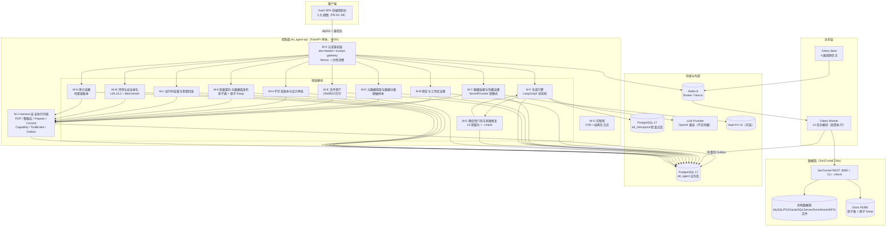
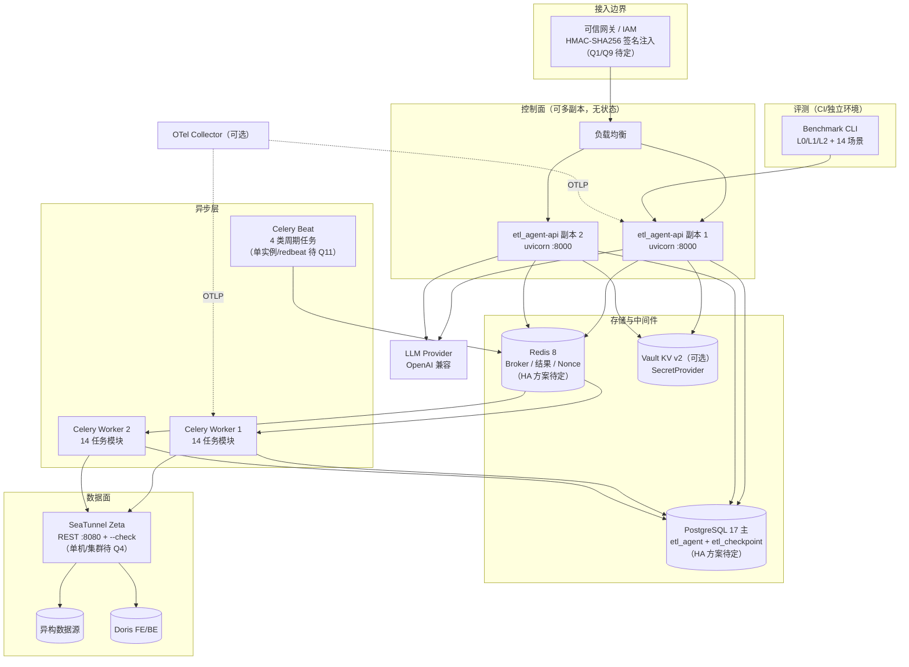
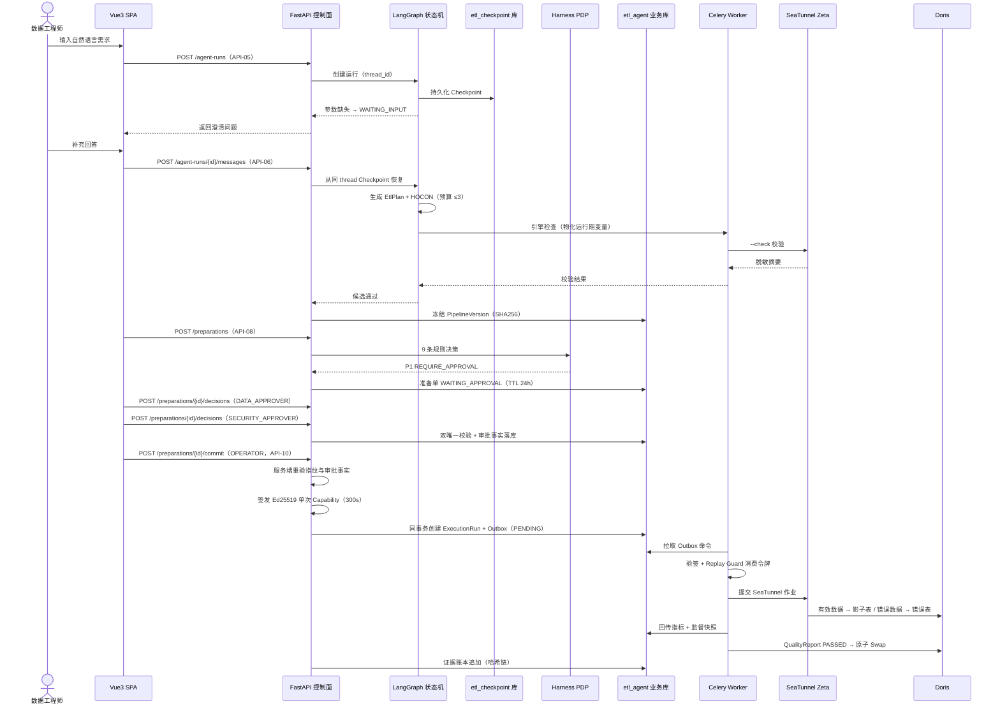
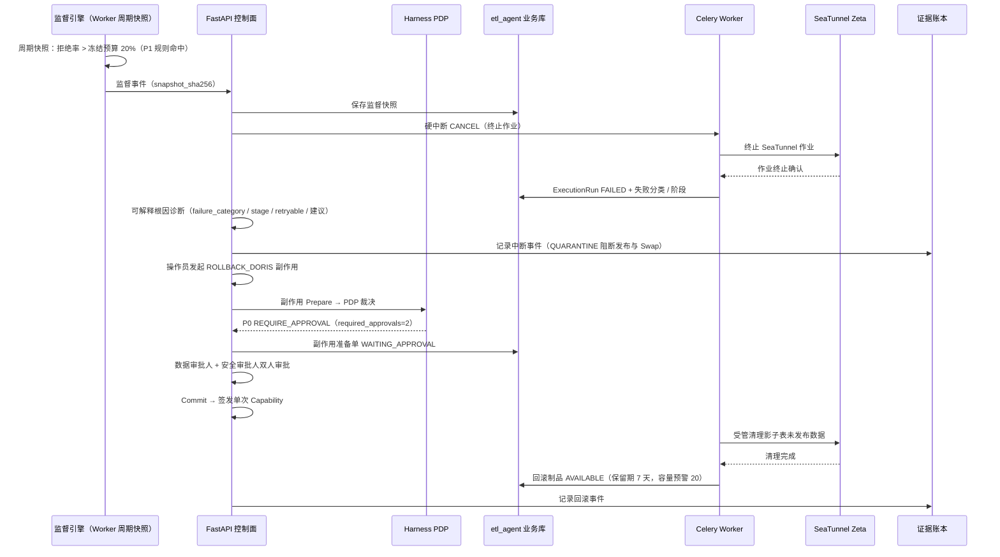

# etl_agent 技术设计规格说明书（Design Spec）

> | 文档名称 | etl_agent 技术设计规格说明书 |
> |----------|---------------------------|
> | 版本 | v1.0.1 |
> | 架构师角色 | 系统架构师 |
> | 日期 | 2026-10-13 |
> | 状态 | 评审稿 |
> | 依据 PRD | etl_agent-PRD_v1.1.1（2026-10-13，评审稿） |

## 修订记录

| 版本 | 日期 | 修订摘要 |
|------|------|---------|
| v1.0 | 2026-10-13 | 初稿：承接 PRD v1.1.1 全部 69 条 FR 与 20 条 AC，按 11 章标准结构产出；技术栈、部署拓扑、数据模型以 PRD 第 9/8 章记载的代码事实为基线；接口契约为目标态定义，落地前需与既有 `/api/v1` 路由核验（见第 11 章 S-Q2） |
| v1.0.1 | 2026-10-13 | 评审前最小修订 4 处（模块编号一致化、FR-58 覆盖补齐、AC 追溯补充、S-Q2 核验清单来源）。改动处均以【修订 v1.0.1】标注，未改动其他内容。 |

---

## 1. 架构设计概述

### 1.1 架构风格

**控制面 / 数据面严格分离的治理型 ETL 平台**，具体由四个子风格复合而成：

1. **前后端分离**：Vue 3 + Vite SPA 通过 `/api/v1` REST 访问 FastAPI 控制面，前端不含业务规则、不持有凭据；
2. **模块化单体（控制面）+ 异步 Worker（执行面）**：FastAPI 单体内按领域划分 **15 个模块**【修订 v1.0.1】（编号 M-I 为预留位，本期不启用；3.1 列出 M-A~M-H、M-J~M-P 共 15 个），跨进程的受管执行由 Celery Worker 承担，二者通过**事务 Outbox**连接；
3. **事件驱动（可靠投递）**：Commit 事务内原子创建 `ExecutionRun` + `Outbox` 命令，Worker 拉取执行，保证进程崩溃不丢已授权执行；
4. **状态机驱动生成 + 协议化授权执行**：生成编排采用 LangGraph 状态机（Checkpoint 持久化）；执行授权采用 Harness 协议 `prepare → approve → commit → capability → execute`，所有副作用经 Tool Broker 唯一出口。

### 1.2 选型理由与权衡

| 决策点 | 选择 | 放弃的方案 | 理由 |
|--------|------|-----------|------|
| 整体形态 | 控制面治理 + SeaTunnel 数据面搬运 | Agent 直连数据源执行 | PRD 核心命题：自然语言生成的配置可能夹带明文凭据、越权访问、破坏性变更。控制面只做治理决策，数据面只认受管指令，攻击面收敛到 Tool Broker 一处 |
| 服务粒度 | 模块化单体 + Celery | 微服务拆分 | Commit 要求「同一事务原子创建 ExecutionRun 与 Outbox」（FR-33），微服务分布式事务成本远高于收益；模块边界已按领域划清，未来可按模块独立拆出（ADR-02） |
| 生成编排 | LangGraph + Postgres Checkpointer | 自研状态机 / Temporal | 澄清中断（interrupt）与跨请求恢复是 P0 硬需求（FR-17），LangGraph 原生支持且与团队 Python 栈一致；Temporal 引入额外集群运维 |
| 执行授权 | Ed25519 短时单次 Capability + Tool Broker + Replay Guard | 长期 API Token / OAuth2 client credentials | 四眼管控 + 防重放要求「令牌 TTL ≤ 300 s、全局仅消费 1 次」（PRD 成功标准），长期令牌无法满足（ADR-04） |
| 凭据托管 | SecretProvider 双模式（fernet-db / vault-kv-v2） | 仅 Vault / 仅数据库密文 | 兼顾无 Vault 的开发测试环境与有 Vault 的生产环境，vault 模式下库内仅存不可认证的定位引用（FR-06，ADR-05） |

### 1.3 设计原则（红线，来自 PRD 约束）

1. **模型零凭据**：LLM Provider 不经数据面，永不可见连接密码与脱敏样本明文（FR-06/65，PRD 9.2 注记）；
2. **P0-DENY 无放行通道**：PDP 输出 DENY 时清空审批要求，审批无法覆盖（FR-29）；
3. **不可变制品**：审批与执行始终绑定同一 `artifact_sha256`，版本只能派生不可原地覆盖（FR-26）；
4. **唯一副作用出口**：一切副作用（执行 / 回滚 / 清理 / 凭据操作）走同一 Harness 协议，以注册清单（非 Agent 自报）判定（FR-34/37）；
5. **只追加证据**：证据账本不可篡改，支持整流验证（FR-36）。

---

## 2. 技术栈与依赖

### 2.1 技术栈（均为 PRD 第 13 章明确的团队既定约束，非本次新引入）

| 层 | 技术选型 | 版本 / 约束 | 用途 |
|----|---------|------------|------|
| 前端 | Vue 3 + Vite + TypeScript | 现代浏览器 SPA | 5 大控制台视图（FR-53~57） |
| 后端 | Python + FastAPI + uvicorn | Python 3.12（>=3.12,<3.13） | 控制面 HTTP 服务（`:8000`，97 端点，前缀 `/api/v1`） |
| ORM / 迁移 | SQLAlchemy（异步）+ Alembic | 版本化迁移 | 业务库模型与 schema 演进 |
| 生成编排 | LangGraph + Postgres Checkpointer | 独立 `etl_checkpoint` 库 | 澄清中断 / 恢复、生成状态机（FR-17/68） |
| 异步执行 | Celery[redis] | 14 任务模块 | Worker 受管执行、Beat 周期任务 |
| 业务存储 | PostgreSQL 17 | 库 `etl_agent` | 控制面全部治理事实 |
| 检查点存储 | PostgreSQL 17 | 库 `etl_checkpoint` | LangGraph Checkpoint（与业务库物理分离） |
| 缓存 / Broker / Nonce | Redis 8 | — | Celery Broker、结果后端、网关 Nonce 一次性消费 |
| 数据面引擎 | Apache SeaTunnel（Zeta + REST API + CLI `--check`） | REST `:8080` | 配置校验与数据搬运 |
| 加密 / 签名 | cryptography（Fernet、Ed25519）、hmac（HMAC-SHA256） | — | 凭据加密、策略包 / Capability / 证据签名、网关验签 |
| 可观测 | OpenTelemetry（FastAPI / HTTPX / SQLAlchemy / Celery）+ OTLP | 导出超时 10 s | 链路追踪、结构化日志 |

### 2.2 第三方依赖

| 依赖 | 用途 | 可控性 | 引入方 |
|------|------|--------|--------|
| Apache SeaTunnel Zeta | 数据面搬运、`--check` 校验、影子表 / Swap 执行 | 外部开源，团队可控部署 | 既定 |
| LLM Provider（OpenAI 兼容多供应商：direct / seatunnel-cli 后端，OPENAI/DOUBAO/DEEPSEEK/KIMIAI/MICROSOFT/ZHIPU/CUSTOM） | EtlPlan / HOCON 候选生成、逐行 LLM Transform（FR-18/24） | 外部服务，需采购 / 配额 | 既定（选型待 Q3） |
| HashiCorp Vault KV v2（可选） | 外部 SecretProvider，库内仅存定位引用 | 团队可控，可选 | 既定 |
| MySQL 8.4 / Doris FE+BE 3.0.8（e2e profile） | 端到端演示与 L2 评测链路 | 团队可控 | 既定 |
| OTel Collector（可选） | 遥测出口 | 团队可控，可选 | 既定 |

---

## 3. 模块 / 服务划分

### 3.1 模块拓扑



> 【修订 v1.0.1】模块编号说明：编号 **M-I 为预留位，本期不启用**；当前实际启用 15 个模块（M-A~M-H、M-J~M-P）。预留位用于未来在"设计审批（M-H）"与"Harness 内核（M-J）"之间插入"设计评审会话 / 变更管控"类模块，避免后续重编号。

### 3.2 模块职责边界

| 模块 | 职责（做什么） | 不做什么（边界） | 覆盖 FR |
|------|---------------|-----------------|---------|
| M-A 认证鉴权层 | 身份鉴别（`X-Actor-ID` 声明 / trusted-gateway HMAC-SHA256 验签：actor/timestamp/nonce/METHOD/path+query，时钟偏移 ≤60s，Nonce 16–128 位安全字符 + Redis `SET NX` 一次性、存储不可用失败关闭 503）；Actor → 项目成员 / Harness 职责解析 | 不管理密码与会话（外部 IAM 边界，Q1/Q9）；不做业务授权判决 | FR-58/65/66 |
| M-B 项目与工作区治理 | Bootstrap 初始化（Bootstrap Token ≥32 字节）、成员管理、`ProjectRoleGrant` 显式授予 5 类 Harness 职责 | 不把 ADMIN 隐式升级为审批人；不接触连接与执行 | FR-01/02/03 |
| M-C 数据连接与凭据治理 | 8 类连接登记（项目内唯一名）、后台连通性测试（UNTESTED/TESTING/READY/FAILED）、SecretProvider 双模式、轮换 / 迁移 / 销毁状态机、到期预警（默认 90 天账龄 / 14 天预警，WARNING/OVERDUE 两级 + Webhook 退避冷却）、轮换策略配置 | 不探查元数据语义；不明文落盘任何凭据；销毁后保留不含秘密的墓碑 | FR-04~11/61/62/63 |
| M-D 元数据探查与数据分级 | 表级只读 Profile（Schema / 类型 / 主键 / 近似统计 / 脱敏样本，SOURCE/SINK 端点角色，带过期时间，不做全表 COUNT）；字段级 6 级分级推断（显式声明优先 → 同名传播 → 显式映射传播），产出带 SHA256 的分级报告 | 不读取全表；不回传明文样本 | FR-12/14/15/64 |
| M-E 文件资产 | 文件上传与探查（CSV/JSON/JSONL/XLSX/Parquet + 扩展 ORC/XML/Markdown/PDF；25 MiB / 100,000 行上限）；上传路径不暴露给 API，引擎只读受挂载路径 `/data/file-assets` | 不做对象存储适配（S3/MinIO 待 Q8 决议，FR-62） | FR-13/62 |
| M-F 生成引擎 | AgentRun 生命周期（QUEUED/RUNNING/WAITING_INPUT/WAITING_APPROVAL/FAILED）；LangGraph 状态机「澄清 → 生成 → 门禁 → 修复 → 等审批」；interrupt 持久化 + 同 thread 恢复；多后端 / 多 Provider 产出 EtlPlan + HOCON；生成遥测只记次数 / 耗时 / 非敏感诊断 | Prompt 与候选正文不落业务库；图内不传凭据（运行期变量在 Worker 侧物化） | FR-16/17/18/24/67/68 |
| M-G 确定性门禁与有限修复 | 14 项静态契约校验（禁明文凭据 / 连接器与转换契约 / 质量契约四要素 / Profile 拓扑 / 受管文件源 / HDFS 契约 / 数据库端点 / 目标 Schema / 增量契约 / 逐行 LLM 契约等）；Worker 侧物化变量后 SeaTunnel `--check`，只回传脱敏摘要；候选预算 ≤3（初始 + 2 次修复） | 不用 LLM 做门禁裁决；不无限自修复 | FR-19/20/21 |
| M-H 不可变版本与设计审批 | 版本链 DRAFT→PROFILING→GENERATED→VALIDATED→WAITING_APPROVAL→APPROVED/REJECTED；派生新版本（`parent_version_id`）；制品 SHA256 冻结 + 乐观锁 `lock_version`；版本 Diff（Schema/HOCON/质量规则）；ApprovalRequest 绑定 `artifact_sha256` | 不允许原地覆盖已冻结版本；审批不覆盖 PDP DENY | FR-26/27/28/55 |
| M-J Harness 安全执行内核 | PDP 9 条确定性规则（P0–P3 + ALLOW/DENY/REQUIRE_APPROVAL/DEFER，按 DENY>DEFER>REQUIRE_APPROVAL>ALLOW、P0>P1>P2>P3 取最严聚合，DENY 清空审批要求）；签名策略包（rule_id/version 唯一 + SHA256 + Ed25519，启动与热切换前强制验签）；Prepare 准备单（输入 / 资源指纹、影响报告、监督契约、回滚计划、TTL 300s–7d 默认 24h、幂等键）；四眼审批（`(preparation_id, role)` 与 `(preparation_id, decided_by)` 双唯一，`evidence_sha256`）；Commit 服务端重验后签发 Ed25519 单次 Capability（TTL 30–900s 默认 300s，绑定工具 / 版本 / 主体 / 环境 / 制品指纹 / 监督契约哈希 / 分级报告哈希 / 允许的减损动作）；Tool Broker 唯一副作用出口 + Replay Guard；事务 Outbox（PENDING/SENDING/SENT/FAILED + 重试 + 锁）；9 类副作用同协议（CANCEL_EXECUTION / ROLLBACK_DORIS / CLEANUP_DORIS / MIGRATE_SECRET / STAGE|VALIDATE|ACTIVATE|ROLLBACK|DESTROY_SECRET）；执行租约防并发重入 | 不直连数据源；不自行判定副作用（以注册清单为准）；不存原始数据与 Prompt（只存规则证据） | FR-29~37 |
| M-K 质量契约与数据面发布 | QualityContract（字段级清洗规则 + 错误码标签、有效 / 错误 sink 路由匹配、最大拒绝行数 / 拒绝率阈值）；水印增量契约（TIMESTAMP 列 / 初始值 / 滞后秒数）；错误分流（原始值 + 违规原因写入错误表，报告只回聚合）；QualityReport（PASSED/WARNING/FAILED/INCOMPLETE）；Doris 影子表 `CREATE LIKE` + `REPLACE TABLE ... PROPERTIES('swap'='true')` 原子发布（同 Schema 强校验） | 不放宽质量阈值；不修改作业语义 | FR-22/23/43/44 |
| M-L 运行时监督与受管回滚 | 冻结预算（记录 10M / 字节 10 GiB / 时长 3600s / 放大比 ≤2.0 / 拒绝率 ≤0.5 / 最低质量行数 100 / 预警比例 0.8）；6 条确定性规则（P0 记录 / P0 字节 / P1 超时 / P0 放大 / P1 拒绝率 / P3 预警）；快照 `snapshot_sha256`；减损动作 CONTINUE/THROTTLE/PAUSE/CANCEL/QUARANTINE（QUARANTINE 阻断质量发布与 Swap；外部减损动作独立可重试 NOT_REQUIRED/PENDING/APPLYING/APPLIED/FAILED）；失败分类 9 类 + 阶段 + 可重试性 + 修复建议；回滚申请 / 审批 / 执行状态机、保留期 7 天 + 容量预警 20、清理申请、制品清单 5 态 | 只能收窄权限，不能扩权；不绕过 Harness 协议直接清理 | FR-45~48 |
| M-M 评测与安全进化 | L0 静态注入（攻击矩阵 / 未选中连接器注入 / 明文 Secret 制品）、L1 模拟故障（故障矩阵 / 令牌重复消费幂等 / 部分成功与未知状态分类）、L2 真实链路（Compose 垂直切片）；Benchmark 套件 `harness-v2/v1` 14 场景 + 冻结 manifest + baseline + 六项门禁；安全改进提案（POLICY/PROMPT/BENCHMARK，状态机不可跳跃，仅人类安全审批人裁决）；受控发布（影子 → 小流量 1%–10% → 晋升 / 回滚，发布清单 Ed25519 签名，观察样本为脱敏聚合事实） | 提案为非可执行代码；不自动改策略 | FR-50/51/52 |
| M-N 审计证据 | 只追加证据流（sequence / payload_sha256 / previous_hash / event_hash / 可选 Ed25519 检查点签名）；整流验证报告（valid/event_count/head_hash/errors）；全量审计事件（actor/project/action/resource/before/after/reason/trace_id） | 不修改 / 不删除既有事件 | FR-36 |
| M-O 可观测 | OTel 四组件埋点 + OTLP 导出（10s 超时）；结构化日志；错误响应附 trace_id；`/health`（脱敏的 SecretProvider 状态，不主动读凭据） | 不回传敏感数据（凭据 / Prompt / 样本明文 / 日志正文） | FR-59/60 |
| M-P 前端控制台 | 总览工作台 / 数据源与资产 / Pipeline Studio（含不可变版本与 Diff 视图）/ 运行中心与审批控制台 / 安全治理与 Benchmark；统一 `/api/v1` + 身份头；工作区初始化引导与身份注入协议 | 不含业务规则；不持有 / 不直传凭据；生产环境不直传 `X-Actor-ID`（由 trusted-gateway 签名替代） | FR-53~58【修订 v1.0.1】 |

> 模块边界说明：M-A 为横切关注点（中间件），M-B~M-N 为领域模块，M-O 为横切关注点，M-P 为客户端。Harness 内核（M-J）是唯一被授权触发副作用的模块，其余模块只能通过它发起执行 / 回滚 / 凭据操作。

---

## 4. 部署拓扑

### 4.1 拓扑图（生产目标态）



### 4.2 环境差异

| 环境 | 认证模式 | 必配项 | 数据面 / 评测 | 备注 |
|------|---------|--------|--------------|------|
| dev | `dev-header`（`X-Actor-ID` 直接声明） | `ETL_AGENT_` 前缀 `.env`；PG/Redis 由 `infra/compose.yaml` 拉起 | `docker compose --profile e2e up` 提供 MySQL→SeaTunnel→Doris 真实链路 | L2 评测与端到端演示依赖此 profile；dev-header **禁止**用于生产 |
| test / staging | `trusted-gateway`（测试网关签名） | `AUTH_MODE=trusted-gateway`、`GATEWAY_HMAC_SECRET`（≥32 字节）、`HARNESS_PUBLIC_KEYS` | SeaTunnel 测试集群（部署形态待 Q4） | 生产缺失项启动即拒绝（AC-11）；L0/L1 评测在 CI 可重复跑 |
| prod | `trusted-gateway`（生产 IAM / 网关，Q1/Q9） | 同上 + Vault（可选）+ OTel Collector | SeaTunnel 生产部署（Q4） | 多副本 API 无状态；Redis 存储不可用时鉴权失败关闭返回 503 |

### 4.3 进程与入口

| 进程 | 启动方式 | 说明 |
|------|---------|------|
| API | `etl-agent-api`（`uvicorn etl_agent.main:app`） | 控制面 HTTP 服务，无状态可多副本 |
| Worker | `celery -A etl_agent.worker worker` | 受管任务执行，需与 API 同版本部署；`acks_late` + `prefetch_multiplier=1` + `reject_on_worker_lost` |
| Beat | `celery -A etl_agent.worker beat` | 4 类周期任务：Worker 心跳 10s / 凭据告警扫描 3600s / 调度扫描 30s / Outbox 扫描 2s；部署形态待 Q11 |
| Checkpoint 初始化 | `etl-agent-checkpoint-setup` | LangGraph Postgres Checkpointer 建表（`etl_checkpoint` 库） |
| Benchmark | `etl-agent-benchmark` | 运行版本化评测套件 |
| 数据库迁移 | `alembic upgrade head` | 业务库 schema 版本化 |

### 4.4 初始化与配置要点

1. **双库分离**：`etl_agent`（业务）与 `etl_checkpoint`（检查点）分别初始化（`infra/postgres-init.sql` 挂载 checkpoint 初始化脚本）；
2. **迁移顺序**：先 `alembic upgrade head`，再 `etl-agent-checkpoint-setup`；
3. **环境变量**统一 `ETL_AGENT_` 前缀；生产必须项：`AUTH_MODE=trusted-gateway`、`GATEWAY_HMAC_SECRET`（≥32 字节）、`HARNESS_PUBLIC_KEYS`（未配置则启动拒绝）；
4. **SeaTunnel 挂载**：文件资产只读路径 `/data/file-assets` 由部署方挂载，引擎不接触上传原始文件名；
5. **LLM 隔离**：LLM Provider 调用不经数据面，不接触凭据与脱敏样本明文。

---

## 5. 数据模型（ER）

### 5.1 核心 ER（控制面业务库 `etl_agent`）

```mermaid
erDiagram
    users ||--o{ project_memberships : "成员关系"
    projects ||--o{ project_memberships : "包含"
    projects ||--o{ project_role_grants : "Harness职责授予"
    users ||--o{ project_role_grants : "承担职责"
    projects ||--o{ data_connections : "连接"
    data_connections ||--o| encrypted_secrets : "secret_ref凭据"
    data_connections ||--o{ data_profiles : "元数据Profile"
    data_connections ||--o{ secret_rotation_requests : "轮换"
    projects ||--o{ file_assets : "文件资产"
    projects ||--o{ pipelines : "包含"
    pipelines ||--o{ pipeline_versions : "版本链"
    pipeline_versions ||--o| pipeline_versions : "parent_version_id派生"
    pipeline_versions ||--o{ agent_runs : "生成运行thread_id"
    pipeline_versions ||--o{ pipeline_artifacts : "不可变制品sha256"
    pipeline_versions ||--o{ approval_requests : "设计审批"
    pipelines ||--o| pipeline_schedules : "调度策略"
    pipeline_versions ||--o{ execution_runs : "执行"
    execution_runs ||--o{ execution_events : "事件流"
    execution_runs ||--o| runtime_supervision_snapshots : "监督快照"
    execution_runs ||--o| quality_reports : "质量报告"
    execution_runs ||--o{ rollback_requests : "回滚"
    execution_runs ||--o{ rollback_cleanup_requests : "回滚制品清理"
    projects ||--o{ harness_policy_decisions : "PDP决策"
    harness_policy_decisions ||--o| execution_preparations : "授权依据"
    execution_preparations ||--o{ harness_approval_decisions : "四眼审批槽位"
    execution_preparations ||--o| harness_capability_grants : "单次令牌"
    execution_runs ||--o| harness_capability_grants : "授权执行"
    projects ||--o{ harness_side_effect_preparations : "副作用准备单"
    harness_side_effect_preparations ||--o{ harness_side_effect_approvals : "审批"
    harness_side_effect_preparations ||--o| harness_side_effect_capability_grants : "令牌"
    projects ||--o{ harness_command_outbox : "可靠投递"
    projects ||--o{ harness_evidence_streams : "证据流head_hash"
    harness_evidence_streams ||--o{ harness_evidence_events : "哈希链事件"
    projects ||--o{ benchmark_runs : "评测运行"
    benchmark_runs ||--o{ safety_improvement_proposals : "改进提案"
    safety_improvement_proposals ||--o| safety_releases : "受控发布"
    projects ||--o{ audit_events : "审计事件"
```



### 5.2 核心实体关键字段（细化到可建表；完整 DDL 以 `infrastructure/models.py` + Alembic 迁移为准）

| 实体 | 关键字段（类型 / 约束） |
|------|----------------------|
| `users` | `id` uuid PK；`subject` string UK（登录主体）；`display_name` string |
| `projects` | `id` uuid PK；`name` string；`created_at` |
| `project_memberships` | `id` uuid PK；`project_id` FK；`user_id` FK；`role` string（ADMIN/DATA_ENGINEER/APPROVER/VIEWER）；UK `(project_id, user_id)` |
| `project_role_grants` | `id` uuid PK；`project_id` FK；`user_id` FK；`role` string（DATA_ENGINEER/DATA_APPROVER/SECURITY_APPROVER/OPERATOR/AUDITOR）；`granted_by` uuid |
| `data_connections` | `id` uuid PK；`project_id` FK；`name` string（项目内唯一）；`connector_type` string（MYSQL/POSTGRESQL/ORACLE/SQL_SERVER/DORIS/HIVE/HDFS/LOCAL_FILE）；`status` string（UNTESTED/TESTING/READY/FAILED）；`secret_ref` FK；`credential_max_age_days` int（默认 90）；`credential_warning_days` int（默认 14） |
| `encrypted_secrets` | `id` uuid PK；`provider` string（fernet-db/vault-kv-v2）；`ciphertext` / `key_version`（fernet 模式）；`vault_path` + `vault_mount`（vault 模式，仅定位引用）；`destroyed_at`（墓碑，不含秘密） |
| `data_profiles` | `id` uuid PK；`connection_id` FK；`endpoint_role` string（SOURCE/SINK）；`schema_name` / `table_name`；`columns` json（类型 / 主键 / 近似统计）；`masked_samples` json；`classification_report_sha256`；`expires_at` |
| `file_assets` | `id` uuid PK；`project_id` FK；`format` string（CSV/JSON/JSONL/XLSX/PARQUET + ORC/XML/MARKDOWN/PDF 扩展）；`size_bytes` / `row_count`（上限 25 MiB / 100,000）；`storage_path`（引擎只读挂载路径，不暴露给 API） |
| `agent_runs` | `id` uuid PK；`pipeline_version_id` FK；`thread_id` string UK（LangGraph）；`status` string（QUEUED/RUNNING/WAITING_INPUT/WAITING_APPROVAL/FAILED）；`pending_question` string；`generation_*` 遥测（计数 / 耗时 / 非敏感诊断，**无 Prompt 与候选正文**） |
| `pipelines` / `pipeline_versions` | `pipeline_versions.id` uuid PK；`pipeline_id` FK；`version_number` int UK；`status` string（DRAFT→…→APPROVED/REJECTED）；`artifact_sha256` string（冻结摘要）；`parent_version_id` FK；`lock_version` int（乐观锁） |
| `pipeline_artifacts` | `id` uuid PK；`pipeline_version_id` FK；`artifact_type` string（plan/hocon/quality_contract）；`sha256` string |
| `approval_requests` | `id` uuid PK；`pipeline_version_id` FK；`artifact_sha256` string；`status`；`decision`（APPROVE/REJECT）；`decided_by`；`reason` |
| `pipeline_schedules` | `id` uuid PK；`pipeline_id` FK UK；`cron` string；`timezone`；`mode` string（BATCH/WATERMARK_INCREMENTAL）；`misfire_policy`（SKIP/FIRE_ONCE，宽限 120s）；`watermark_column` / `watermark_initial` / `watermark_lag_seconds` |
| `harness_policy_decisions` | `id` uuid PK；`project_id` FK；`outcome` string（ALLOW/DENY/REQUIRE_APPROVAL/DEFER）；`risk_level` string（P0–P3）；`rule_evidence` json（只存规则证据）；`policy_package_id` / `policy_package_sha256` |
| `execution_preparations` | `id` uuid PK；`policy_decision_id` FK UK；`pipeline_version_id` FK；`status` string（DENIED/WAITING_APPROVAL/READY/REJECTED/EXPIRED/COMMITTED）；`risk_level`；`input_fingerprint` / `resource_fingerprint`；`impact_report` json；`rollback_plan` json；`supervision_contract` json；`required_roles` / `required_approvals`；`idempotency_key` UK（项目内）；`expires_at`（默认 24h） |
| `harness_approval_decisions` | `id` uuid PK；`preparation_id` FK；`role` string（审批职责槽）；`decided_by` uuid；`decision`；`evidence_sha256`；UK `(preparation_id, role)` + UK `(preparation_id, decided_by)`（双唯一，强制四眼） |
| `harness_capability_grants` | `token_id` uuid PK；`preparation_id` FK UK；`token_sha256` UK；`claims` json（工具 / 版本 / 主体 / 环境 / 制品指纹 / 监督契约哈希 / 分级报告哈希 / 允许减损动作）；`expires_at`（默认 300s）；`consumed_at`（单次消费事实） |
| `harness_command_outbox` | `id` uuid PK；`project_id` FK；`command_type`；`payload` json；`status` string（PENDING/SENDING/SENT/FAILED）；`retry_count`；`locked_until` |
| `execution_runs` | `id` uuid PK；`pipeline_version_id` FK；`harness_preparation_id` FK UK（V2 唯一绑定）；`status` string（QUEUED/SUBMITTED/RUNNING/SUCCEEDED/FAILED/CANCELLING/CANCELLED）；`seatunnel_job_id`；`engine_status`；`trigger`（MANUAL/SCHEDULED）；`source_rows` / `sink_rows` / `source_bytes` / `sink_bytes`；`table_metrics` json；`retry_of_run_id` / `attempt_number`；`failure_category` / `failure_stage` / `retryable` / `diagnosis`；`supervision_action` / `supervision_contract_sha256` / `quarantined_at` |
| `execution_events` | `id` uuid PK；`run_id` FK；`level` / `stage` / `event_type`；`message`；`occurred_at` |
| `runtime_supervision_snapshots` | `id` uuid PK；`run_id` FK UK；`action` string；`risk_level`；`rule_matches` json（仅规则证据）；`observed` json（仅聚合指标）；`snapshot_sha256` |
| `quality_reports` | `id` uuid PK；`run_id` FK UK；`status`（PASSED/WARNING/FAILED/INCOMPLETE）；`total_rows` / `passed_rows` / `rejected_rows` / `reject_rate`；`valid_sink` / `error_sink`；`rules` json；`diagnostics` json；`generated_at` |
| `rollback_requests` / `rollback_cleanup_requests` | 状态机字段（申请 / 审批 / 执行）；`retention_days`（默认 7）；`capacity_warn_threshold`（20）；制品清单状态（AVAILABLE/ROLLED_BACK/ROLLBACK_PENDING/CLEANUP_PENDING/INVALID_METADATA） |
| `harness_evidence_streams` / `harness_evidence_events` | stream：`id` PK、`head_hash`；event：`id` PK、`stream_id` FK、`sequence` bigint（流内递增）、`payload_sha256`、`previous_hash`、`event_hash` UK、`signature_algorithm` / `signature_key_id` / `signature_value`（可选 Ed25519 检查点）、`occurred_at` / `actor_id` / `event_type` / `risk_level` / `policy_decision_id` / `trace_id` |
| `benchmark_runs` | `id` uuid PK；`suite_id`；`manifest_version` / `manifest_sha256`；`status`（PASS/FAIL）；`metrics` json（六项门禁）；`report_sha256` |
| `safety_improvement_proposals` / `safety_releases` | proposal：`type`（POLICY/PROMPT/BENCHMARK）、`status`（DRAFT→IN_REVIEW→APPROVED/REJECTED→RELEASED，不可跳跃）；release：`stage`（SHADOW_RUNNING/CANARY/PROMOTION_APPROVED/ROLLED_BACK）、`canary_percent`（1–10）、`manifest_sha256` + Ed25519 签名 |
| `audit_events` | `id` uuid PK；`project_id` FK；`actor_id` / `action` / `resource_type` / `resource_id`；`before` / `after` json；`reason`；`trace_id` |

### 5.3 三层状态隔离的物理分布（对应 FR-67/68/69）

| 层 | 载体 | 物理位置 | 隔离边界 |
|----|------|---------|---------|
| Conversation State | LangGraph Checkpoint（`conversation_state`）+ `AgentRun.pending_question` | `etl_checkpoint` 库（业务库仅存当前挂起问题） | 对话不含凭据；Prompt / 候选正文不落业务库 |
| Workflow State | LangGraph Checkpoint（`workflow_checkpoint`，`thread_id` PK） | `etl_checkpoint` 库 | 图状态不含凭据；运行期变量 Worker 侧物化，图内只传占位符 |
| Execution State | `execution_runs` + `execution_events` + `runtime_supervision_snapshots`（+ `seatunnel_job_binding` 语义） | `etl_agent` 业务库 | 与 Workflow State 通过 `pipeline_version_id` 关联而非共享存储；控制面只存治理事实与聚合指标 |

> 数据模型设计约束：领域枚举一律以字符串持久化（禁 PostgreSQL 原生枚举），保证 Alembic 迁移可回滚；`sequence` 等大整数用 bigint；所有跨项目资源以 `project_id` 为隔离边界。

---

## 6. 关键接口定义

### 6.1 核心 API 总览（`/api/v1`，共 97 端点，此处定义主流程核心契约）

| 编号 | 方法 | 路径 | 说明 | 覆盖 FR |
|------|------|------|------|---------|
| API-01 | POST | `/api/v1/bootstrap` | 工作区初始化（Bootstrap Token ≥32 字节） | FR-01 |
| API-02 | POST | `/api/v1/projects/{project_id}/connections` | 登记数据连接（Secret 引用制） | FR-04/06 |
| API-03 | POST | `/api/v1/projects/{project_id}/connections/{connection_id}/test` | 安全连通性测试（后台执行，回写状态） | FR-05 |
| API-04 | POST | `/api/v1/projects/{project_id}/profiles` | 元数据探查（只读 Profile + 脱敏样本） | FR-12/14/15 |
| API-05 | POST | `/api/v1/projects/{project_id}/agent-runs` | 创建生成运行（自然语言需求 + Profile 集合） | FR-16 |
| API-06 | POST | `/api/v1/agent-runs/{run_id}/messages` | 澄清回答并恢复（同 thread_id Checkpoint） | FR-17 |
| API-07 | POST | `/api/v1/pipeline-versions/{version_id}/freeze` | 冻结不可变版本（SHA256 摘要） | FR-26 |
| API-08 | POST | `/api/v1/projects/{project_id}/preparations` | 创建准备单（PDP 评级 + 影响报告 + 回滚计划） | FR-29/31 |
| API-09 | POST | `/api/v1/preparations/{preparation_id}/decisions` | 四眼审批决策（双唯一校验） | FR-32 |
| API-10 | POST | `/api/v1/preparations/{preparation_id}/commit` | Commit：重验指纹与审批事实，签发单次 Capability，同事务写 ExecutionRun + Outbox | FR-33/35 |
| API-11 | POST | `/api/v1/projects/{project_id}/executions` | 触发受管执行（Operator） | FR-38 |
| API-12 | GET | `/api/v1/executions/{run_id}` | 执行状态、事件流、行数 / 字节、监督快照 | FR-39/45 |
| API-13 | POST | `/api/v1/executions/{run_id}/rollback` | 受管回滚申请（副作用 Prepare 入口） | FR-37/48 |
| API-14 | GET | `/api/v1/executions/{run_id}/quality-report` | 质量契约与分流报告 | FR-44 |
| API-15 | POST | `/api/v1/projects/{project_id}/benchmark-runs` | 运行版本化 Benchmark 套件 | FR-50 |

### 6.2 核心接口契约（入参 / 出参 / 错误码）

**API-05 创建生成运行**

| 项 | 内容 |
|----|------|
| 入参 | `{ "pipeline_version_id": "uuid", "source_profile_ids": ["uuid"], "sink_profile_ids": ["uuid"], "requirement": "自然语言需求文本", "file_asset_ids": ["uuid"]? }` |
| 出参 | `{ "id": "uuid", "thread_id": "string", "status": "QUEUED" }`；参数缺失时状态转 `WAITING_INPUT` 并返回 `pending_question` |
| 错误码 | `BIZ_400_VALIDATION`（参数非法）、`BIZ_404_NOT_FOUND`（版本 / Profile 不存在或跨项目）、`BIZ_409_STATE_CONFLICT`（版本状态不允许生成） |

**API-08 创建准备单（Prepare）**

| 项 | 内容 |
|----|------|
| 入参 | `{ "pipeline_version_id": "uuid", "idempotency_key": "string", "environment": "dev/staging/prod", "tool_name": "pipeline.execute", "tool_version": "string" }` |
| 出参 | `{ "id": "uuid", "status": "WAITING_APPROVAL", "risk_level": "P1", "artifact_sha256": "64-hex", "input_fingerprint": "64-hex", "required_roles": ["DATA_APPROVER"], "required_approvals": 1, "expires_at": "ISO8601" }`；PDP DENY 时返回 `status: "DENIED"` 且无审批槽位 |
| 错误码 | `HARNESS_403_POLICY_DENY`（P0-DENY 无放行通道）、`BIZ_409_IDEMPOTENCY_CONFLICT`（同键不同载荷）、`BIZ_410_PREPARATION_EXPIRED` |

**API-09 审批决策**

| 项 | 内容 |
|----|------|
| 入参 | `{ "role": "DATA_APPROVER", "decision": "APPROVE", "reason": "string", "evidence_sha256": "64-hex"? }` |
| 出参 | `{ "preparation_id": "uuid", "role": "DATA_APPROVER", "decision": "APPROVE", "decided_by": "uuid" }` |
| 错误码 | `HARNESS_409_SELF_APPROVAL`（申请人自批，`(preparation_id, decided_by)` 唯一）、`HARNESS_409_ROLE_TAKEN`（职责槽被占，`(preparation_id, role)` 唯一）、`AUTH_403_ROLE_REQUIRED`（无该 Harness 职责）、`BIZ_409_STATE_CONFLICT`（准备单非 WAITING_APPROVAL） |

**API-10 Commit 签发 Capability**

| 项 | 内容 |
|----|------|
| 入参 | `{ "operator_id": "uuid" }`（或由身份头解析） |
| 出参 | `{ "token_id": "uuid", "preparation_id": "uuid", "claims": { "tool_name": "...", "tool_version": "...", "subject": "...", "environment": "...", "artifact_sha256": "...", "supervision_contract_sha256": "...", "classification_report_sha256": "...", "allowed_mitigations": ["CANCEL", "PAUSE"] }, "expires_at": "ISO8601" }`；同事务创建 `ExecutionRun`（QUEUED）+ Outbox 命令（PENDING） |
| 错误码 | `HARNESS_409_APPROVAL_INSUFFICIENT`（审批票数 / 槽位不足）、`HARNESS_409_ALREADY_COMMITTED`（重复 Commit）、`BIZ_410_PREPARATION_EXPIRED`、`AUTH_403_ROLE_REQUIRED`（非 OPERATOR） |

**API-13 受管回滚申请**

| 项 | 内容 |
|----|------|
| 入参 | `{ "side_effect_type": "ROLLBACK_DORIS", "resource_ids": ["uuid"], "reason": "string", "idempotency_key": "string" }` |
| 出参 | `{ "preparation_id": "uuid", "status": "WAITING_APPROVAL", "risk_level": "P0", "required_roles": ["DATA_APPROVER", "SECURITY_APPROVER"], "required_approvals": 2 }` |
| 错误码 | `HARNESS_403_POLICY_DENY`（跨项目 / Secret 外发类直接 DENY）、`BIZ_409_STATE_CONFLICT`（运行状态不允许回滚） |

**API-15 运行 Benchmark**

| 项 | 内容 |
|----|------|
| 入参 | `{ "suite_id": "harness-v2", "manifest_version": "v1", "layers": ["L0", "L1", "L2"] }` |
| 出参 | `{ "run_id": "uuid", "status": "PASS/FAIL", "metrics": { "p0_p1_block_rate": 1.0, "legitimate_success_rate": 0.97, "false_positive_rate": 0.02, "evidence_coverage_rate": 1.0, "reproducibility_rate": 1.0, "non_llm_p95_regression": 0.05 }, "report_sha256": "64-hex" }` |
| 错误码 | `AUTH_403_ROLE_REQUIRED`（仅 SECURITY_APPROVER）、`BIZ_404_NOT_FOUND`（suite 版本不存在） |

### 6.3 OpenAPI 片段示例（API-10 Commit）

```yaml
/api/v1/preparations/{preparation_id}/commit:
  post:
    summary: Commit 准备单并签发单次 Capability（Ed25519，TTL 默认 300s）
    operationId: commitPreparation
    parameters:
      - name: preparation_id
        in: path
        required: true
        schema: { type: string, format: uuid }
    requestBody:
      required: true
      content:
        application/json:
          schema:
            type: object
            required: [operator_id]
            properties:
              operator_id: { type: string, format: uuid }
    responses:
      '200':
        description: 签发成功，同事务创建 ExecutionRun 与 Outbox 命令
        content:
          application/json:
            schema:
              type: object
              properties:
                token_id: { type: string, format: uuid }
                preparation_id: { type: string, format: uuid }
                claims: { type: object }
                expires_at: { type: string, format: date-time }
      '403': { description: 策略 DENY 或角色不足, content: { application/json: { schema: { $ref: '#/components/schemas/ErrorResponse' } } } }
      '409': { description: 审批不足 / 重复 Commit, content: { application/json: { schema: { $ref: '#/components/schemas/ErrorResponse' } } } }
      '410': { description: 准备单已过期, content: { application/json: { schema: { $ref: '#/components/schemas/ErrorResponse' } } } }
components:
  schemas:
    ErrorResponse:
      type: object
      properties:
        code: { type: string, example: HARNESS_409_APPROVAL_INSUFFICIENT }
        message: { type: string }
        trace_id: { type: string }
```

### 6.4 错误码体系（段位划分）

| 段 | HTTP | 错误码 | 含义 |
|----|------|--------|------|
| AUTH_ | 401 | `AUTH_401_UNKNOWN_ACTOR` / `AUTH_401_BAD_SIGNATURE` / `AUTH_401_TIMESTAMP_SKEW` | 身份未知 / 签名无效 / 时钟偏移超限（≤60s） |
| AUTH_ | 403 | `AUTH_403_NOT_PROJECT_MEMBER` / `AUTH_403_ROLE_REQUIRED` | 非项目成员 / 缺 Harness 职责 |
| AUTH_ | 503 | `AUTH_503_NONCE_STORE_UNAVAILABLE` | Nonce 存储不可用，失败关闭不降级放行 |
| BIZ_ | 400 | `BIZ_400_VALIDATION` | 参数校验失败 |
| BIZ_ | 404 | `BIZ_404_NOT_FOUND` | 资源不存在（含跨项目视同不存在） |
| BIZ_ | 409 | `BIZ_409_IDEMPOTENCY_CONFLICT` / `BIZ_409_STATE_CONFLICT` / `BIZ_409_UNIQUE_CONSTRAINT` | 幂等冲突 / 状态机不允许 / 唯一约束（如连接名、双唯一审批） |
| BIZ_ | 410 | `BIZ_410_PREPARATION_EXPIRED` | 准备单 TTL 过期（默认 24h） |
| BIZ_ | 422 | `BIZ_422_GATE_FAILED` | 确定性门禁未通过（附脱敏失败摘要） |
| HARNESS_ | 403 | `HARNESS_403_POLICY_DENY` | PDP DENY，无人工放行通道 |
| HARNESS_ | 401 | `HARNESS_401_CAPABILITY_EXPIRED` | Capability 过期（TTL ≤300s） |
| HARNESS_ | 409 | `HARNESS_409_CAPABILITY_REPLAYED` / `HARNESS_409_APPROVAL_INSUFFICIENT` / `HARNESS_409_SELF_APPROVAL` / `HARNESS_409_ROLE_TAKEN` / `HARNESS_409_ALREADY_COMMITTED` | 令牌重放 / 审批不足 / 自批 / 职责槽被占 / 重复 Commit |
| SYS_ | 500 | `SYS_500_INTERNAL` | 内部错误（附 trace_id） |
| SYS_ | 503 | `SYS_503_DEPENDENCY_UNAVAILABLE` | 依赖（PG/Redis/LLM/引擎）不可用 |

> 所有错误响应统一携带 `trace_id`，与 OTel 链路贯通（FR-60）。响应体绝不包含凭证明文（PRD 10.5）。

---

## 7. 关键流程时序图

### 7.1 主流程：生成 → 门禁 → 四眼审批 → 受管执行 → 原子发布（场景 A）



### 7.2 异常流程：预算超限硬中断 → 诊断 → 受管回滚（场景 B）



---

## 8. 非功能设计

| 维度 | 指标（来自 PRD 第 5 章） | 设计手段 |
|------|------------------------|---------|
| 安全 · 认证 | 生产必须 trusted-gateway（HMAC-SHA256 ≥32 字节，时钟偏移 ≤60s，Nonce 一次性）；dev-header 仅非生产 | 中间件统一验签（actor/timestamp/nonce/METHOD/path+query 规范载荷）；Nonce 16–128 位安全字符 + Redis `SET NX` 跨实例一次性；Redis 不可用**失败关闭**返回 503；生产启动强制校验 `AUTH_MODE` 与 `GATEWAY_HMAC_SECRET`，缺失即拒绝启动（AC-11） |
| 安全 · 授权与职责分离 | 申请人禁自批；职责槽唯一；P0 双人批准；P0-DENY 无放行通道 | 两层角色体系（项目成员 + `ProjectRoleGrant` Harness 职责，ADMIN 不隐式升级）；DB 层 `(preparation_id, role)` 与 `(preparation_id, decided_by)` 双唯一约束 + API 双重校验；PDP 输出 DENY 时清空审批要求（无状态可达放行） |
| 安全 · 防重放与授权 | Ed25519 Capability，TTL ≤300s，全局仅消费 1 次 | Commit 时服务端重验输入 / 资源指纹与审批事实后签名签发；Replay Guard 在 Tool Broker 消费点拦截二次使用；令牌 claims 绑定工具 / 版本 / 主体 / 环境 / 制品指纹 / 监督契约哈希 / 分级报告哈希 / 允许减损动作 |
| 安全 · 凭据保护 | 全链路敏感明文泄露 = 0 | SecretProvider 双模式（fernet-db 密文 + key_version；vault-kv-v2 仅存定位引用）；LLM 不见凭据与样本明文；Profile 列名启发式脱敏；销毁留墓碑不含秘密；错误表例外条款（原始值仅落数据面错误表，报告 / 证据 / 快照只回聚合） |
| 安全 · 审计 | 证据覆盖率 = 100%，可整流验证 | 只追加证据流：sequence + payload_sha256 + previous_hash + event_hash + 可选 Ed25519 检查点签名；整流验证 API 输出 `{valid, event_count, head_hash, errors[]}`；审计事件全字段留痕（actor/project/action/resource/before/after/reason/trace_id） |
| 安全 · 多租户 | 项目级隔离，跨项目意图 DENY | 全部资源以 `project_id` 为隔离边界，访问控制基于项目成员关系；PDP `HARNESS-P0-CROSS-PROJECT` 规则直接 DENY（无审批通道）；查询层强制 project_id 过滤（防越权读） |
| 性能 | 非 LLM 决策路径（PDP / 门禁 / 监督 / 证据）P95 ≤20ms，相对基线回归 ≤20% | PDP 9 条规则、门禁 14 项检查、监督 6 条规则全部为**进程内确定性计算**（无 IO 依赖 LLM）；规则输入以指纹 / 预计算字段命中；核心表按 `(project_id, status)`、`(preparation_id, role)` 等建索引；Benchmark 将 `non_llm_p95` 纳入六项门禁，回归 >20% 即 FAIL，防劣化 |
| 性能 | LLM 生成单次请求超时 ≤180s（可配置） | HTTPX 异步客户端统一超时与重试策略；生成遥测记录耗时分布用于基线标定 |
| 性能 | 运行时预算硬上限（记录 10M / 字节 10 GiB / 时长 3600s / 放大比 ≤2.0 / 拒绝率 ≤0.5 / 最低质量行数 100 / 预警 0.8） | 监督引擎周期快照比对冻结契约；预警比例 0.8 触发 THROTTLE/PAUSE；超限触发 CANCEL/QUARANTINE；预算为不可扩权硬上限（监督动作只能收窄权限，不能修改作业语义） |
| 高可用 | Worker 心跳 10s、35s 判失活 | Beat 周期任务扫描 `worker_heartbeats`；失活 Worker 的执行进入可诊断状态（不自动重放，防重复副作用） |
| 高可用 | Outbox 扫描 2s、投递重试与锁；进程崩溃不丢已授权执行 | 事务 Outbox：Commit 同事务落库命令；扫描器按 `locked_until` 加锁领取，PENDING/SENDING/SENT/FAILED 状态机 + 指数退避重试；Worker `acks_late` + `prefetch_multiplier=1` + `reject_on_worker_lost` 保证至少一次投递；副作用执行租约防并发重入；消费侧幂等（Replay Guard + 稳定 SeaTunnel JobId + `retry_of_run_id`/`attempt_number` 追溯） |
| 高可用 | 控制面无单点依赖数据面；准备单 TTL 24h + 幂等键；令牌 TTL 300s | API 无状态多副本（LB 后置）；幂等键防重复提交；准备单 / 令牌短 TTL 缩小攻击与不一致窗口 |
| 高可用 | 评测分层：L0/L1 CI 可重复，Benchmark 六项门禁全过才允许策略发布 | L0/L1 为无外部副作用确定性仿真（CI 门禁）；L2 依赖开发 Compose；安全策略晋升前必须影子 + 小流量验证（FR-52） |
| 可观测 | OTel 四组件埋点 + OTLP 导出（超时 10s）；trace_id 贯通 | FastAPI / HTTPX / SQLAlchemy / Celery 四处 instrumentation；错误响应统一附 trace_id；结构化日志（不含凭据 / Prompt / 样本明文）；监督快照 `observed` 仅聚合指标、`rule_matches` 仅规则证据 |
| 可观测 | `/health` 不主动读取凭据 | 健康检查仅返回存活状态与脱敏的 SecretProvider 配置状态 |
| 可扩展 | 新数据源 / 新 LLM Provider 可插拔 | 连接器抽象（ConnectorType + probe 适配器 + 门禁契约 + 类型映射四件套，ClickHouse/S3/REST 即按此扩展，FR-61/62/63）；LLM Provider 抽象（OPENAI/DOUBAO/DEEPSEEK/KIMIAI/MICROSOFT/ZHIPU/CUSTOM 已内置） |
| 可维护 | 迁移可回滚；schema 版本化 | 领域枚举字符串持久化（禁 PG 原生枚举）；Alembic 版本化迁移；双库分离（业务库 / 检查点库），检查点库由独立入口建表 |
| 兼容 | Python 3.12 / PostgreSQL 17 / Redis 8 / 现代浏览器 | 版本区间锁定（`>=3.12,<3.13`）；compose 固定镜像版本；前端 Vite 构建产物为静态 SPA |

---

## 9. 设计决策记录（ADR）

| 编号 | 决策 | 背景 / 选项 | 选择理由 | 后果 |
|------|------|-----------|---------|------|
| ADR-01 | 控制面与数据面严格分离 | 背景：自然语言生成的配置可能夹带明文凭据、越权、破坏性变更。选项：A) Agent 直连数据源执行；B) 控制面治理 + SeaTunnel 数据面 | B 把攻击面收敛到 Tool Broker 唯一出口；控制面不搬运海量业务数据，只存治理事实 | 需建设 Outbox/Worker 异步链路，复杂度上升；引擎只读挂载路径带来部署约束 |
| ADR-02 | 模块化单体 + Celery，而非微服务 | 背景：97 端点、Commit 要求同事务创建 ExecutionRun + Outbox。选项：A) 微服务；B) 模块化单体 + 异步 Worker | B 避免分布式事务；模块边界已按领域划清（第 3 章），未来可沿模块拆服务 | 单体需靠代码结构纪律维持边界；Worker 与 API 必须同版本部署 |
| ADR-03 | LangGraph + Postgres Checkpointer，双库分离 | 背景：澄清中断与跨请求恢复是 P0；对话 / 工作流状态不得污染业务库。选项：A) 自研状态机；B) LangGraph + 业务库同库存 Checkpoint；C) LangGraph + 独立 `etl_checkpoint` 库 | C 原生支持 interrupt/恢复，且物理隔离保证「Prompt 与候选正文不落业务库」（FR-67）可强制执行 | 双库运维与初始化顺序约束（先 alembic 后 checkpoint-setup）；检查点库需纳入备份策略 |
| ADR-04 | Harness 协议 prepare→approve→commit + Ed25519 单次 Capability + Tool Broker + Replay Guard | 背景：四眼管控 + 防重放 + 唯一副作用出口。选项：A) 长期 API Token；B) OAuth2 client credentials；C) 短时单次签名令牌 + 注册清单判定副作用 | C 满足「TTL ≤300s、全局仅消费 1 次、P0-DENY 无放行通道」；副作用以注册清单判定而非 Agent 自报，消除自报风险 | Commit 到执行完成受 300s 窗口约束（超时需重新 Prepare）；Replay Guard 依赖存储可用性；令牌 claims 变更需版本化管理 |
| ADR-05 | SecretProvider 双模式（fernet-db / vault-kv-v2） | 背景：开发测试无 Vault，生产要求外部托管。选项：A) 仅 Vault；B) 仅数据库密文；C) 双模式 | C 平滑覆盖两种环境；vault 模式库内仅存不可认证的定位引用，降低拖库风险 | 两套代码路径需分别测试；fernet 主密钥的 KMS 托管方式待定（Q5） |
| ADR-06 | 事务 Outbox + Celery（acks_late / reject_on_worker_lost） | 背景：进程崩溃不丢已授权执行。选项：A) Commit 后直接发 Celery 任务；B) 事务 Outbox | B 保证业务事实与 Worker 命令同事务落库，无「已提交但命令丢失」窗口 | 至少一次投递要求消费侧幂等（Replay Guard + 稳定 JobId + 重试追溯）；需 Outbox 扫描器（2s）与清理策略 |
| ADR-07 | 领域枚举以字符串持久化 | 背景：PG 原生枚举增删值需重写表，迁移难回滚 | 字符串持久化 + 应用层校验，Alembic 迁移可回滚 | 应用层承担枚举合法性校验；DB 层无枚举约束，需靠测试与门禁保障 |

---

## 10. 任务分解清单

> 口径说明：PRD v1.1.1 声明大部分 FR 已【已实现】。本清单按交付顺序编排，T-01~T-20 对应「落地 / 核验」双轨任务（已实现条目以核验 + 补测试为主，未实现条目以实现为主）；T-21 为条件范围任务，T-22 为端到端演示。可并行项在「依赖」列体现。

| 任务编号 | 模块 | 依赖 | 说明 |
|---------|------|------|------|
| T-01 | 基础设施 | 无 | `infra/compose.yaml` 拉起 PostgreSQL 17（双库）+ Redis 8；`alembic upgrade head`；`etl-agent-checkpoint-setup`；`ETL_AGENT_` 环境变量骨架 |
| T-02 | 数据模型 | T-01 | 按第 5 章 ER 落地 / 核验 `infrastructure/models.py`：双唯一约束、字符串枚举、索引、乐观锁 `lock_version` |
| T-03 | M-A 认证鉴权 | T-02 | dev-header 与 trusted-gateway 双模式中间件；HMAC 验签、时钟偏移、Redis Nonce 一次性（失败关闭 503）；Actor → 项目成员 / Harness 职责解析 |
| T-04 | M-B 项目治理 | T-02/T-03 | Bootstrap（Token ≥32 字节）、成员管理、`ProjectRoleGrant` 授予与授予人留痕 |
| T-05 | M-C 连接与 SecretProvider | T-02/T-03 | 8 类连接登记与状态机；fernet-db / vault-kv-v2 双模式；连通性后台测试回写 |
| T-06 | M-C 凭据治理 | T-05 | 轮换（VALIDATING→…→SUCCEEDED/FAILED，回滚恢复旧凭据原始年龄）、Provider 迁移（目标 UUID 冻结 + Worker 重试写同一路径）、销毁墓碑、到期预警（两级 + 去重 + Webhook 退避冷却）、轮换策略配置 |
| T-07 | M-D 元数据探查 | T-05 | 只读 Profile（不做全表 COUNT）、脱敏样本、6 级分级推断 + 分级报告 SHA256 |
| T-08 | M-E 文件资产 | T-05 | 上传 / 格式 / 上限（25 MiB / 100,000 行）、只读挂载路径、点名格式覆盖核对（FR-64） |
| T-09 | M-F 生成引擎 | T-07/T-08 | LangGraph 状态机（澄清 → 生成 → 门禁 → 修复 → 等审批）、interrupt 持久化 + 同 thread 恢复、多后端 / 多 Provider、生成遥测（无 Prompt 落库） |
| T-10 | M-G 门禁与修复 | T-09 | 14 项静态契约校验；Worker 侧物化变量 + SeaTunnel `--check`（脱敏摘要回传）；候选预算 ≤3 |
| T-11 | M-H 版本与审批 | T-10 | 版本链与 SHA256 冻结、派生新版本、乐观锁；ApprovalRequest 绑定 `artifact_sha256`；Diff 后端能力 |
| T-12 | M-J Harness 内核 | T-11 | PDP 9 规则 + 签名策略包（Ed25519，启动 / 热切换验签）；Prepare（指纹 / 影响 / 监督契约 / 回滚计划 / TTL / 幂等键）；四眼审批双唯一；Commit 重验 + Capability 签发；Tool Broker + Replay Guard；事务 Outbox；9 类副作用同协议 + 执行租约 |
| T-13 | M-J/M-K 执行 Worker | T-12 | 14 个 Celery 任务模块；验签消费、Secret 物化、SeaTunnel 提交、心跳上报（10s/35s）、`acks_late` + `prefetch=1` + `reject_on_worker_lost` |
| T-14 | 调度 | T-13 | Celery Beat 4 类周期任务；cron + 时区；BATCH / WATERMARK_INCREMENTAL；misfire SKIP/FIRE_ONCE（宽限 120s）；水印推进与 `watermark_window` |
| T-15 | M-K 质量与发布 | T-13 | QualityContract 配置；错误分流（原始值 + 原因入错误表）；QualityReport；影子表 `CREATE LIKE` + 原子 Swap（同 Schema 强校验） |
| T-16 | M-L 监督与回滚 | T-13/T-15 | 冻结预算 + 6 条规则 + 快照 SHA256；减损动作与 QUARANTINE 阻断；失败分类 9 类 + 诊断；回滚 / 清理状态机 + 保留期 7 天 + 容量预警 20 |
| T-17 | M-N 审计证据 | T-12 | 只追加证据流（哈希链 + 可选 Ed25519 检查点）；整流验证报告；全量审计事件 |
| T-18 | M-M 评测与进化 | T-12 | L0/L1 确定性仿真（CI）；L2 Compose 垂直切片；Benchmark 14 场景 + 六项门禁；安全提案状态机；影子 / 小流量 / 晋升受控发布 |
| T-19 | M-P 前端 | T-03~T-18（API 就绪后） | 5 大视图：总览 / 数据源资产 / Studio（含不可变版本与 Diff 视图）/ 运行中心与审批控制台 / 安全治理与 Benchmark；统一 `/api/v1` + 身份头；生产禁直传 `X-Actor-ID` |
| T-20 | M-O 可观测 | T-13 | OTel 四组件埋点 + OTLP（10s 超时）；结构化日志；错误响应 trace_id；`/health` 脱敏状态 |
| T-21 | M-C 条件数据源 | T-05/T-07（+ Q8 决议） | ClickHouse（FR-61，P1）/ S3/MinIO（FR-62，P1）/ REST API（FR-63，P2）：probe 适配器 + 门禁契约 + 类型映射四件套；决议纳入后激活 AC-18/19/20 |
| T-22 | 端到端演示 | T-01~T-20 | 场景 A（MySQL→Doris 宽表增量投产）或场景 B（脏数据超限硬中断与受管回滚）全流程走通，证据账本可复盘（AC-10） |

**关键路径**：T-01 → T-02 → T-05 → T-09 → T-10 → T-11 → T-12 → T-13 → T-15 → T-16 → T-22。
**可并行段**：T-06（T-05 后）/ T-07+T-08（T-05 后）/ T-17（T-12 后）/ T-18（T-12 后）/ T-20（T-13 后）/ T-19（API 契约冻结后与后端并行）。

---

## 11. 待明确事项

| 编号 | 问题 | 建议确认方 |
|------|------|-----------|
| S-Q1 | 生产可信网关由哪套既有 IAM/网关承接？Actor → Harness 职责映射规则需与安全团队对齐（承接 PRD Q1/Q9，影响 M-A 契约与部署拓扑接入边界） | 安全架构 / 平台团队 |
| S-Q2 | 本 SPEC 第 6 章接口契约为目标态定义，落地前需与既有 97 个 `/api/v1` 路由及 `infrastructure/models.py` 字段逐项核验；不一致处以代码现状为准并回刷本文档。【修订 v1.0.1】核验清单以既有 `openapi.json` 或路由注册表为来源，评审时由后端负责人提供；本 SPEC 第 6 章的 15 个 API 为权威契约，其余 82 个端点做一致性核验，不一致处以代码现状为准并回刷本 SPEC。 | 架构评审 + 后端负责人 |
| S-Q3 | Celery Beat 生产部署形态（单实例 vs redbeat 多实例 + 时钟源），影响调度可用性设计（承接 PRD Q11） | 平台团队 |
| S-Q4 | SeaTunnel Zeta 生产部署形态（单机 / 集群）与 `--check` / 作业提交 API 契约版本锁定策略（承接 PRD Q4） | 数据平台团队 |
| S-Q5 | 是否要求容器编排（K8s）部署？PRD 仅定义 Compose 形态；若需 K8s，部署拓扑需补充 HPA / PDB / 探针等设计 | 平台团队 |
| S-Q6 | ClickHouse / S3/MinIO / REST API 是否列入本期范围（承接 PRD Q8，决定 T-21 排期与 AC-18/19/20 激活） | 业务负责人 / 产品 |
| S-Q7 | Vault 生产部署与 fernet 主密钥的 KMS 托管方式（承接 PRD Q5），影响 SecretProvider 运维与灾备设计 | 安全架构 |

---

## 附录 A：需求覆盖追溯（PRD FR → SPEC 落点）

| PRD 模块 | SPEC 落点（章节） | 关键任务 |
|---------|------------------|---------|
| M1 项目与工作区治理（FR-01~03） | 3.2 M-B；6.2 API-01 | T-04 |
| M2 数据连接与凭据治理（FR-04~11/61/62/63） | 3.2 M-C；6.2 API-02/03 | T-05/T-06/T-21 |
| M3 元数据探查与文件资产（FR-12~15/64） | 3.2 M-D/M-E；6.2 API-04 | T-07/T-08 |
| M4 Pipeline Studio 生成（FR-16~25） | 3.2 M-F/M-G；7.1；6.2 API-05/06 | T-09/T-10 |
| M5 不可变版本与设计审批（FR-26~28） | 3.2 M-H；6.2 API-07 | T-11 |
| M6 Harness 安全执行内核（FR-29~37） | 3.2 M-J；7.1/7.2；6.2 API-08/09/10/13 | T-12/T-13 |
| M7 执行调度与数据面（FR-38~44） | 3.2 M-J/M-K；7.1；6.2 API-11/12/14 | T-13/T-14/T-15 |
| M8 运行时监督与受管回滚（FR-45~49） | 3.2 M-L；7.2；6.2 API-13 | T-16 |
| M9 评测与安全进化（FR-50~52） | 3.2 M-M；6.2 API-15 | T-18 |
| M10 前端控制台（FR-53~58） | 3.2 M-P；4.1 | T-19 |
| M11 平台与可观测性（FR-59/60） | 3.2 M-O；8 | T-20 |
| M12 认证鉴权与多租户（FR-65/66） | 3.2 M-A；8 安全行 | T-03 |
| M13 三层状态隔离（FR-67~69） | 5.3；3.2 M-F | T-09 |

### A.1 验收标准（AC）设计落点【修订 v1.0.1】

将 PRD v1.1.1 的 AC-01~20 逐条映射到 SPEC 章节 / 任务编号，作为设计对验收的支撑性证明；测试细节以测试计划为准。

| AC 编号 | 验收主题 | SPEC 设计落点 | 支撑任务 |
|---------|---------|--------------|---------|
| AC-01 | 四眼职责分离拦截 | 2.3 红线（PRD）；3.2 M-J（双唯一审批）；6.2 API-09 错误码；8「安全 · 授权与职责分离」 | T-04/T-12 |
| AC-02 | 无敏感明文泄露 | 1.3 设计原则；8「安全 · 凭据保护」；PRD 10.5 引用；3.2 M-C/M-D | T-05/T-06/T-07 |
| AC-03 | LangGraph 中断与恢复 | 3.2 M-F；7.1 时序图；6.2 API-05/06 | T-09 |
| AC-04 | 门禁 + 有限修复 + 不可变版本 | 3.2 M-G/M-H；6.2 API-07 | T-10/T-11 |
| AC-05 | prepare→approve→commit + 单次令牌 + 防重放 | 3.2 M-J；7.1；6.2 API-08/09/10；6.3 OpenAPI；8「安全 · 防重放与授权」 | T-12 |
| AC-06 | Worker 调度 SeaTunnel + 影子表 + 质量分流 | 3.2 M-J/M-K；7.1 | T-13/T-15 |
| AC-07 | 原子 Swap + 实时指标与质量报告 | 3.2 M-K；6.2 API-12/14 | T-15 |
| AC-08 | 硬中断 + 根因诊断 + 受管回滚 | 3.2 M-L；7.2 时序图；6.2 API-13 | T-16 |
| AC-09 | Benchmark 六项门禁 | 3.2 M-M；6.2 API-15 | T-18 |
| AC-10 | 端到端演示链路 | 7.1/7.2 时序图 | T-22 |
| AC-11 | 认证边界 | 3.2 M-A；4.2 环境差异；8「安全 · 认证」 | T-03 |
| AC-12 | 多租户隔离 | 3.2 M-A；5.2/5.3 `project_id` 隔离；8「安全 · 多租户」 | T-02/T-03 |
| AC-13 | 三层状态隔离 | 5.3 三层状态物理分布；3.2 M-F | T-09 |
| AC-14 | L0 静态注入 | 3.2 M-M（L0 定义） | T-18 |
| AC-15 | L1 模拟故障 | 3.2 M-M（L1 定义） | T-18 |
| AC-16 | L2 真实链路 | 3.2 M-M（L2 定义）；4.2 dev/e2e profile | T-18 |
| AC-17 | 版本 Diff 视图 | 3.2 M-H（版本 Diff 后端）/ M-P（前端视图）；6.2 API-07 关联 | T-11/T-19 |
| AC-18 | ClickHouse（条件） | 3.2 M-C（FR-61）；S-Q6 | T-21 |
| AC-19 | S3/MinIO（条件） | 3.2 M-C（FR-62）；S-Q6 | T-21 |
| AC-20 | REST API（条件） | 3.2 M-C（FR-63）；S-Q6 | T-21 |

> 条件验收 AC-18/19/20 的激活时点由 PRD Q2/Q8 决议决定（对应本 SPEC S-Q6）；决议纳入本期后转为强制 AC，并同步激活 T-21。

## 附录 B：质量自检（Quality Gate）核对记录

| 检查项 | 结果 |
|--------|------|
| 架构风格已定 | ✅ 控制面/数据面分离 + 模块化单体 + 事件驱动 + 状态机生成，含选型理由与放弃方案（1.1/1.2） |
| 模块边界清晰 | ✅ 15 个启用模块 + M-I 预留位说明（1.1/3.1）；职责表明确「做什么 / 不做什么」，PRD M1~M13 全覆盖（3.2，附录 A 追溯） |
| 接口有契约 | ✅ 15 个核心 API 总览 + 6 个详细契约（入参/出参/错误码）+ OpenAPI 片段 + 错误码段位体系（第 6 章） |
| 数据模型一致 | ✅ ER 与 PRD 第 8 章对齐并细化到关键字段级；三层状态物理分布单列（5.1~5.3） |
| 非功能有手段 | ✅ PRD 每项 NFR 指标均落到具体设计手段（第 8 章） |
| 关键流程有时序 | ✅ 2 条跨模块 sequence 图：主流程（7.1）与中断回滚（7.2），对应 PRD 场景 A/B |
| 重大选型有 ADR | ✅ 7 条 ADR，含背景/选项/理由/后果（第 9 章） |
| 任务可编排 | ✅ 22 项任务含依赖关系与关键路径 / 可并行段（第 10 章） |
| FR 追溯 | ✅ 附录 A：PRD M1~M13 全覆盖；FR-58 补入 M-P【修订 v1.0.1】 |
| AC 追溯 | ✅ 附录 A.1：AC-01~20 逐条映射到 SPEC 章节 / 任务【修订 v1.0.1】 |
| 接口核验来源明确 | ✅ S-Q2 补充 `openapi.json` / 路由注册表来源说明【修订 v1.0.1】 |
| 无臆造约束 | ✅ 技术栈与合规均来自 PRD 第 13 章约束；接口契约为目标态定义并标注核验要求（S-Q2）；条件范围挂接 PRD Q8（S-Q6） |